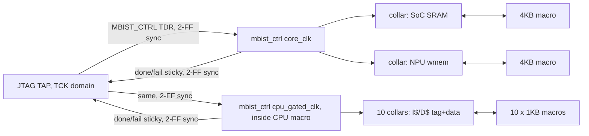
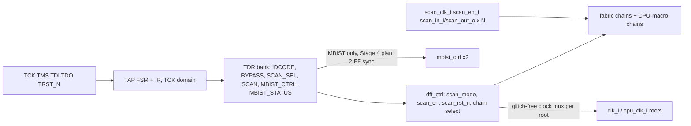
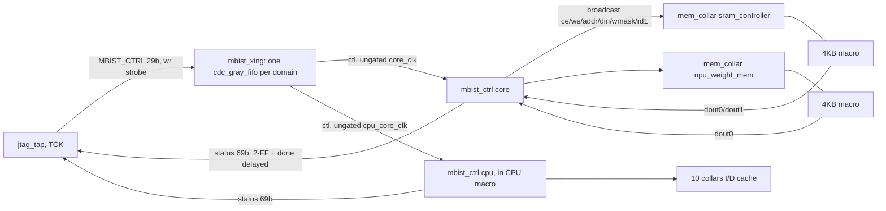

# DFT Architecture: scan + MBIST + JTAG for the Sky130 SoC (Stage 0)

Bead `j41m.1` (epic `j41m`), GH #244. Scope: Sky130 only (`pnr/sky130/soc/`, `pnr/sky130/cpu/`). No RTL, flow, macro or
LibreLane-install change was made. Experiments live in `/nobackup/claude_sim_build/dft_stage0/`; the reproducible
scripts are in `tools/dft/` (see its README).

**Evidence labels.** Every statement carries one: **[M]** measured (command and output named), **[R]** read from source
(`file:line`), **[A]** assumed or estimated (reasoning given). Where a source said something that a measurement
contradicted, the measurement is reported and the conflict is called out.

## 0. Decisions already taken (2026-10-10)

These are **DECIDED** by the project owner and are not open questions. The rest of the document is written against them.

| # | Decision | Consequence in this document |
|---|---|---|
| 1 | **Goal is real tape-out intent on Sky130.** DFT must be production-usable. | A stuck-at coverage target is stated and justified (section 2.1). Patterns must reach a tester (section 2.3). Section 2.4 lists what the open-source tools cannot deliver. |
| 2 | ATPG tools may be added to **this repo's `flake.nix` devshell only**. Non-commercial-licensed tools (Atalanta) are acceptable. | Licence text quoted in section 2.2. A tape-out with commercial intent changes this and is flagged there. |
| 3 | **Crypto key registers are EXCLUDED from scan.** | Quantified and enforced in section 7, with a check script that fails on violation. Exclusion alone leaks the key; masking is required (section 7). |
| 4 | **MBIST is tester-only.** No APB register, no power-on auto-run, no firmware visibility. | The APB-slot analysis was dropped. MBIST is started and read only through the TAP (decision 5). |
| 5 | **Test access is an IEEE 1149.1 JTAG TAP** controlling both scan and MBIST. | The TAP is a Stage 1 deliverable, not an optional last stage (sections 9, 10). |
| 6 | **Pad ring / chip top is NOT in scope now.** | The core macro exposes the TAP and any unavoidable raw ports. Section 9.5 lists what a future chip-top epic needs. |
| 7 | **Scan access = JTAG TAP for control and MBIST, PLUS parallel scan ports** (direct scan-in / scan-out / scan-enable / test clock for several chains). *(2026-10-10, follow-up)* | Resolves the old N3 in favour of parallel ports. Pin plan, chain proposal, test time and the at-speed statement are rewritten in sections 8, 9.5, 9.6, 10. Zero delay-fault coverage is **not** accepted as a goal; section 2.4 says what would be needed and that it is out of reach of the current tools. |
| 8 | **99 % test / 98 % fault coverage is a GOAL, not a commitment.** *(2026-10-10, follow-up)* | Stage 3 begins with a time-boxed ATPG tool spike on the real netlist. The sign-off number is fixed only after a tool is shown to complete at scale (section 2.1, 10). |
| 9 | **Sky130 CPU macro Synlig exposure is bead `dud4` (P1): test first, then the user decides on re-hardening.** *(2026-10-10, follow-up)* | The test is the `ma7` branch-dependent differential on the Sky130 CPU macro gate netlist against RTL, **no PD run**. Stage 2's CPU re-harden depends on its outcome (sections 4, 5, 10). |

**Schedule decisions (2026-10-10).** Stage 1 is approved to start now that PR #250 has merged. FPGA Stage 0 (GH #245) follows Stage 1, not before it.

## 1a. Summary

| Q | Headline | Basis |
|---|---|---|
| 1 Scan tool | The Sky130 flow's OpenROAD **does** have a `dft` module and stitched a legal chain on a real block (`timer`, 178 flops) and on the whole synthesised SoC fabric (18,752 flops, 5 s). It honours `set_dont_touch` (needed for decision 3). It has real defects (below). No lock-up latches, no clock-gate/test-enable handling, no macro scan pins. **Usable for stitching, with workarounds.** | [M] |
| 2 ATPG | Nothing was installed. Quaigh 0.0.6 (MIT/Apache, Rust, SAT) built and ran: **92.41 % raw (4336/4692), 358 patterns, 1.5 s** on the full-scan cut of `timer` (generic-gate model, not Sky130 cells). No tool is proven at SoC scale, and **none of them delivers production-grade ATPG** (section 2.4). | [M] / [A] |
| 3 RTL audit | 18,753 sequential cells in the fabric + 4,829 inside the CPU macro. One live clock gate (no test enable), one latch, no RTL negedge flops, no tri-states, no comb loops, no ring oscillator in the build. ~20 Stage 1 changes (section 4). | [M]/[R] |
| 4 Hard macros | The CPU is a hard macro with **no scan or test pins**; 4,829 flops are invisible to SoC-level insertion. ~6-7 h per CPU+SoC re-harden round. | [R]/[A] |
| 5 MBIST | 12 SRAM macros (2 x 4 KB in the fabric, 10 x 1 KB inside the CPU macro), 147,456 bits. March C- (10N): 10,240 cycles fabric / 2,560 cycles CPU in parallel = 256 us at 40 MHz. Two controllers, driven and read through the TAP. | [R] + [A] |
| 6 Crypto | DECIDED: exclude. 256 flops (1.37 % of flops). **Unmasked, the exclusion costs ~11 % of the fault universe and still leaks the key**; masking brings it to ~0.7 %. | [M] |
| 7 Cost | Scan flops +117,350 um2 fabric (+10.2 % of synthesised stdcell, ~+0.6 pp utilisation), +30,209 um2 CPU macro. D-pin setup +0.07 to +0.45 ns by corner. | [M] area/setup |
| 8 Access | DECIDED: JTAG TAP (control + MBIST) **plus parallel scan ports** (decision 7): TAP 5-6 pins + `scan_clk_i`, `scan_en_i`, 8 x `scan_in_i`/`scan_out_o` = 23-24 raw pins (proposal, section 8). | decision / [A] |

**Go/no-go:** Stage 1 (TAP + parallel ports + scan-ready RTL) GO and approved to start (PR #250 merged). Stage 2 CONDITIONAL GO. Stage 3 CONDITIONAL: GO for a time-boxed tool spike, NO-GO for a promised coverage number until a tool is shown to complete at scale (decision 8). Stage 2's CPU re-harden additionally waits on `dud4` (decision 9). Stage 4 (MBIST) GO. Details in section 11.

## 1. Scan insertion tool

### 1.1 Which OpenROAD
The task brief expected `openroad-2026-02-17`. **[M]** The Sky130 flow does not use it. `nix-shell` in the LibreLane checkout
(`shell_probe.log`) puts `openroad` at `/nix/store/784j83yn...-openroad-python3-3.11.9-env/bin/openroad`, reporting revision
`edf00dff99f6c40d67a30c0e22a8191c5d2ed9d6`. This matches `pnr/Makefile:112-136` [R], which says Sky130 and FreePDK45 are
deliberately **not** overridden and only ASAP7 uses 26Q2. Three builds are on this host:

| Build | Revision | DFT commands [M: `tools/dft/help_probe.tcl`] |
|---|---|---|
| LibreLane devshell (**Sky130 flow**) | `edf00dff...` | `set_dft_config`, `report_dft_config`, `preview_dft`, `insert_dft`, `scan_replace` |
| `openroad-2026-02-17` | `dcf36133...` | `set_dft_config`, `report_dft_config`, `report_dft_plan`, `execute_dft_plan`, `scan_replace`, `scan_opt` |
| `openroad-26Q2` | `26Q2` | same as 2026-02-17 |

`set_dft_config` options: `edf00dff`: `-max_length -max_chains -clock_mixing`. 26Q2 adds `-scan_enable_name_pattern
-scan_in_name_pattern -scan_out_name_pattern`. Valid `-clock_mixing` values are `no_mix` and `clock_mix`; `mix` raises DFT-0006 and
**aborts the process with a stack trace** [M: `toy_edf.log`].

### 1.2 Real-block experiment [M]
`timer` (+ `apb4_register_bank`) -> sv2v -> Yosys 0.46 `synth -flatten; dfflibmap; abc` against `sky130_fd_sc_hd__tt_025C_1v80.lib`
(`tools/dft/synth.ys`) -> 891 cells, 178 `dfxtp_1`. Then `scan_replace; preview_dft; insert_dft` (`tools/dft/dft_timer.tcl`):

- Result: 178 `dfxtp_1` became 178 `sdfxtp_1`, one chain of 178, new ports `scan_enable_1`, `scan_in_1`, `scan_out_1`.
- `tools/dft/chain_check.py` walked the netlist: chain length 178, 0 unreached flops, 0 non-scan flops left, one SCE net, one clock net.
- The scan netlist re-reads and links in OpenROAD (891 cells). It also reads and times in OpenSTA.
- **Not done:** functional-mode equivalence and a shift/flush simulation. The chain was checked structurally only.
- Whole fabric, `RUN_2026-10-06_22-43-34/04-yosys-synthesis/soc_top.nl.v` (91,424 cells) with the real CPU and SRAM LEFs/libs
  (`tools/dft/soc_dft.tcl`): `scan_replace` plus `insert_dft` took **5 s**. 17,903 `dfxtp_2` -> `sdfxtp_2`, 843 `dfrtp_2` ->
  `sdfrtp_2`, 6 `dfstp_2` -> `sdfsbp_2`, the 1 latch (`dlxtn_1`) left alone. With `-max_chains 4 -clock_mixing no_mix` it made
  **8 chains**: four of 235-236 flops on `cpu_clk_i` (944 flops) and four of 4,450-4,453 on `clk_i` (17,809). So `-max_chains` is per clock
  domain, and the CPU-domain flops are only the 173 + 771 outside the macro.

### 1.3 What the module cannot do, and the defects found

| Capability | Result |
|---|---|
| Multiple clock domains | Groups by (clock, edge) in `no_mix`. In `clock_mix` it stitches rising/falling and different clocks into **one chain with no lock-up latch** (toy: `fn0` falling clka -> `fb1` rising clkb -> `fg0` -> ...). [M `toy_edf.log`] Use `no_mix` only. |
| Lock-up latches | None inserted (no `dlx*` cell added in the toy; the only latch in the output is the one that was in the input). [M] |
| Clock gates | A gated flop's clock is traced through the gate to the root clock (`fg0` joined clka's chain). The gate itself is **not** scan-replaced (`DFT-0002`) and no test-enable is driven. A library `dlclkp` has an `sdlclkp` equivalent in the Liberty but the tool does not use it. [M] |
| Latches | Skipped with a warning, left unscanned (`DFT-0002/0007`). [M] |
| Negedge flops | Own chain in `no_mix`. **Defect, edf00dff only:** `dfrtn_1` was replaced by `sdfbbn_1` (set+reset flop) and its `SET_B` pin is **left unconnected**; 26Q2 picks `sdfrtn_1` correctly. [M `toy_scan_edf.v`, `toy_scan_26q2.v`] |
| `report_dft_config` | Fails with a Tcl error (`can't read "args"`) on edf00dff. [M] |
| Chain count/balancing | Chain count follows the clock-domain count; `-max_chains` below the domain count is not honoured (toy: asked 2, got 3). The 8-chain fabric result is 236 vs 4,453, unbalanced. `-max_length` was not shown to split anything. [M] |
| Scan-enable | One `scan_enable_N` port, **one net with 18,752 sinks, unbuffered**. No buffer tree. [M] |
| Hard-macro scan pins | Macro instances are ignored (not scan cells). A chain through a macro cannot be built by the tool. [M: CPU/SRAM macros untouched] |
| Netlist legality | `write_verilog` emits `assign scan_out_N = <internal net>` for each scan-out (8 assigns in the SoC; the input netlist had 0). `Checker.NetlistAssignStatements` runs at flow step 06 and would object if the insertion ran before it. [M] |
| DEF `SCANCHAINS` | **Not tested.** [A] Assume absent: no command in either build writes it, and the module has no scan-def API. |
| `set_dont_touch` | **Honoured** by `scan_replace` and the stitcher (256 marked flops stayed `dfxtp_2` and off the chains). Needed for decision 3. [M `soc_excl.log`] |
| Reset/set handling in shift | Not handled. Async resets stay functional, so any internally generated reset can corrupt a chain in shift (section 4). |

### 1.4 Alternatives (not exercised)
- **Yosys-level replacement**: Yosys `dfflibmap` warned `Found unsupported expression 'D&!SCE|SCD&SCE'` on every Sky130 `sdf*` cell [M],
  so it cannot map to scan flops from Liberty; you would hand-write a techmap. More work than the OpenROAD route for no gain.
- **Fault's chain stitcher** (`fault chain`): Swift, not built [A]. It also produces boundary-scan registers. Held in reserve.
- **Recommendation:** OpenROAD `dft` with `no_mix`, run from the **26Q2 binary on the Verilog netlist** (bug-free `sdfrtn_1` choice, name
  patterns), with the chain count set explicitly. Netlist-level avoids reading an ODB written by a different OpenROAD build [A: ODB
  schema compatibility across builds is not guaranteed; not tested].

### 1.5 Slotting into LibreLane as a project-local plugin
The existing plugin `pnr/sky130/soc/plugin/librelane_plugin_cvt_sky130/__init__.py` registers `Step` subclasses and activates them
through `meta.substituting_steps` [R]. Classic's step list is `librelane/flows/classic.py` (`Yosys.Synthesis`,
`Checker.YosysUnmappedCells`, ..., `Checker.NetlistAssignStatements`, `OpenROAD.CheckSDCFiles`, ..., `OpenROAD.Floorplan` ...) [R]; the
Sky130 run's own order (steps 04-21) is `Yosys.Synthesis` 04, `Checker.*` 05-06, `OpenROAD.STAPrePNR` 09, `OpenROAD.Floorplan` 10,
tap/PDN 14-18, global placement skip-IO 20, `OpenROAD.IOPlacement` 21 [M: step directory names in `RUN_2026-10-09_06-18-39`].
`substituting_steps` only replaces a step, so adding one needs a plugin-registered `Flow` subclass of `Classic` with `Steps` edited [A:
not tried; the `SequentialFlow` class exposes `Steps` as a plain list].

| Option | Where | For | Against |
|---|---|---|---|
| **N (recommended)** netlist step | after `Checker.NetlistAssignStatements` (06), before `STAPrePNR` | any OpenROAD build; ports exist before IO placement; no ODB version coupling | must remove or accept the `assign` lines |
| O ODB step | after `OpenROAD.Floorplan` (10), before IO placement (21) | native ODB, no netlist re-read | pinned `edf00dff` only (SET_B defect, no name patterns) |

What breaks downstream [A, except where noted]:
- **SDC**: the single functional SDC has no `scan_enable`/`scan_mode` constraint. Needs `set_case_analysis 0` for functional timing (or a
  false path), plus a separate shift-mode check. `cpu_clk_i` has **no `create_clock`** in `sky130_soc.sdc` today [R: audit; the file defines
  only `core_clk` at `:237`], so CPU-domain flops are unconstrained in the current SoC signoff. This must be fixed before scan timing means anything.
- **Hold**: every chain link is Q -> SCD with no logic. Sky130 `GRT_RESIZER_HOLD_SLACK_MARGIN` is 0.3 ns [R: PD history], so expect a
  hold-buffer count proportional to chain links (18.7 k). Not measured; this is the largest unknown in Stage 2.
- **CTS**: unchanged sink count; the gated-clock structure is the same. The scan-enable net needs a buffer tree (resizer/`repair_design`).
- **Antenna and `e45j`**: one new net with ~18.8 k pins plus 8-12 long scan-out/in nets. The repair-design steps (`CVT.RepairDesignPostGRT`) and
  the diode-on-port step will see new nets; slew/cap/antenna counts must be re-compared against the Gate B and `rccal` baselines.
- **Cell policy**: the flow's resizer must be allowed to keep `sdf*` cells. Whether the PDK `DONT_USE_CELLS` list contains them was **not
  verified** (I could not locate the list in `resolved.json`).

## 2. ATPG tool, coverage target, pattern export

### 2.1 Coverage goal (decision 8: a GOAL, not a commitment) [A]

**Decision 8 (2026-10-10):** the numbers below are a goal. Nothing is promised until a tool has been shown to complete on the real netlist. Stage 3 therefore starts with a **time-boxed ATPG tool spike**, and the sign-off target is fixed only afterwards (section 10, Stage 3). If the spike fails, the per-block fallback of section 2.4 applies and the goal is restated per block.

**Goal: stuck-at test coverage >= 99.0 % of the scanned-domain fault list, and stuck-at fault coverage >= 98.0 % of the whole-SoC fault list,
with every exclusion itemised.** Test coverage = detected / (total - proven untestable); fault coverage = detected / total.

Why 99.0 %: the DFT orchestrator's own sign-off criterion in this repo is `saf_coverage_pct >= 99.0` [R: dft-orchestrator contract], and the
standard Williams-Brown estimate shows what lower numbers cost. Defect level DL = 1 - Y^(1-T) for yield Y and coverage T
(arithmetic computed here, but **Y is assumed**; no Sky130 yield data for this die exists in the repo):

| T (stuck-at) | DL at Y=0.8 (ppm) | DL at Y=0.5 (ppm) |
|---|---|---|
| 95 % | 11,095 | 34,064 |
| 98 % | 4,453 | 13,767 |
| 99 % | 2,229 | 6,908 |
| 99.5 % | 1,115 | 3,460 |
| 99.9 % | 223 | 693 |

Reading: even 99 % is thousands of ppm, which is **not** production-grade for a volume product (that needs ~99.5 %+ plus transition and
functional tests). It is a reasonable floor for a low-volume MPW-class die, where every part is also functionally tested. 98 % is the
minimum I would accept, and only with itemised exclusions. The model is stuck-at only: **delay defects are not covered** (section 2.4).

Budget: the 1 % gap between 100 % and 99 % is nearly consumed by the already-decided exclusions: crypto keys ~0.7 % with masking [M proxy, section 7],
TAP flops (~100-300 flops plus their cone, not on any chain) ~0.2-0.4 % [A]. Therefore **SRAM-boundary shadowing (section 6.3) and key masking are both
mandatory to hit the target**; without them the number is ~89 %.

### 2.2 Tools, licences, packaging

| Tool | Licence | Packaging | Maintenance | Scale evidence |
|---|---|---|---|---|
| **Quaigh** 0.0.6 (Coloquinte/quaigh) | MIT OR Apache-2.0 [M: `gh api`] | crates.io. `cargo install` needs OpenSSL headers because `rustsat-kissat` fetches Kissat at build time. Built here with a throwaway `CARGO_HOME` (`tools/dft/build_quaigh.sh`). | last push 2026-02-02, 53 stars [M] | 2.9 k gates, 1.5 s [M]. Larger **unmeasured**. |
| **Fault** (AUCOHL) | Apache-2.0 for Fault itself [M: Readme] | Swift 5.6; ships `flake.nix`, `default.nix`, `nix/atalanta.nix`, `nix/podem.nix` [M: repo tree]. **Not built here.** | last push 2025-08-30, release 0.9.4 on 2025-05-28, 206 stars [M] | Own engine = pseudo-random patterns + fault simulation through iverilog (`atpg.swift` references `iverilogExecutable`) [R]; algorithmic back ends are Atalanta/PODEM. SoC scale unknown. |
| **Atalanta** (hsluoyz/atalanta, from Virginia Tech) | See quote below. GitHub reports no licence file (`license: null`) [M]. Fault's `nix/atalanta.nix` marks it `licenses.unfree` [M]. | Plain C, built from rev `a8e07fe` by Fault's nix file | last push 2024-05-07 [M] | ISCAS-class circuits [A] |
| **PODEM** (via Fault) | Fault's Readme, below | via Fault's nix file | not checked | ISCAS-class [A] |

**Licence text, verbatim.** Atalanta README: "The source code is released for teaching and research use only. Any publication in which ATALANTA was used
to obtain the results should cite the reference given below. ... This program, or any derivative thereof, may not be reproduced nor used for any commercial product
without a written permission form from Prof. Dong S. Ha. For commercial use of ATALANTA ... please contact to Prof. Dong S. Ha" [M: `gh api repos/hsluoyz/atalanta/readme`].
Fault Readme: "SOFTWARE INCLUDED WITH SOME FAULT DISTRIBUTIONS, I.E. ATALANTA AND PODEM, WHILE FREE TO DISTRIBUTE, ARE PROPRIETARY, AND MAY NOT BE USED FOR COMMERCIAL PURPOSES." [M].

**Flag (decision 2 and decision 1 interact).** The owner accepted non-commercial tools. Atalanta's grant is "teaching and research use only"; patterns it
generates for a die that is sold, or taped out with commercial intent, are arguably a use "for a commercial product" and need written permission. This is a
legal reading I cannot settle. If the tape-out becomes commercial, Atalanta/PODEM must be dropped or licensed; **keep Quaigh/Fault's own engine as the
licence-clean path** so the flow does not depend on Atalanta. Installing: add the tools to a new devshell in this repo's `flake.nix` (existing shells: `default`, `bench`, `hls`
at `flake.nix:161,229,250` [R]); nothing system-wide. Not done in Stage 0 (no flake edit was made).

**Measured run (Quaigh).** `tools/dft/cut.ys` makes a full-scan combinational cut of `timer` (`dffunmap; expose -evert-dff; abc` to
AND/NAND/OR/NOR/XOR/XNOR/MUX, written as BLIF): 554 inputs, 976 outputs, 2,925 gates. `quaigh atpg timer_cut.blif -o timer.test`:
> Generated 128 random patterns, detecting 2547/4692 faults (54.28 % coverage) ... Generated 6528 patterns total, detecting 4336/4692 faults (92.41 % coverage) ... Kept 358 patterns, detecting 4336/4692 faults (92.41 % coverage)

It also reported `unobservable=351`. **[A]** If those are proven-redundant faults, test coverage would be 4336/(4692-351) = 99.88 %; I did not verify that reading.
Caveats: the fault universe is generic gates after `abc`, not Sky130 cell pins; the cut ignores the scan path (no shift/flush test, no SCE/SCD faults);
clocks and resets are plain inputs; no cell-library awareness, no fault dictionary, no tester format. Quaigh offers `--num-cycles` for sequential random patterns only.

### 2.3 Pattern export to a tester (decision 1)

Patterns are driven through the TAP (decision 5), so the natural exchange format is **SVF** (Serial Vector Format: `SIR`/`SDR`/`RUNTEST`), which JTAG controllers
and, I believe, OpenOCD can play [A: not verified here]. Plan: (1) ATPG gives pseudo-primary-input/output vectors for the full-scan cut; (2) a **project script**
maps them onto chain order (the `chain_check.py` walk gives the order) and emits SVF plus a cocotb/Verilator replay of the same TAP sequence on the gate-level netlist;
(3) the test house or a project converter produces STIL (IEEE 1450) / WGL for a production ATE. **No open-source tool here does (2) or (3)**; both are glue to be written. [A]

### 2.4 What the open-source tools cannot deliver (strict list, tape-out context) [A unless noted]

- **No scan DRC tool.** Nothing checks, in the commercial sense, clock-as-data, reset controllability, X sources, bus contention, latch transparency. Stage 1 must carry its own netlist checks (`tools/dft/chain_check.py` and `check_scan_exclusions.py` are the start).
- **No transition / at-speed ATPG, no path-delay.** Quaigh and Fault target stuck-at [R: Fault Readme topics and `atpg.swift`; `quaigh atpg --help` offers only stuck-at generation plus random sequential patterns via `--num-cycles`]. This survey is not exhaustive. **Decision 7 does not accept zero delay-fault coverage as a goal**, so this is an unmet requirement, not an accepted loss. What parallel scan ports do and do not change is in section 9.6. What delay-fault coverage needs, and the current tools lack: (1) a transition-delay fault model (and path-delay for chosen critical paths); (2) two-time-frame test generation (launch-on-capture, or launch-on-shift), because a single-frame stuck-at pattern's expected response is **wrong** if the capture is applied with two pulses; (3) a transition-fault simulator to grade coverage; (4) timing-derived targeting from STA/SDF for small-delay defects; (5) capture-clock control: ATE-supplied bursts are enough here (section 9.6), an on-chip clock controller is not required; (6) masking of the asynchronous-domain crossings, the clock gate and false/multicycle paths in the capture sequence. Commercial ATPG (TetraMAX, Modus, Tessent) provides these; nothing available here does. It is **out of reach of the current tools**. Route options are open item N10.
- **No pattern compression (EDT-style), no diagnosis, no fault dictionary.** Test time grows linearly with pattern count (section 8).
- **No clock-domain-aware capture sequencing** for two asynchronous domains with a clock gate; the capture protocol (which domain pulses when) is hand-written.
- **No clock-gate / latch modelling.** `en_latch` and the gate are untested structures (section 4 item 5).
- **No X-masking engine** beyond what the cut makes explicit; SRAM outputs and the unscanned TAP/key flops must be made X-free by design (sections 6.3, 7).
- **No guarantee of correlation between gate-level fault coverage and the Sky130 cell netlist.** Measured coverage on a generic-gate cut is an approximation; the final number must be re-simulated on the real netlist with Sky130 models.
- **Scale unproven.** Whether a SAT-based generator finishes on a ~20 k-flop cut (a few hundred thousand gates [A]) is unmeasured.

Plainly: **no tool available here is credible at SoC scale today for a signed production coverage number.** The honest fallback if the Stage 3 spike fails is scan with
chain-integrity tests plus partial coverage on blocks that do complete, reported per block, not as one SoC number.

## 3. Memory inventory

### 3.1 Hard macros (12 instances, 147,456 bits = 18 KiB)

| Instance | Macro | Words x bits | Ports | Clock | Where |
|---|---|---|---|---|---|
| `u_sram.u_sram_macro` | `sky130_sram_4kbyte_1rw1r_32x1024_8` | 1024 x 32 | 1RW + 1R | `core_clk` | SoC fabric |
| `u_npu.g_on.u_wmem.u_sram_macro` | same | 1024 x 32 | 1RW + 1R, port 1 tied off | `core_clk` | SoC fabric |
| icache `u_tag_sram` + 4 x `gen_data_sram` | `sky130_sram_1kbyte_1rw1r_32x256_8` | 256 x 32 each (5) | 1RW + 1R, port 1 tied off | `cpu_gated_clk` | **inside CPU macro** |
| dcache `u_tag_sram` + 4 x `gen_data_sram` | same | 256 x 32 each (5) | same | `cpu_gated_clk` | **inside CPU macro** |

Sources: macro instances [M: `grep` on `soc_top.nl.v:659127,659179,659192`; `design__instance__count__macros = 3` in
`62-cvt-maxcapviolations/state_out.json`], CPU-internal SRAMs [R: `pnr/sky130/cpu/macro_placement.cfg`, 10 instances], wrapper `ifdef` arms [R]:

| Wrapper | `SRAM_SKY130` arm | Other arms |
|---|---|---|
| `rtl/soc/sram_controller.sv` | macro `:856-881`, 2-entry skid read FSM `:663-854` | default: flat 32 K-flop array `:146-148` (no ASAP7 macro arm) |
| `rtl/npu/npu_weight_mem.sv` | one 4 KB macro `:85-104` | `SRAM_ASAP7` 4 x 256x32 behind `rv32i_clock_gate` `:119-129`; default FreePDK45 `:130-139` |
| `rtl/mem/rv32i_icache.sv` / `rv32i_dcache.sv` | tag `:82-95` / `:105-118`; data x4 `:130-143` / `:153-166` | `elsif SRAM_ASAP7`, `else` FreePDK45 |

Macro interface [M: `grep PIN` on the LEF, 127 pins]: port 0 `clk0 csb0 web0 wmask0[3:0] addr0[9:0] din0[31:0] dout0[31:0]`, port 1 `clk1 csb1 addr1[9:0] dout1[31:0]`.
Both `dout` are negedge-launched (Liberty `falling_edge`, clk-to-q 0.336 / 0.365 / 0.481 ns) [R]. The sim model used by cocotb
(`sim/sky130_sram_4kbyte_1rw1r_32x1024_8.sv`) captures inputs on posedge and acts on negedge [R]. **No spare rows/columns**: pass/fail only.
Functional port use: the SoC SRAM writes on port 0 and reads on **port 1** (`dout0` unused, `sram_controller.sv:856-881`); NPU and caches read on port 0.

### 3.2 Not hard macros but memory-like (flops)
8,192-flop `dma_engine.linebuf` (`:318`), 944-bit `cdc_gray_fifo.mem_q`, UART/SPI/I2C/TRNG FIFOs, SHA `w_q`, NPU `ain_q/aout_q`, regfile 992 flops
inside the CPU macro, cache valid/dirty arrays (256 flops each) [M for the totals, R for locations]. These are scanned as ordinary flops; they do not need MBIST.
`boot_rom.mem` folds to constant zero under `__pnr__` [R `boot_rom.sv:105-122`; not present in the netlist].

## 4. Scan-readiness audit (source reading plus netlist counts)

Measured flop census, `RUN_2026-10-09_06-18-39/04-yosys-synthesis/reports/stat.rpt` [M]: `dfxtp_2` 17,903 (no reset), `dfrtp_2` 843
(async reset to 0), `dfstp_2` 6 (async set), `dlxtn_1` 1; **18,753 sequential cells, 855 with async reset/set**. CPU macro
(`rv32i_cpu_top.nl.v.gz`): **4,829 `dfxtp`, 0 reset flops, 0 latches** [M]. By group (Q-net-name attribution; totals exact, split
approximate): DMA ~9,012 (8,192 linebuf), CRYPTO ~3,008, NPU ~1,169, `u_cpu_axi_cdc` ~1,044, I2C ~621, TRNG ~515, bus ~507, GPIO ~352.
Sky130 build facts [R]: CPU is a blackbox (`rv32i_cpu_top_stub.sv`), GPU is a tie-off, `pll_clkgen_stub` is a pure passthrough
(`assign out_clk_o = ref_clk_i`), `USE_ICG_CELL` is not set, `trng_ro_sky130.sv` is not in the build (the TRNG is an LFSR, `trng_lfsr_entropy.sv`).

| # | Item | Where | What it is | Stage 1 must |
|---|---|---|---|---|
| 1 | Scan ports | `soc_top.sv:196-261` | none exist (35 ports / 266 bits [M]) | add `scan_mode_i`, `scan_en_i`, `scan_rst_ni`, `scan_in_i[C]`, `scan_out_o[C]`; update `soc_top_ports.v` and IO config |
| 2 | Tie-offs | `soc_top.sv:288-289` | `SCAN_MODE_TIE_OFF=0`, `SCAN_RST_TIE_OFF=1`, 6 sites / 12 connections | replace with the ports (sites: `:647`, `:707`, `:1021`, `:1248`, `:2076`, `:2182`) |
| 3 | `cdc_reset_sync` hook | `cdc_reset_sync.sv:82,128` | mux is on the **input** of the sync chain only; `rst_n_o = sync_q[...]` is a scan-chain flop that toggles during shift and would pulse every downstream async reset (262+83+133+56+... flops) | move/add the mux to the **output**; 10 instances |
| 4 | `cdc_sync` | `cdc_sync.sv:151-177` | async reset from raw `rst_n_i`, no hook; ~60 instances (GPIO 32, FIFO pointers, 4 in `soc_top`) | add `scanmode_i/scan_rst_ni` |
| 5 | Clock gate | `rv32i_clock_gate.sv:13-27`; users `soc_top.sv:2320` (live), `:2321` (GPU, dead), caches/NPU (ASAP7 arm only) | latch + AND, no test enable; `ICGx1` arm hard-ties `SE=1'b0` | add `test_en`, `en_latch` input = `en | test_en`; tie `.SE(test_en)` in the ICG arm. **One** live site on Sky130 |
| 6 | Latch | `rv32i_clock_gate.sv:24` | the only `always_latch` in `rtl/`; `dlxtn_1` in netlist | none beyond item 5; ATPG must treat it as a clock-gate latch |
| 7 | Resets | `pll_subsystem.sv:97,100`, `soc_top.sv:826`, `async_axi_fifo.sv:167`, `apb_cdc_bridge.sv:~325` | `core_rst_n = rst_n_i & pll_locked`, `pll_rst_n = rst_n_i & pll_enable` (an APB register), `cpu_domain_rst_n` = AND of 3 flop-derived resets, `wdt_cpu_rst_req_q`, PMU resets. Only `rst_n_i`/`cpu_rst_n_i` are real pins; all others are flop- or register-driven | in scan mode force every internal async reset inactive (mux with `scan_rst_ni`) at the *net* feeding the flops, not at a sync input |
| 8 | PLL stub | `pll_clkgen_stub.sv:55,69` | passthrough clock, async-reset lock counter | make `locked_q` controllable; a real PLL (Phase 7) will need a test-clock bypass. **Not needed while it is a stub** |
| 9 | Two domains | see below | `clk_i` 17,809 flops, `cpu_clk_i` 173, `cpu_gated_clk` 771 + 4,829 macro [M] | separate chains per domain, no `clock_mix`; add `create_clock cpu_clk_i` to the SDC |
| 10 | `cdc_gray_fifo` | `cdc_gray_fifo.sv:191-199` | no-reset `mem_q` (944 bits) read combinationally across domains | ATPG capture constraint or a lock-up element at the read path |
| 11 | `apb_cdc_bridge` | `:549,649,716` | async-reset toggle handshakes, 3 instances | reset override; chains per side |
| 12 | CPU macro | `rv32i_cpu_top_stub.sv` | 4,829 flops, no scan pins; **built with `USE_SYNLIG: true`** (`pnr/sky130/cpu/config.json:88`) | add scan ports to `rv32i_cpu_top`, pins in `pin_order.cfg`, re-harden (section 5) |
| 13 | SRAM macros | 2 in SoC, 10 in CPU | opaque, negedge-launched outputs, X to ATPG | collar with bypass (section 6) |
| 14 | Large no-reset arrays | `dma_engine.sv:318-327`, `cdc_gray_fifo`, FIFOs | ~11 k flops; X until written | none for scannability; they dominate chain length |
| 15 | Key material | `crypto_accel.sv:441`, `aes128_core.sv:442` | scan-reachable | policy (section 7) |
| 16 | TRNG | `trng.sv:107-111` | LFSR only in this build; the real ring oscillator (a comb loop) is blackboxed and not in any file list | none now; a future RO needs a scan bypass |
| 17 | Boot ROM | `boot_rom.sv:105-122` | constant 0 | none (coverage accounting only) |
| 18 | `initial`/tri-state/neg-edge RTL flops | grep over `rtl/` | **none found**; the negedge behaviour lives in the SRAM macro model only [R] | none |
| 19 | Combinational loops | grep | **none found** | none |
| 20 | SDC | `sky130_soc.sdc:237` | only `core_clk`; `cpu_clk_i` flops unconstrained | add clock and `set_clock_groups -asynchronous` before Stage 2 |

**Stage 1a status (bead `j41m.2`, section 14):** items 1, 2, 3, 5, 6, 7, 8 and 15 are implemented in the fabric; item 4 was resolved without a `cdc_sync` hook (section 14.2); items 9 and 11 are covered by the reset/clock overrides but the per-domain chains are Stage 2; items 12 (CPU macro scan pins) and 13 (SRAM collars) are **not** done (section 14.6, Stage 4); item 20 (`create_clock cpu_clk_i`) is deferred (section 14.5).

Existing hook in detail (bead `07n`) [R]: declared in `cdc_reset_sync.sv:61-62`, forwarded by `async_axi_fifo.sv:108-109,194-195,204-205`
and `apb_cdc_bridge.sv:304-305,353-354,363-364`. Behaviour `assign rst_n_async = scanmode_i ? scan_rst_ni : rst_n_i;` (`:82`).
The comment at `soc_top.sv:279-283` warns that new top ports would "perturb the pinned CPU macro"; that note is about ASAP7's `pin_order.cfg`. The Sky130 SoC has no
`FP_PIN_ORDER_CFG`; the Sky130 *CPU* macro does.

Domain crossings that need chain separation or lock-up handling [R]: `u_cpu_axi_cdc` (`soc_top.sv:1247`, 5 gray FIFOs), `u_apb_dbg_cdc` (`:1018`),
`u_apb_pll_cdc` (`:2073`), `u_apb_pll2_cdc` (`:2179`), `cdc_sync` x2 for PMU clock/isolate (`:583,611`), IRQ syncs (`:771,780`),
`cdc_reset_sync` x2 (`:642,702`). `cpu_gated_clk` and `cpu_clk_i` are the same root and phase, so they can share a chain *if* the gate is forced on in scan.

**Side finding, now bead `dud4` (P1; decision 9).** `CLAUDE.md` says Sky130 is unaffected by the `ma7` Synlig miscompile because "both use the sv2v frontend". `pnr/sky130/soc/config.json:41` has `USE_SYNLIG: false`, but `pnr/sky130/cpu/config.json:88` has `USE_SYNLIG: true`, and the CPU macro contains `rv32i_regfile.sv`'s runtime-indexed read idiom [R]. I did not test whether the Sky130 CPU macro is affected [A: the defect was `OPT_MUXTREE` on a Synlig-elaborated design, PDK-independent in principle]. **Decided:** test first, with the `ma7` branch-dependent differential (the `tb_cpu_macro_check.v` method) on the Sky130 CPU macro gate netlist against RTL, **no PD run**; then the user decides on re-hardening. **Stage 2's CPU-macro re-harden depends on that outcome** (sections 5, 10), because a frontend switch changes the netlist the scan chains are inserted into.

## 5. Hard macros

- The Sky130 SoC consumes the CPU as a hard macro (`MACROS.rv32i_cpu_top`, 9 corner libs, LEF, GDS, spice from `../cpu/macro/`) [R `soc/config.json`]; 3600 x 1800 um, 403 pins
  [R LEF]; produced by `pnr/sky130/cpu/config.json` (period 13.333 ns, die `[0,0,3600,1800]`, `FP_PIN_ORDER_CFG pin_order.cfg`, `ERRORS_ON_UNMATCHED_IO both`) [R].
- `rv32i_cpu_top.sv` contains no `scan` identifier [M: grep]. Required for scan through it: (1) scan ports on `rv32i_cpu_top`; (2) every new pin added to
  `pin_order.cfg`, because unmatched IO is an error, and earlier pin-order attempts crashed at `Odb.CustomIOPlacement` and caused GRT-0118 congestion
  (`pin_order.README.md`) [R]; (3) insertion **inside** the macro flow; (4) regenerate LEF, 9 Liberty views, GDS, spice, netlist; (5) re-run the SoC.
- The 10 cache SRAMs are inside it, so MBIST ports (`mbist_en`, start, done, fail, per-memory fail optional) are macro pins too.
- Chain architecture: the macro gets its own chains (e.g. 4 x ~1,207 flops), wired in `soc_top` RTL straight to top-level `scan_in/scan_out`. The SoC-level OpenROAD pass never sees
  those flops, so they are stitched in the macro run. Fabric chains are made at SoC level.
- **Dependency on `dud4` (decision 9).** The CPU-macro re-harden for scan should be the same re-harden that fixes the Synlig exposure if the user chooses to re-harden for `dud4`; doing them as two rounds would cost another ~6-7 h per round (below). So Stage 2's CPU-macro half waits for the `dud4` differential result and the user's decision. The SoC-fabric half does not depend on it.
- Re-harden cost [R from run history; the sum is [A]]: CPU full flow ~2h17m for 74 steps (`RUN_2026-07-21_18-02-11`), adopted run estimated 2.5-3 h; CPU harden had 8 runs and one pin-order
  attempt crashed twice before succeeding; SoC harden 3.4-3.6 h (`runtime.txt` sums [M]: 12,328 s and the prior accepted run 3.62 h); SoC Magic DRC peak ~15.4 GiB RSS on a 15 GiB host;
  host reboots every 2-8 h. So **~6-7 h per CPU+SoC round, realistically 2-3 rounds: 12-21 h of wall time**, with the KLayout DRC still skipped.
- Timing headroom is thin: CPU macro standalone nom_tt setup was +0.174 ns at 13.333 ns [R `memory/pd/run_state.archived_pd_20260918_repo_root.md`]. A scan mux adds +0.066/+0.085 ns (rise/fall, nom_tt) to every `dfxtp_2`
  D input at a mid-table point [M, section 8], so the CPU macro may need a period relaxation or a retime. This is the single most likely Stage 2 blocker.

## 6. MBIST architecture (tester-only, TAP-driven; decisions 4 and 5)

> **Superseded for Stage 4 by section 16 (2026-10-17): algorithm set, TAP registers, the control-word crossing (depth-2 `cdc_gray_fifo`) and the CPU-macro proposal are specified there.** The text below is the Stage-0 plan, kept as history.
>
> **Status (2026-10-13): Stage 4 plan, NOT built.** No MBIST RTL exists; `MBIST_CTRL`/`MBIST_STATUS` (IR 6/7) decode to BYPASS (`jtag_tap.sv:17`). The "2-FF sync" crossings drawn and described in this section (and the "write, then wait >= 3 destination cycles" rule in section 9.3) apply **only to the future MBIST control/status words**. They do **not** describe the as-built Stage 1b scan controls, which are deliberately unsynchronised (section 15.5, crossing 2). The crossing mechanism for the MBIST control word is not settled; see "Deferred: MBIST control-word crossing" at the end of section 15.5.

### 6.1 Algorithm and coverage
- **March C- (10N)**: `up(w0) up(r0,w1) up(r1,w0) down(r0,w1) down(r1,w0) down(r0)`. Covers stuck-at, transition, address-decoder faults, unlinked
  inversion/idempotent/state coupling faults. **Does not cover** neighbourhood-pattern-sensitive faults, read-disturb and retention faults (need a pause/hammer element), write-mask
  (`wmask0`) lane faults unless each byte lane is exercised separately, linked coupling faults, and timing faults beyond what a 40 MHz functional clock implies. Add: **two data backgrounds**
  (solid, checkerboard), a **byte-lane pass**, and for the 1R port a **port-1 read pass** (write via port 0, read everything via port 1, plus a simultaneous port-0 write / port-1 read of different
  addresses). Port 1 is the SoC SRAM's functional read path (`sram_controller.sv:856-881` [R]), so it must be tested, not assumed. No spare rows/columns exist: **pass/fail only**.
- **Test time [A, arithmetic]**: N=1024 -> 10,240 cycles; N=256 -> 2,560. Both fabric macros in parallel (shared address/data generator, two comparators) = **256 us at 40 MHz**; the 10 CPU macros in parallel = 2,560 cycles (<= 34 us at 75 MHz). Serial worst case 46,080 cycles = 1.15 ms. With 2 backgrounds + lane + port-1 passes, ~3-4x: under 5 ms. Test time is not a constraint, so parallel-within-domain is chosen for cheap control.

### 6.2 Control and observation through the TAP only (decision 4)
- **Start:** the tester loads `MBIST_RUN`, shifts a control TDR (domain select, algorithm/background select, `go`), and `Update-DR` latches it in the TCK domain. A `go` level crosses to `core_clk` and to the CPU macro's clock through a `cdc_sync` per control bit; the control word is quasi-static (written, then held) so a 2-FF synchroniser is sufficient [A] (**Stage 4 plan only; the mechanism is a PROPOSAL, see the deferred note at the end of section 15.5**). The "quasi-static, written then held" contract is the one the repo already states for `scanmode_i` [R `cdc_reset_sync.sv:48-49`], but `scanmode_i` and the other as-built TAP scan controls are **not** synchronised (section 15.5, crossing 2).
- **Run:** the memory test runs on the **functional clock** (`core_clk` / `cpu_gated_clk`), i.e. at speed for the memories. The tester idles in `Run-Test/Idle` and polls.
- **Observe:** sticky `done` and `fail` flops (one `done` and a `fail` bit per memory, 12 + 2) sit in the functional domain and are captured into `MBIST_STATUS` at `Capture-DR` through a 2-FF synchroniser (`done`/`fail` are stable once `done` is high). The tester reads them from TDO.
- **What is deliberately absent:** no APB slot (the `0x2001_1000` slot analysis in the previous draft is withdrawn), no IRQ bit, no power-on auto-run, no firmware-readable status. Enforcement: `mbist_go` is generated only from the TAP control register, reset by `TRST_N`/Test-Logic-Reset, and the controller has no bus slave port. A check in Stage 4: grep/elaboration test that no `soc_top` bus slave decodes to the MBIST block, and a cocotb test that firmware-visible address space is bit-identical with and without MBIST compiled in.
- The controller and the TAP control register must come out of a **functional reset in a known idle state**; `rst_n_i` must not start MBIST.

### 6.3 Collar placement, scan interaction, SRAM-boundary shadowing
- **Collar placement**: the mux sits on the **functional side of the `ifdef` arms**, between the cache/controller/NPU logic and the arm's macro or model instance, so the FreePDK45 and ASAP7 arms and the cocotb sim model sit behind the same collar and the sim exercises it [R: arms listed in section 3]. For `sram_controller` the default arm is a flat array; BIST there tests nothing physical but must still elaborate. Collar per macro: ~48 muxes on port 0 (`addr0` 10, `din0` 32, `wmask0` 4, `csb0`, `web0`), ~11 on port 1, a 32-bit compare per read port [A].
- **Scan interaction**: in scan mode an SRAM macro is a black box, so (a) its outputs must be controllable: a 32-bit shadow flop per `dout` (on a chain) drives the downstream logic in scan mode; (b) its inputs must be observable: an XOR-reduction of `addr/din/wmask/csb/web` into a few scan flops per macro (aliasing accepted) [A: standard technique, not built]. The MBIST controller's own flops (~150-300 per domain [A]) go on the chains. Without (a)/(b) the SRAM fan-in/fan-out cones are X-blocked and the coverage target of section 2.1 is not reachable.
- **Timing risk**: the collar mux lands on exactly the pins that `e45j` lists as max-slew residue. In `RUN_2026-10-09_06-18-39`, 18 SRAM-input pins violate max slew at max_ss (limit 0.5 ns): worst `u_npu...addr0[0]` 0.7009 ns, `u_sram...addr1[5]` 0.6553, `wmask0[3]` 0.6260 [M: `51-openroad-stapostpnr/max_ss_100C_1v60/checks.rpt`]. A mux2_1 driving the pin adds a drive stage (could help) or load (could hurt) [A: untested]; those pins get re-closed either way. Setup is not the concern: no SRAM path in the top 1,000 setup paths at max_ss, worst setup +3.3286 ns (max_ss) [M]. The NPU MAC path was +1.84 ns at Gate A but +3.56 ns at max_ss post-route in Gate B [R `PHASE6_IP_EXPANSION_PLAN.md:896`]; the collar does not touch it.
- **Repair**: none. **Area [A]**: 12 collars x ~1.2 k um2 + two controllers ~12 k + shadow flops ~20 k = ~45-60 k um2, ~0.3 pp of the 20.36 M um2 core.

## 7. Crypto key registers: EXCLUDED from scan (decision 3)

### 7.1 What is excluded [M]
`rk_q` (AES round key, 128 flops, invertible to the master key) and the key shadow register (128 flops; the netlist Q-net name is `u_crypto.g_aes.u_aes.key_i`,
the AES core's key input, which is `crypto_accel.sv`'s `key_q` [A: inferred from the name and the 128 count; `key_q` itself does not appear as a net name]).
Total **256 flops = 1.37 % of the 18,752 fabric flops** [M: `tools/dft/crypto_cone.py` on `RUN_2026-10-06_22-43-34/04-yosys-synthesis/soc_top.nl.v`]. They are `dfxtp_2` (no reset).

### 7.2 Coverage lost, quantified [M, graph analysis, not ATPG]
`crypto_cone.py` builds the connectivity graph of the synthesised netlist (91,424 cells). Fault counts use an **uncollapsed pin-based proxy** (2 faults per cell pin; 778,780 total), not an ATPG number.

| Quantity | Cells | Fault proxy | Share |
|---|---|---|---|
| Excluded flops' own D/CLK/Q pins | 256 flops | 1,536 | 0.20 % |
| Fan-in cone observable **only** through the excluded flops | 386 | 4,018 | 0.52 % |
| Fan-out cone of the excluded flops (affected, upper bound) | 9,142 | 87,388 | **11.22 %** |
| Cells with no scan-controllable input at all | 0 | 0 | 0 % |

Interpretation [A]: the fan-out cone is large because the round key feeds the AES datapath. Those cells are not dead (the scanned `s_q` state controls their other inputs), but the
excluded flops hold values the tester cannot set; ATPG must treat them as X, and X propagates through every XOR/AND on the way to a scanned capture flop. **Left unmasked, up to ~11 %
of the fault universe is X-blocked and the 99 % target is unreachable.**

### 7.3 Exclusion alone leaks the key; masking is mandatory [A, reasoned]
Not scanning a flop does not stop its value reaching scanned flops. In scan mode a tester can shift a chosen `s_q` in, pulse one capture, and shift out `f(s_q, rk_q)`
(the AES round output). That is key-dependent data on TDO, from which the round key is recoverable. So the exclusion is only secure together with a **scan-mode mask on the
excluded flops' outputs**: `key_eff = key_q & {128{~scan_mode}}`, `rk_eff = rk_q & {128{~scan_mode}}` (256 AND2 gates, ~1.6 k um2 [A]). The mask also makes the cone
controllable (constant 0), which is what shrinks the loss from ~11 % to the first two rows plus the 256 masked nets' faults: **~0.7 % [M proxy] + the AND-gate key-side faults**. Mask placement is an RTL change
in `crypto_accel.sv`/`aes128_core.sv` (Stage 1) and must not be optimised away (hierarchy `keep`, or a dedicated cell).
The key *load* path (APB write-snoop into the flops) is not observable through scan because the excluded flops' D pins are not captured into any chain.

### 7.4 How the exclusion is enforced in the insertion flow [M]
`set_dont_touch` on the excluded instances is honoured by the Sky130 flow's OpenROAD `scan_replace` + `insert_dft`: with 256 instances marked, all 256 stayed `dfxtp_2`, the other 18,496 became
scan cells, and the chains totalled 943 + 17,553 = 18,496 stitched flops (`tools/dft/soc_dft_exclude.tcl`, log `soc_excl.log`) [M]. The exclusion list must be **derived from the netlist, not typed**: instance names are
anonymous (`_147697_`), so the plugin step derives them from the Q-net names `u_crypto.g_aes.u_aes.(rk_q|key_i)` (regex in `tools/dft/check_scan_exclusions.py`) before calling `set_dont_touch`.

### 7.5 How it is checked [M]
`tools/dft/check_scan_exclusions.py scan_netlist.v --expect 256` exits non-zero unless (a) exactly 256 flops match the regex, (b) none is a scan cell or sits on a chain, (c) every other flop is a scan cell.
Results: the `dont_touch` netlist **passes** (256 excluded, 18,496 other, 0 problems); the full-scan netlist (negative control) **fails** with 256 problems; a wrong regex **fails** with a count mismatch, so a renamed or merged register cannot silently drop the exclusion. A second check, to add in Stage 2, must prove the mask exists: every fan-out sink of an excluded Q net is an AND gate whose other input is `~scan_mode` (structural check on the netlist).
The key is also still readable by anyone with functional access (no privilege split exists, per `CLAUDE.md` item 14); scan exclusion does not change that.

### 7.6 Residual
The excluded flops get no structural test. A functional known-answer test (FIPS-197 vector, already in `test_crypto`) run by boot firmware would exercise them; that is a production-test item, outside the TAP flow [A]. The same applies to the TAP's own flops (section 9.4).

## 8. Cost estimate

**Area.** Cell areas from the tt Liberty [M: `sky130_fd_sc_hd__tt_025C_1v80.lib`]: `dfxtp_2` 21.2704 -> `sdfxtp_2` 27.5264 (+6.256); `dfrtp_2` 26.2752 -> `sdfrtp_2` 32.5312 (+6.256); `dfstp_2` 26.2752 -> `sdfsbp_2` 38.7872 (+12.512); `dfxtp_1/_4` also +6.256.

| Item | Calculation | um2 | Label |
|---|---|---|---|
| Fabric scan-flop swap | 17,903 x 6.256 + 843 x 6.256 + 6 x 12.512 | **117,350** | [M] counts x [M] areas |
| as fraction | of synthesised stdcell area 1,150,630 / of core 20,359,700 | +10.2 % / +0.58 pp | [M] |
| CPU macro | 4,829 x 6.256 | **30,209** | [M]; macro die fixed 6.48 M |
| SCE buffer tree | ~18.8 k sinks / ~20 per buffer | ~4 k | [A] |
| Hold buffers on chain links | unknown | ? | [A] largest unknown |
| MBIST + collars | section 6 | 45-60 k | [A] |

Current utilisation 45.21 % [M: `design__instance__utilization`]. Scan alone moves it to ~45.8 %, with MBIST ~46.1 %; plus hold buffers [A]. Headroom is not the constraint.

**Timing.** Setup of the D pin, mid-table point, `tools/dft/lib_setup.py` [M, read from the Liberty, not STA]:

| Cell | tt D rise/fall (ns) | ss_100C_1v60 D rise/fall (ns) |
|---|---|---|
| `dfxtp_2` | 0.086 / 0.201 | 0.282 / 0.590 |
| `sdfxtp_2` (D pin) | 0.152 / 0.286 | 0.469 / 0.709 |
| delta | +0.066 / +0.085 | +0.187 / +0.119 |
| `dfrtp_2` -> `sdfrtp_2` | 0.090/0.205 -> 0.205/0.405 | 0.260/0.599 -> 0.625/1.049 (**+0.365/+0.450**) |

Clock-to-Q is unchanged (0.370 vs 0.369 ns for `dfxtp_2`). Against the latest accepted run's worst setup slack **+3.3286 ns (max_ss), +10.05 ns (nom_tt)** [M], the fabric absorbs this easily. Thin spots: the CPU macro (+0.174 ns, section 5) and the 843 reset flops (+0.45 ns at ss). Hold: worst +0.2822 ns (min_ff) [M]; the new Q->SCD links add the hold risk of section 1.5.
**Pins** (core macro, no pad ring [R]; decisions 5 and 7). Raw ports to add to `soc_top`:

| Group | Ports | Count |
|---|---|---|
| TAP | `tck_i tms_i tdi_i tdo_o tdo_oe_o` (+ optional `trst_ni`) | 5-6 |
| Parallel scan control | `scan_clk_i` (test clock), `scan_en_i` | 2 |
| Parallel scan data | `scan_in_i[7:0]`, `scan_out_o[7:0]` | 16 |
| **Total** | | **23-24** (proposal [A]; N=8 chain pairs) |

`scan_mode`, `scan_rst_n`, chain select and all MBIST control stay internal, set through the TAP. The direct pins are **OR-ed** with the TAP-held test controls (`scan_mode = scan_mode_i | tap_scan`, section 15.4): the 1a pins work on their own and the TAP never gates them (user decision 2026-10-11, Q-PIN; an earlier draft here said "ANDed with the TAP-held `scan_mode`"). Protection of a floating or noisy `scan_mode_i`/`scan_clk_i` is therefore **not** in the RTL: it is a pad pull-down on those pins, to be added at pad-ring time (section 9.5). Pin count is 2N+2 for N chain pairs: N=4 gives 10, N=16 gives 34 (plus the TAP). At chip top the pairs are candidates for GPIO-pad sharing (section 9.5). The earlier 15-31 dedicated-pin estimate and the TAP-only 5-6-pin plan are both superseded.

**Chain proposal (decision 7) [A, from measured flop counts].** Scanned flops: core domain 17,553, `cpu_clk_i` fabric domain 943 [M: `soc_excl.log`, 256 key flops excluded], CPU macro 4,829 [M: macro netlist]; total 23,325. Chains are single-domain (`no_mix`) and the macro chains are stitched inside the macro run (section 5):

| Chains | Domain | Flops each | Pairs |
|---|---|---|---|
| 5 | `clk_i` fabric | ~3,511 | 5 |
| 1 | `cpu_clk_i` fabric (incl. `cpu_gated_clk` flops outside the macro) | 943 | 1 |
| 2 | CPU macro | ~2,415 | 2 |

Longest chain 3,511, so the 943-flop chain is under-used. The OpenROAD stitcher does not balance (section 1.3), so the split is made by the plugin (it picks flop subsets per chain), which is Stage 2 work. N=16 would give a longest chain of ~1,755 (10 core chains) at 34 raw pins.

**Test time [A].** Shift cycles per pattern = longest chain + 1. At an assumed 1,000 patterns (no pattern count exists until Stage 3): N=8 gives 3.51 M cycles = **0.14 s at 25 MHz, 0.35 s at 10 MHz**. Serial TAP scan (23,325 bits) is 23.3 M cycles = 0.93 s at 25 MHz, 2.3 s at 10 MHz, so parallel ports are ~6.6x faster at N=8 (the imbalance limits it below 8x). Parallel shift is clocked by `scan_clk_i`, which is not limited by JTAG pad timing; the achievable rate is unknown until a pad ring exists.

## 9. Test access: IEEE 1149.1 TAP (decisions 5 and 6)

### 9.1 Architecture

TAP, IR, TDRs and `dft_ctrl` are new RTL (Stage 1). **None of this exists in the repo today** [R: `grep -ri jtag rtl/` finds no TAP; not exhaustively checked, [A]].

### 9.2 Instruction set (private codes to be fixed in the RTL spec)

| Instruction | DR | Purpose |
|---|---|---|
| `BYPASS` (all ones) | 1 bit | mandatory |
| `IDCODE` (reset default) | 32 bit | mandatory in practice. **Manufacturer ID field needs a decision** (section 12, N1) |
| `SAMPLE/PRELOAD`, `EXTEST` | none until a pad ring exists | see 9.5 and decision N2: they cannot be implemented without a boundary register |
| `SCAN_SEL` | chain-group select (fabric `clk_i`, fabric `cpu_clk_i`, CPU macro, all) | selects which chain(s) `SCAN` connects to TDI/TDO |
| `SCAN` | selected chain(s); a `PARALLEL` bit in `SCAN_SEL` hands shift/capture control to `scan_clk_i`/`scan_en_i`/`scan_in_i`/`scan_out_o` (decision 7) | enters scan mode (`scan_mode`=1, internal resets forced inactive, clock muxes to TCK). `Shift-DR` shifts with `scan_en`=1; `Capture-DR` performs one capture pulse with `scan_en`=0 |
| `MBIST_CTRL` | control word | domain/algorithm/background select, `go` |
| `MBIST_STATUS` | status word | 12 `done` + 12 `fail` + controller state, read-only, captured at `Capture-DR` |
| `SCAN_RST` (optional) | 1 bit | pulse the functional reset network under test control |

Tester-only MBIST (decision 4) is exactly `MBIST_CTRL` then idle then `MBIST_STATUS`; see section 6.2.

### 9.3 Clocking, domains, reset

- **TCK is a third asynchronous domain**, unrelated to `clk_i` and `cpu_clk_i` (and these two are already asynchronous to each other [R]).
- **Scan shift clock = TCK in serial mode, `scan_clk_i` in parallel mode** (decision 7). One `test_clk = parallel ? scan_clk_i : TCK` is formed first (the select comes from the TAP and is quasi-static), so each domain's clock root still has a single 2-input **glitch-free clock mux** (`scan_mode ? test_clk : functional clock`, select synchronised into each source domain, enable-before-switch) placed at the port side, ahead of the `u_cpu_cg` gate and ahead of CTS. Consequences: (1) no crossing exists *during shift*, because every scanned flop sees the same test clock; (2) the mux is on the clock path, so the clock tree insertion delay and the TCK-to-each-tree skew change, and **chains must stay single-domain** (`no_mix`, as planned) with a TDR-level junction (negative-edge retiming flop or lock-up latch) wherever chains are concatenated [A]; (3) CTS must treat the mux inputs; this changes `cts` results and needs a re-closure of hold on both trees [A: not measured].
- **Capture** uses a TCK pulse as well (a slow capture): fine for stuck-at, **not** at-speed. See 9.6.
- **Control crossings TCK -> `core_clk` / `cpu_clk`:** **Stage 4 plan, applies ONLY to the future MBIST control word (not built); the mechanism is a PROPOSAL, see "Deferred: MBIST control-word crossing" at the end of section 15.5.** The quasi-static MBIST bits (`go`, algorithm selects) were planned to go through `cdc_sync`, with the protocol "write, then wait >= 3 destination cycles in Run-Test/Idle". **As built (Stage 1b), the scan controls (`scan_mode`, `test_en`, `scan_rst`, `scan_en`, `serial`, `parallel`, `chain_grp`, `shift_clk_en`) are NOT synchronised and there is no such wait rule**; they cross unsynchronised by design under the quasi-static tester contract, with the reasons in section 15.5 crossing 2 (the original plan listed `scan_mode` for the reset overrides here; that was superseded by Stage 1b). **Status crossings back** (`done`, `fail`) are sticky and sampled at `Capture-DR` through 2-FF synchronisers (also Stage 4 plan). The repo's existing primitives (`cdc_sync`, `cdc_reset_sync` [R]) are reused; the SDC needs `set_clock_groups -asynchronous` for TCK and `set_max_delay -datapath_only` on these crossings, following `phase5_soc_multiclock.sdc` [R: item 12 of CLAUDE.md].
- **TRST_N / reset:** TAP FSM, IR and TDRs are reset by `TRST_N` (async, optional pin) **or** by five TCK cycles with TMS high (mandatory). The TAP must **not** be reset by `rst_n_i` or the PLL-derived resets (it must keep working while the core is in reset and while scan has forced the reset network). Entering Test-Logic-Reset clears `scan_mode`, `mbist_go` and the clock-mux selects. `TRST_N` and the TAP flops need a defined power-up state; they are not on any scan chain (9.4).
- **`scan_rst_ni` becomes an internal signal** from `dft_ctrl`, not a pin: the `07n` hooks (`scanmode_i ? scan_rst_ni : rst_n_i`) are wired to it [R], with the `cdc_reset_sync` output-side mux fix of section 4 item 3.

### 9.4 The TAP's own flops
The TAP FSM, IR and TDRs (~100-300 flops [A]) cannot be on the chains they control. They are an additional **unscanned set** (like the keys): tested by `IDCODE`/`BYPASS` readback and TDR write/readback, not by ATPG. Their coverage cost (~0.2-0.4 % [A]) is in the budget of section 2.1.

### 9.5 Raw ports on the core macro (decisions 6 and 7)
The macro boundary exposes the TAP ports `tck_i`, `tms_i`, `tdi_i`, `tdo_o`, **`tdo_oe_o`** (a separate output-enable, matching this tree's no-`inout` style [R]; the chip top will build the tristate), `trst_ni` (optional), and, from decision 7, the parallel scan ports `scan_clk_i`, `scan_en_i`, `scan_in_i[N-1:0]`, `scan_out_o[N-1:0]` (N=8 proposed, section 8). `clk_i`, `cpu_clk_i`, `rst_n_i`, `cpu_rst_n_i` already exist [R]. `scan_mode`, `scan_rst_n` and the `mbist_*` signals stay internal.
The CPU macro boundary (403 pins today [R]) gains `scan_in[2]/scan_out[2]`, `scan_en`, `scan_mode`, MBIST `go/done/fail[10]` and the shadow/observation ports, all through `pin_order.cfg` [R].

**What a future chip-top epic will need from DFT (not done now):** pad pull-downs on `scan_mode_i` and `scan_clk_i` and a pull-up on `scan_rst_ni` (their inactive levels) (the RTL OR-s the direct pins with the TAP and does not protect a floating pin, section 15.6 item 6); boundary-scan register and cells on every pad, real `EXTEST`/`SAMPLE`/`PRELOAD`/`CLAMP`/`HIGHZ` (making the TAP 1149.1-compliant); a registered JEDEC manufacturer ID in `IDCODE`; the TDO tristate and pad enables; the pad-level pin budget and whether the 18 parallel scan pins (`scan_clk_i`, `scan_en_i`, 8 pairs) can share GPIO pads; pad-ring test (the pad cells and ESD are outside scan); package pinout and ATE pin map; TCK/TMS/TDI input timing and TDO output timing constraints; the SDC `set_input_delay`/`set_output_delay` for the JTAG pins; and a probe/bond test plan including `TRST_N` handling.

### 9.6 Throughput and at-speed with parallel ports (decision 7) [A unless noted]
- **Throughput.** Serial TAP scan is ~23.3 k bits per pattern [M counts]; parallel ports at N=8 cut the longest chain to ~3.5 k (section 8). Serial TAP scan stays available for bring-up and as the path that needs only 5-6 pins.
- **What parallel ports buy.** (a) Shift throughput, as above. (b) A shift clock decoupled from TCK. (c) A tester-controlled `scan_en_i` and test clock, so the **capture sequence is under ATE control**: shift with `scan_en_i` high, drop `scan_en_i` and let it settle, then apply the capture pulses on the test clock (or, with a select, on the functional clock pins; the PLL in this build is a passthrough, `pll_clkgen_stub.sv:69` [R], so the functional clocks are ATE-supplied pins anyway). A two-pulse launch-on-capture burst at core-clock rate is therefore **physically possible**, with `scan_en_i` held static low across both pulses; no on-chip clock controller and no pipelined `scan_en` are needed for launch-on-capture. Launch-on-shift (a `scan_en_i` transition at speed) is **not** supported: an external pin and its buffer tree cannot switch inside one core cycle.
- **What they do not buy with stuck-at-only open-source ATPG.** (1) The tools generate **single-frame stuck-at patterns**. Applied with two pulses their expected responses are wrong, so each pattern must be re-simulated through two frames on the gate netlist (cocotb/Verilator) to obtain expected data; that gives pass/fail data, not a coverage figure. (2) No transition-fault list, fault simulation or targeting exists, so **delay-fault coverage remains unmeasured and unclaimed**; at-speed application of stuck-at patterns detects delay defects only incidentally. (3) Nothing masks the `clk_i`/`cpu_clk_i` asynchronous crossings, `en_latch` or false/multicycle paths in a two-pulse capture; the capture protocol per domain is hand-written. (4) The root clock mux must pass an ATE burst glitch-free and its insertion delay changes the capture timing seen by each domain (section 9.3). What delay coverage would need is in section 2.4 and open item N10.
- **TCK ceiling.** TCK and `scan_clk_i` rates are limited by pad timing, not logic; with no pad ring the real limit is not yet known.
- **Clock-mux cost.** The mux in each clock root adds insertion delay on the functional clock path in *every* mode and perturbs CTS and the macro/SoC clock skew; the CPU macro's +0.174 ns margin (section 5) makes this the most likely Stage 2 blocker.

## 10. Proposed architecture and staged plan (restaged for decision 5)

- Test-mode controls are **internal**, from `dft_ctrl` inside the TAP: `scan_mode`, `scan_en`, `scan_rst_n`; `test_en = scan_mode | mbist_en` OR-ed into every clock-gate enable.
- Chains (decision 7): 8 pairs on parallel ports: 5 fabric `clk_i`, 1 fabric `cpu_clk_i`, 2 CPU macro, all `no_mix`; the same chains are also reachable serially through the TAP; key flops and TAP flops unscanned; SRAM macros shadowed (section 8).
- MBIST: two controllers, collars on the functional side of the `ifdef` arms, TAP-only start/status.
- Raw ports: TCK, TMS, TDI, TDO, TDO_OE, TRST_N, `scan_clk_i`, `scan_en_i`, 8 x `scan_in_i`/`scan_out_o` (section 9.5).

| Stage | Content | Concrete changes |
|---|---|---|
| **1 TAP + parallel ports + scan-ready RTL** (**approved to start**, PR #250 merged; FPGA Stage 0 GH #245 follows it) | no behaviour change with the TAP idle and the scan pins inert | (a) TAP FSM, IR, TDR bank, `dft_ctrl`, `test_clk` select, parallel-port gating by `scan_mode`, glitch-free clock muxes, TCK crossings, standalone cocotb suite (TAP state walk, IDCODE, BYPASS, reset). (b) Items 1-9, 11-13, 20 of section 4: un-tie the `07n` hooks to `dft_ctrl`; `cdc_reset_sync` output-side mux; scan hook in `cdc_sync`; `test_en` on `rv32i_clock_gate` (+ `.SE`); internal-reset override mux; scan/MBIST ports on `rv32i_cpu_top` + `pin_order.cfg`; `create_clock cpu_clk_i` and TCK clocks in `sky130_soc.sdc`; key/`rk_q` scan-mode masks (section 7). Gate: `soc_all` unchanged with TAP idle; Verilator lint; netlist X/loop check; `check_scan_exclusions.py`. |
| **2 Insertion** | plugin step (option N, section 1.5), CPU macro first; **the CPU-macro re-harden waits on `dud4` (decision 9)** | Plugin `Flow` subclass; `set_dont_touch` list derived from net names; CPU macro re-harden with chains; SoC re-harden; compare LVS/DRC/setup/hold/antenna/`e45j` against `RUN_2026-10-09_06-18-39`; SET_B workaround (use 26Q2 on the netlist); scan/TCK SDC. |
| **3 ATPG** | time-boxed tool spike first (decision 8); sign-off number fixed only after it | Spike [A, proposed box: about 5 working days, 12 GB RAM cap, 24 h per tool run]: Quaigh on the fabric-sized full-scan cut (~18.5 k flops) via a ladder `npu` (~1.2 k flops), `crypto` (~3 k), `dma` (~9 k), fabric, recording completion, wall time, peak RAM, coverage. Then: add the tools to a new `flake.nix` devshell; Quaigh on `dma`/`npu`-sized cuts, then the fabric; Sky130-cell glue; gate-level replay of patterns through the TAP incl. a chain flush; SVF/STIL export (2.3). |
| **4 MBIST** | via `rtl-design-orchestrator`; needs Stage 1 TAP | `mbist_ctrl`, `mem_collar` x12, SRAM shadow/observe logic, cocotb with injected stuck-at/coupling/decoder faults on the sim models (a BIST that always passes is the failure to rule out), then re-harden. |
| **5 Chip-top hand-off** | notes only now | Boundary scan, IDCODE ID, TDO tristate, pad-level test; future epic (decision 6). |

## 11. Go / no-go

| Stage | Call | Reason |
|---|---|---|
| 1 | **GO, approved to start** | RTL-only, reversible, regression-checkable with the TAP idle; every item read from source. Stage 1 now includes the TAP, so it is larger than the issue's original estimate. |
| 2 | **CONDITIONAL GO** (CPU-macro half also waits on `dud4`) | Tool works at SoC scale in 5 s [M] and honours `dont_touch` [M]; Sky130 build has defects (SET_B, `report_dft_config`), no lock-up/clock-gate/scan-enable handling; the CPU macro setup margin is +0.174 ns and now also pays for a clock mux. |
| 3 | **CONDITIONAL**: GO for a time-boxed spike; NO-GO for a promised number (99 % / 98 % is a goal, decision 8) | Quaigh works on a 2.9 k-gate cut [M]; SoC scale unproven; Fault unbuilt; Atalanta/PODEM non-commercial. Fallback is itemised per-block coverage. |
| 4 MBIST | **GO** | independent of ATPG; memory is 88 % of placed area; cheap; known SRAM-pin timing risk. Depends on the Stage 1 TAP. |
| 5 | **N/A now** | pad ring out of scope. |

## 12. Open items

IDs are kept stable because other sections cite them. Resolved items move to the second table.

**Still open** (each needs an answer before the stage that uses it):

| # | Question | Options | Recommendation |
|---|---|---|---|
| N1 | `IDCODE` manufacturer/part values | placeholder (documented non-JEDEC) / registered ID | placeholder until the chip-top epic |
| N2 | 1149.1 compliance level: mandatory `SAMPLE/PRELOAD`/`EXTEST` need a boundary register | compliant-minus-boundary (documented) / boundary register on macro ports now | compliant-minus-boundary; revisit at chip top |
| N4 | TAP flops unscanned (~0.2-0.4 %) | accept with IDCODE/TDR readback / develop a separate TAP scan mode | accept |
| N7 | CPU macro target period (13.333 ns, +0.174 ns margin) with a clock mux and scan muxes | keep / relax | relax if Stage 2 shows negative slack; do not hide it |
| N8 | Atalanta use if the tape-out turns commercial (2.2) | drop / license | keep the flow licence-clean (Quaigh/Fault engine) |
| N10 | **Route to delay-fault coverage** (new; follows from decision 7 rejecting zero delay coverage, section 2.4) | commercial ATPG licence or pattern-generation service for the tape-out / build transition ATPG on Quaigh/Fault / accept incidental detection only | scope as its own bead after the Stage 3 spike; a commercial service for pattern generation is the only option that meets the goal at tape-out scale |
| N11 | Parallel chain count N (section 8: 8 pairs, 23-24 raw pins) | 4 (10+TAP pins) / 8 / 16 (34+TAP) | 8; revisit when the chip-top pad budget is known |
| N12 | Spike box for Stage 3 (section 10) | as proposed / different box | as proposed; owner to confirm before Stage 3 starts |

**Resolved** (2026-10-10):

| # | Was | Resolution |
|---|---|---|
| N3 | Serial TAP scan vs parallel scan ports | **Decision 7:** TAP for control and MBIST plus parallel scan ports. Sections 8, 9.5, 9.6. |
| N5 | Confirm coverage target 99.0 % test / 98.0 % fault | **Decision 8:** a goal, not a commitment; fixed after the Stage 3 tool spike. Section 2.1. |
| N6 | `ma7`: Sky130 CPU macro built with `USE_SYNLIG: true` | **Decision 9:** bead `dud4`, test first (no PD run), then the user decides on re-hardening. Section 4. |
| N9 | Delay-fault coverage: accept none from scan | **Not accepted** (decision 7). Replaced by N10. |

## 13. Not done or not verified
- Fault was not built; Quaigh was not run beyond the `timer` cut; **no SoC-scale ATPG number exists**. No change to `flake.nix` was made.
- No functional-mode equivalence or shift/flush simulation of any scan netlist (structural chain walk only). Scan netlists were not run through OpenSTA with a real SDC.
- DEF `SCANCHAINS`, lock-up latch behaviour beyond the toy, and 26Q2 `-max_length` splitting were not tested. The `dont_touch` experiment used `edf00dff` only.
- Whether `sdf*` cells are in the PDK `DONT_USE_CELLS` list was not verified.
- Hold-buffer impact of chain links, the clock-mux CTS effect, and the collar muxes on SRAM pins are estimates.
- The crypto cone numbers are a pin-count proxy on one netlist (`RUN_2026-10-06_22-43-34`), not an ATPG result; the `key_q` = `key_i` identification is by name and count.
- SVF/OpenOCD playback and the TAP RTL itself are not built; the TAP section is a design, not a measurement.
- `hdl-kgraph` was not used; the RTL audit is grep and file reading, so a construct outside the greps could be missed.
- The audit used RTL from a sibling worktree for the synthesis counts (same `main` at the time; small differences possible). Flop-count attribution by group is approximate; totals are exact.
- Follow-up (decisions 7-9): the chain split, pin count and test times in section 8 are proposals from measured flop counts, not an insertion result; the parallel-port gating by `scan_mode` and the two-pulse launch-on-capture feasibility are design reasoning, not simulated; the `dud4` differential has not been run; the spike box is a proposal.

## 14. Stage 1a implementation record (bead `j41m.2`): scan-ready fabric RTL

Added after the 2026-10-10 decisions (parallel scan ports in addition to the TAP; TAP is Stage 1b, bead `j41m.3`). Scope is the
**fabric only**: the CPU hard macro boundary is untouched (section 14.6). Labels as above: **[M]** measured, **[R]** read, **[A]** assumed.

### 14.1 Ports added to `soc_top` and the internal seam

| Port | Dir | Width | Inactive value | Meaning |
|---|---|---|---|---|
| `scan_mode_i` | in | 1 | 0 | test mode; quasi-static (set before the first test clock edge, not toggled while a clock runs) |
| `scan_en_i` | in | 1 | 0 | 1 = shift, 0 = capture; no RTL consumer until Stage 2 inserts scan flops |
| `scan_rst_ni` | in | 1 | 1 | scan reset, active low; delivered to every async reset in scan mode |
| `scan_clk_i` | in | 1 | 0 (any) | the single shared shift/capture clock for all scanned domains |
| `scan_in_i` | in | `SCAN_CHAINS` | 0 | chain inputs, **placeholder** until Stage 2 |
| `scan_out_o` | out | `SCAN_CHAINS` | 0 | chain outputs, **tied 0** until Stage 2 |

`SCAN_CHAINS` defaults to **8**, the figure fixed by the chain-count decision (PR #253): 5 `clk_i` fabric chains, 1 `cpu_clk_i`
fabric chain, 2 CPU-macro chains. Indices `[7:6]` are reserved for the macro; they are wired through to `rv32i_cpu_top` since 14.10 (`j41m.4`) and the macro ties its own `scan_out_o` 0 until Stage 2. My own count
(17.5 k `clk_i`-domain scannable flops [M, section 4], 0.9 k `cpu_clk_i` outside the macro) does not contradict it: 5 chains of ~3.5 k
is within 40 % of 7 of ~2.5 k, and the shift time is set by the longest chain, so the pin saving of two pairs costs ~1.4x shift length.

All consumers take their control from one instance of `rtl/soc/dft/dft_ctrl_ports.sv` (`dft_scan_mode`, `dft_scan_rst_n`,
`dft_test_en`, `dft_test_clk`, `dft_scan_en`). In 1a it is a pass-through of the ports; **Stage 1b replaces that one module** with the
TAP-driven `dft_ctrl` of identical port list, so nothing in `soc_top` is re-plumbed. `test_en = scan_mode` (OR `mbist_en` in Stage 4).

### 14.2 What each scope item became

| Item | Change | Where |
|---|---|---|
| Test clock | `dft_clk_mux` on each PLL reference (`ref_clk_w`), so lock counter, PLL registers and the stub's passthrough `core_clk` run on `scan_clk_i` in scan mode; a non-stub PLL's output gets its own mux (`g_core_clk_pll`). The APB CDC bridges' destination faces use `ref_clk_o`, not the raw port | `pll_subsystem.sv`, `soc_top.sv` |
| Gate test enable | `rv32i_clock_gate.test_en`: latch input `en \| test_en`; `.SE(test_en)` on the ICG-cell arm. `u_cpu_cg`, `u_gpu_cg` get `dft_test_en`. icache/dcache (x2 each) and `npu_weight_mem` tie `1'b0`: their gates clock **SRAM macros only**, no scannable flop behind them | `rv32i_clock_gate.sv`, callers |
| Reset sync | `cdc_reset_sync`: output mux `rst_n_o = scanmode_i ? scan_rst_ni : sync_q[last]` **plus** the existing input mux (the chain's own clear must also stay quiet during shift). Scan-mode release is not re-timed; the tester owns it | `cdc_reset_sync.sv` |
| Internal resets | `pll_rst_n`, `core_rst_n`, the PLL register-file reset and `gpu_domain_rst_n` get a `dft_rst_mux`. `cpu_domain_rst_n` needs none: its three terms all equal `scan_rst_ni` in scan mode. `async_axi_fifo` and `apb_cdc_bridge` resets come out of `cdc_reset_sync`. `cdc_sync` was **not** given a hook (section 4 item 4 proposed one): every one of its instances is reset from a net that is already scan-controlled at its source, which `check_scan_clk_rst.py` proves on the netlist | `soc_top.sv`, `pll_subsystem.sv` |
| Crypto | `key_eff_w = key_q & ~scan_mode_i` (128 AND, the AES core's `key_i`) and `rk_eff_w = rk_q & ~scan_mode_i` (128 AND, the **only** reader of `rk_q`). 256 gates [A: area]. Nothing else is masked | `crypto_accel.sv`, `aes128_core.sv` |
| Latch | the only latch in the build is the clock-gate latch; `check_scan_clk_rst.py` requires its D cone to contain `scan_mode` | - |
| `cpu_clk_i` `create_clock` | **NOT done** (14.5) | - |

### 14.3 Findings the mask does not close
1. **Residual state at scan entry. CLOSED in hardware by bead `j41m.6` (section 14.10), with one stated limit.** The mask stops the
   *capture-path* leak. `s_q` is scanned and holds `block ^ key` (reloaded every idle cycle) and round states from a prior functional
   operation, and the SHA working state and the DOUT/DIGEST/IV words are scanned too; shifting out before any test-clock capture reads
   them. The original answer was a protocol requirement on the TAP/ATE (reset the block first). The user decision of 2026-10-15/17 replaced
   it with a **hardware zeroize on every `scan_mode` edge**: `crypto_accel` clears its key, round-key, AES state, SHA state, message shadow
   and result/IV words in one cycle, on entry and on exit. Limit: the clear is functional D logic that a shift edge overrides, so it protects
   against software and a cooperating tester, not an adversarial one (14.10 item 5). **Closed for scan_en by `j41m.17` (14.14): the shift enable is now withheld in hardware until the wipe is applied.**
2. The unmasked `msg_q`/IV/`DOUT` are scanned and are not secret by themselves.
3. A reset is not enough for *DOUT* if a prior ciphertext is sensitive; it is ciphertext, which is already an output.

### 14.4 Scan port contract for Stage 2 insertion [A: the OpenROAD behaviour is untested]
`scan_in_i`/`scan_out_o`/`scan_en_i` exist now; `scan_out_o` is one `assign scan_out_o = '0; // DFT_PLACEHOLDER`. Insertion (plugin option
N, section 1.5) must (a) delete that tie from the netlist (a driver conflict otherwise), (b) connect chain *k*'s last flop to `scan_out_o[k]` and
`scan_in_i[k]` to its first, (c) connect every scan flop's `SCE` to `scan_en_i`. Whether 26Q2 `insert_dft` reuses a pre-existing port by
`-scan_in_name_pattern`/`-scan_out_name_pattern` or always creates `scan_in_N` is **not verified**; the fallback is to let it create its ports and drop
ours in the same plugin step. Lint stays clean because the unread inputs are consumed into a waived sink and the output is driven.

### 14.5 Clock/reset paths the new muxes sit on, and SDC
* **Clock path** (matters for CTS): one `dft_clk_mux` between each of `clk_i` and `cpu_clk_i` and its whole tree (two muxes, every flop behind them); in the stub
  build `pll_clkgen_stub`'s passthrough remains. ASAP7 history records that this passthrough already costs a real buffer under `deferred_flatten`; the mux is
  one more cell in front of it. **No PD run was made**, so CTS skew/insertion-delay change is unmeasured.
* **Reset paths** (recovery/removal): `dft_rst_mux` adds one mux delay in front of `pll_rst_n`, `core_rst_n`, `gpu_domain_rst_n` and each `cdc_reset_sync` output.
  `cdc_reset_sync` now has two muxes on its async path (input into the chain clear, output to the destination).
* **SDC** (functional mode only): `set_case_analysis` pins `scan_mode_i`=0, `scan_en_i`=0, `scan_rst_ni`=1 (so `scan_clk_i` is blocked from the clock network)
  and `set_false_path` removes the test ports from timing, in `sky130_soc.sdc` and the three ASAP7 SoC SDCs. A **scan-mode SDC is a Stage 2 deliverable**.
  `create_clock cpu_clk_i` was *not* added to `sky130_soc.sdc`: it newly constrains ~5.7 k CPU-domain flops and needs the async clock groups and CDC
  budgets of `phase5_soc_multiclock.sdc`, which changes sign-off timing and cannot be validated without a PD run. Filed as a bead.

### 14.6 CPU macro boundary: deliberately not changed (SUPERSEDED for the Sky130 RTL by 14.10, bead `j41m.4`)
`rv32i_cpu_top` has no scan pins, and adding them invalidates the committed LEF/Liberty/blackbox views and `pin_order.cfg` on both PDKs; the ASAP7 macro cannot be
re-hardened on this host (`ma7`/`lxv`/`2kn`), and `dud4` is currently investigating gate-versus-RTL differences in the Sky130 CPU macro netlist. So: the macro
instantiates `rv32i_clock_gate` only in its ASAP7 cache arms, with `test_en` tied `1'b0` (no netlist change after constant propagation; the ASAP7 `ICG` `.SE` pin was
already tied 0), the Sky130 macro is bit-for-bit unaffected by this change, and the macro's 4,829 flops, its internal gates and resets are the named follow-up.

### 14.7 Checks added
* `tools/dft/check_scan_clk_rst.py`: on the flattened `proc`-ed netlist, every async reset/set cone ends at a pin, a constant or a scan-mode mux (never a
  flop output), and every clock cone passes a scan-mode mux or ends at a gate latch whose enable contains `scan_mode`. On `soc_top_sv2v.v` (Sky130): **0
  violations, 1,640 sequential cells, 240 async pins, 28 scan-mode muxes**; negative controls (clock mux -> wire, reset mux -> wire, `cdc_reset_sync` output mux -> wire)
  fail with 556, 103 and 117 violations. `make -C pnr dft-scan-check`. Re-measured 2026-10-10 on the netlist regenerated from the final merged tree (yosys 0.62): unchanged
  (1,640 / 240 / 28, 0 violations). Per-instance negative controls (one instance bypassed): `u_core_rm` 99 violations, `u_pll_rm` 4, `u_ref_cm` 556, **`u_gpu_domain_rm` 0 (not detected)**:
  the GPU is a stub in both PDK builds, so no flop sits behind that mux and the netlist check cannot see it (see 14.9, mutant g).
  The checker was hardened the same day: it crashed (`KeyError`) on the ASAP7 netlist and would have passed vacuously on any cell with no definition; it now fails on those and
  takes `--models` (`tools/dft/asap7_cell_models.v`: `ICGx1_ASAP7_75t_R`, `sram_1rw_256x32_asap7`). ASAP7 netlist: 0 violations, 3,726 sequential cells, 240 async pins, 29 muxes
  (`make -C pnr dft-scan-check-asap7`). `tb/tests/test_dft_scan_check.py` (6 tests, skipped without yosys) holds the negative controls the checker's docstring referred to.
* `tools/dft/check_scan_exclusions.py` regex follows the renamed Q nets (`u_crypto.key_q`, `u_crypto.g_aes.u_aes.rk_q`) [A: net names of the next synthesis are not yet seen].

### 14.8 Stage 1a done / not done
| Done in this change | Not done (bead) |
|---|---|
| `soc_top` test ports + `dft_ctrl_ports` seam (TAP-ready); `scan_clk_i` shared test clock | CPU macro scan ports, its internal clock gates/resets, `pin_order.cfg`, re-harden (CPU-boundary bead) |
| `rv32i_clock_gate.test_en`, live on `u_cpu_cg`/`u_gpu_cg`; SRAM-only gates tied 0 | `create_clock cpu_clk_i` in `sky130_soc.sdc` (SDC bead) |
| `cdc_reset_sync` output-side scan select; PLL/GPU-domain reset overrides; PLL test-clock bypass | Scan-mode SDC, scan insertion, lock-up latches (Stage 2) |
| Crypto `key_q`/`rk_q` read masks, tested | ~~Scan-entry scrub protocol for crypto residue~~ done in hardware by `j41m.6` (14.10); scan_en withholding done by `j41m.17` (14.14) |
| `check_scan_clk_rst.py` netlist proof + negative controls; both sv2v netlists regenerate | Re-run `make soc_coverage` and prune waivers that the new suite makes stale (coverage bead) |

### 14.9 Gap-closure results (2026-10-10, after the implementing agent ran out of turns)
* **Merge of `origin/main`** (#255-#257): one conflict, `memory/rtl-design/experiences.jsonl` (both sides appended; both kept). No RTL conflict. `PASS_FLOOR` 622 in both `cocotb.yml` and
  `soc_coverage.yml` (the latter was still 602): 625 measured pre-merge minus 3 (**superseded by j41m.9: 624 = 627 measured minus 3, `soc_all_ci` from clean on the merged tree, 627/0/17 over 62 summaries**); the merge touched no `tb/cocotb/soc` file, so the count is carried over, not re-measured.
* **sv2v netlists regenerated on the final tree, both PDKs** (`make -C pnr sky130-soc-sv2v asap7-soc-sv2v`; neither is tracked). Real yosys 0.62: Sky130 `hierarchy -check -top soc_top` passes
  with no undefined module; ASAP7 leaves exactly `ICGx1_ASAP7_75t_R` and `sram_1rw_256x32_asap7` (library cell and hard macro, undefined before this change too).
  `dft_clk_mux`, `dft_rst_mux`, `dft_ctrl_ports` are defined in both.
* **SDC**: all four edited SDCs sourced in OpenSTA against a port-only `soc_top` netlist built from the generated netlists. `scan_mode_i`, `scan_en_i`, `scan_rst_ni`, `scan_clk_i` resolve to 1 port
  each, `scan_in_i` and `scan_out_o` to 8; sky130 (with the hd tt liberty) and `phase5_soc.sdc` source to completion with no new message against the `origin/main` version; the two multiclock SDCs
  abort at their own pre-existing section 10b guard (CPU macro pins are absent from a port-only netlist), after their DFT block, with identical messages on main and PR.
* **Formal equivalence (test inputs tied inactive vs `origin/main`, yosys 0.62, capped at 4 GB, finished well under the cap)**: `rv32i_clock_gate`, `cdc_reset_sync` (earlier), `aes128_core`
  (399/399 `$equiv` cells proven; the same miter with `scan_mode_i` tied 1 leaves 252 unproven, so it is not vacuous) and `pll_subsystem` (140/140, via sv2v because yosys rejects `parameter string`).
  `crypto_accel` was not run separately: its only change is the `key_q` mask, covered by mutant a.
* **Mutation checks** (each applied, suite run, restored; diff empty afterwards): a `key_q` mask removed -> `test_crypto` 2 FAIL; b `rk_q` mask removed -> `test_crypto` 2 FAIL; c `u_cpu_cg` `test_en`
  tied 0 -> `soc_dft_scan.test_cpu_clock_gate_forced_open` FAIL; d `cdc_reset_sync` input-side only -> `cdc_reset_sync_scan` 2 FAIL, `soc_dft_scan` 1 FAIL; e `dft_clk_mux` ignores scan -> `dft_muxes` 1,
  `soc_dft_scan` 3 FAIL; f1 `dft_rst_mux` ignores scan (all instances) -> `dft_muxes` 1, `soc_dft_scan` 5 FAIL; f2 one instance (`pll_subsystem.u_core_rm`) -> `soc_dft_scan` 2 FAIL.
  **g `u_gpu_domain_rm` ignores scan: first SURVIVED** (`soc_dft_scan` 8/8 pass): with `pmu_gpu_rst_n` high the functional side already equals `scan_rst_ni`. **Killed 2026-10-10 (bead j41m.9)** by `soc_dft_scan.test_scan_gpu_reset_with_pmu_gpu_off` (9 PASS / 1 FAIL on the mutant, message `gpu_domain_rst_n ignored scan_rst_ni=1 while the PMU held the GPU in reset`; 10/10 on the real RTL). The test boots a 4-instruction CPU firmware (`sw MODE_GPU_OFF` to PMU CTRL `0x2000_8000`, then spin) so the PMU walks the GPU domain to `DOM_OFF` itself, no deposit; asserts in functional mode that `pmu_gpu_rst_n`, `gpu_domain_rst_n_func` and `gpu_domain_rst_n` are all 0; stops the functional clocks and enters scan mode with `scan_rst_ni` held at 1 (the PMU is reset by `core_rst_n`, which equals `scan_rst_ni` in scan mode, so holding it high preserves the power-down state); re-asserts the guard (`dom_state_q[GPU]==DOM_OFF`, `pmu_gpu_rst_n==0`, `gpu_domain_rst_n_func==0`) and only then requires `gpu_domain_rst_n==1`. The converse leg pulses `scan_rst_ni`=0, which resets the PMU (`pmu_gpu_rst_n` back to 1, asserted as a guard) and requires `gpu_domain_rst_n==0`. **CPU analogue** (`test_scan_cpu_reset_with_pmu_cpu_off`, firmware -> DMA -> PMU CTRL `MODE_CPU_OFF` via the existing `pmu_cycle.hex`): `cpu_domain_rst_n` follows `scan_rst_ni` with the PMU holding the CPU in reset; **passes on the real RTL, so the "needs no mux" claim for `cpu_domain_rst_n` holds**. Mutant h (`u_cpu_pmu_rst_sync.scanmode_i` tied 0) fails it (and also `test_cpu_clock_gate_forced_open`). A mutant that removed only the output-side mux of `cdc_reset_sync` while keeping its async-input select is equivalent once the 2-stage chain fills (the chain input is constant 1 and its async clear is `scan_rst_ni`), so it is not distinguishable by any test and is not claimed.

### 14.10 CPU macro scan/test boundary, Sky130 half (bead `j41m.4`, RTL step only)

Supersedes 14.6 for the macro boundary. RTL only: **no PD run, no macro view regenerated** (the committed `pnr/sky130/cpu/macro/*` views and the ASAP7 views are still the pre-DFT ones). The ASAP7 half is bead `j41m.13`. Labels as above.

**Ports added to `rv32i_cpu_top`** (inactive values = today's behaviour; Verilator leaves an undriven input at 0, so every existing cocotb top that instantiates the macro bare is unaffected):

| Port | Dir | Width | Inactive | Driven in `soc_top` from |
|---|---|---|---|---|
| `scan_mode_i` | in | 1 | 0 | `dft_scan_mode` (pin OR TAP) |
| `scan_en_i` | in | 1 | 0 | `dft_scan_en` (`dft_ctrl`: TAP-serial ? TAP : pin). **Not** the raw `scan_en_i` port |
| `scan_in_i` | in | 2 | 0 | top `scan_in_i[SCAN_CHAINS-1 -: 2]`, i.e. indices 7:6 |
| `scan_out_o` | out | 2 | tied 0 | top `scan_out_o[7:6]`; fabric bits `[5:0]` stay the old placeholder tie |

**Deliberately no `scan_clk` and no `scan_rst_ni` port** [R]:
* `clk_i` of the macro is `cpu_gated_clk`, which in scan mode is already the test clock (`dft_clk_mux` on the `cpu_clk_i` root, ahead of `u_cpu_cg`, 14.2). The macro keeps one clock root and gains **no clock mux, so no insertion delay on its tree**; the +0.174 ns margin of section 5 is not spent on a clock mux.
* Every reset inside the macro is the synchronous `rst_n_i` (no `or negedge` flop, no derived reset: `check_scan_clk_rst.py` block mode reports **0 async reset/set pins** on both macro netlists [M]). `soc_top` drives it from `cpu_domain_rst_n`, which equals `scan_rst_ni` in scan mode (14.2). A mux inside the macro would only put a gate in front of a ~4.8 k-flop reset tree. If a later change introduces any async or derived reset, `--max-async-pins 0` fails and the override becomes mandatory then.

**Clock gates** [R]: the Sky130 macro has **none** (`SKY130_CPU_SV_FILES` omits `rv32i_clock_gate.sv`, the SRAM arm instantiates the macro directly). The ASAP7 arm has 10 (`u_tag_cg` + 4x `u_data_cg`, in each of `u_icache` and `u_dcache`); their `test_en` was tied `1'b0` and is now `test_en_w = scan_mode_i` (via new `test_en_i` ports on `rv32i_core`, `rv32i_icache`, `rv32i_dcache`; `| mbist_en` is added where Stage 4 lands). They clock **SRAM macros only**, so nothing scannable is gained; the reason to do it is that the clock-gate rule of the checker requires a test term in every clock-gate latch. The new port is unused in the Sky130/FPGA/FreePDK45 arms (waived with a scoped `lint_off UNUSEDSIGNAL`).

**Placeholders**: `scan_en_i`/`scan_in_i` have no RTL consumer and `scan_out_o` is one `assign scan_out_o = '0; // DFT_PLACEHOLDER` until Stage 2 stitches the two chains **inside the macro flow** (14.4 contract: remove the tie, last flop to `scan_out_o[k]`, `scan_in_i[k]` to first flop, every `SCE` to `scan_en_i`). The two blackbox stubs (`pnr/{sky130,asap7}/soc/rv32i_cpu_top_stub.sv`) carry the same four ports. The committed ASAP7 macro LEF/lib lack these pins: an ASAP7 SoC P&R against them fails at macro pin match until `j41m.13`.

**Pins** (`pnr/sky130/cpu/pin_order.cfg`): 6 added at the end of the N edge (401 -> 407 signal bits; every port bit matches exactly one entry [M]). `pnr/asap7/cpu/pin_order.cfg` is **unchanged**: the ASAP7 CPU harden will fail loudly in `io_place.py` (design pin missing from the file) until `j41m.13` adds them; it could not complete on this host anyway (`ma7`/`lxv`/`2kn`).

**Checks** [M]: `make -C pnr dft-scan-check-cpu-macro` / `dft-scan-check-cpu-macro-asap7` (new; `check_scan_clk_rst.py` BLOCK MODE: `--clock-port clk_i --max-async-pins 0 --expect-seq-min 900 --all-latches-need-scan-mode`, ASAP7 also `--expect-latches-min 10`): Sky130 macro 944 word-level sequential cells, 0 async pins, 0 violations; ASAP7 macro 954 / 0 / 0 violations, 10 clock-gate latches all with `scan_mode_i` in D. Negative control on the real ASAP7 macro netlist with `.test_en(1'b0)`: **10 violations**. The SoC-level checks needed `u_dft_ctrl.tap_scan_en` added to `--tap-allowed-nets` (its first consumer is now the macro pin), as 15.9 / the bead note predicted. `tb/tests/test_dft_scan_check.py` 25 -> 32 tests, CI floor raised to 32 and the two macro targets added to the CI loop.

**Risks and Stage 2 notes** [A unless noted]:
* Fabric insertion (`j41m.8`) must take its `SCE` from `dft_scan_en`, not the raw `scan_en_i` port, or serial (TAP) scan would shift the macro and not the fabric.
* Re-harden of the Sky130 macro will add the scan mux to ~4.8 k D pins (+0.066/+0.085 ns, section 5) on a +0.174 ns margin: the relaxation/retime question of section 5 is still open and is *the* Stage 2 risk. This RTL step adds only the 6 pins and one tie cell, no logic on a timing path.
* Whether appending 6 names to the N list moves the other 397 pins is **unmeasured**; compare the regenerated LEF against the committed one before accepting (see `pin_order.README.md`).
* The macro netlist now has 3 input ports and 2 output ports without loads/with tie cells; `DIODE_ON_PORTS: in` may place diodes on the unloaded inputs. Harmless, not checked.
* `sky130_cpu.sdc` is unchanged (new ports are unconstrained in functional STA); a scan-mode macro SDC is a Stage 2 deliverable.

### 14.11 PD re-harden for the CPU macro scan boundary and the `cpu_clk_i` SDC (beads `j41m.4` PD step + `j41m.5`, 2026-10-16)

Labels: [M] measured this session, [R] read from a file, [A] inferred. Runs: CPU macro `RUN_2026-10-16_02-27-26`
(`/nobackup/sky130_cpu_runs`), SoC `RUN_2026-10-16_04-53-49` (`make -C pnr librelane-sky130-soc-rccal-noklayout`,
KLayout DRC skipped as always). Baselines: CPU `RUN_2026-10-11_06-00-12`, SoC `RUN_2026-10-11_08-39-41`
and `RUN_2026-10-09_06-18-39`. **Not a single-variable comparison with either baseline** (RTL vintage changed: JTAG TAP,
clock switch, scan boundary; and the SoC SDC now clocks the CPU domain).

**CPU macro [M].** LVS 0, KLayout DRC 0, routing DRC 0, Magic 27,733,913 (bit-identical to the dud4 macro), antenna 94/96 (was 96/96),
4,880 flops (was 4,868; not attributed). Setup: tt/ff corners clean and slightly better (+3.79 ns nom_tt, was +3.44); **ss still fails
exactly as before** (max_ss -4.009 ns / 972 violators, was -3.704 / 996; nom_ss -3.333 / 861, was -3.198 / 854; icache-tag path class,
reported not tuned). Hold: I/O-port-only violators remain (nom_tt -0.076 ns / 7, was -0.379 / 84; max_ss -0.467 / 124, was -0.834 / 144);
reg-to-reg hold clean. Gate-vs-RTL proof (`tools/verif/gls/sky130/run_netlist_proof.sh` on the post-fill netlist): 6/6 programs identical,
124/124 matrix, negative control detected (4/6 diverge, 90 cells fail). **Pin result: the 6 appended N-edge names re-spaced the whole N edge:
95 of the 403 existing pins moved (max 214 um, mean 106 um), S/E/W/power identical** (`pin_order.README.md`). The Liberty views carry the 6 new pins.

**SoC [M]** (vs `RUN_2026-10-11_08-39-41`): LVS 0 (same), routing DRC 0 (same), Magic 8,984 (same), setup and hold 0 violators at all 9 corners
(same), hold worst +0.113 ns (max_ff; was +0.287), antenna 197/252 nets/pins (was 187/265), max-slew 304 (was 370), util 45.37 % (45.22), power 100.3 mW
(84.6; the CPU domain's 945 flops and the new CTS tree are now clocked and counted, [A]), 433 hold buffers (was 2: the CPU-macro input hold of about 1 ns,
previously unchecked because the macro clock was undefined). CTS now builds `cpu_core_clk` (174 sinks) and `cpu_gated_clk_regs` (771 sinks) trees.
The flow's reported setup worst slack is a literal 0.000 at every corner: a latch time-borrow artifact of the TAP's negative-level latch in the `tck`
group, not a real margin. Real per-clock figures (replica STA with the run's SPEF, propagated clocks): core_clk +9.97 ns nom_tt / +2.55 max_ss
(baseline +2.48), cpu_clk +10.1 nom_tt / +7.09 max_ss, hold cpu_clk +0.59 / +1.34.
**`CVT.MaxCapViolations` FAILS (deferred): 2 unwaived nets, both clock nets**: `cpu_gated_clk` (driver `and2_2` clock-gate AND, 0.60-0.68 pF vs limit
0.19-0.40 at 8 corners) and `core_clk` (driver `a21bo_2`, the `dft_clk_mux` output, 0.29-0.31 pF vs 0.18-0.29 at 4 tt/ss corners). Both old waivers are STALE
(the by-name driver waivers for `RUN_2026-10-11_08-39-41` match nothing). Attribution [A]: the `core_clk` driver is the clock switch from the JTAG TAP
work, absent from the baseline netlist (no `tck_i` there), so that one is not caused by this change; `cpu_gated_clk` was an `and2_4` in the baseline and is
now a clock net owned by CTS, which `repair_design` does not buffer. No waiver was added or changed (owner decision).

**Clock-root drive fix (owner decision: fix, not waive; RTL done, PD re-harden pending)**: root cause is that CTS owns the clock net, hangs a long root wire on the
synthesised driver (the register-tree root buffer is placed at the sink centroid: `and2_2` at (4533, 2026) um, `clkbuf_regs_0_cpu_clk` at (2276, 193) um, about 4 mm), and
`repair_design` skips clock nets, so nothing re-drives it. The drivers must be strong from synthesis on. Under `+define+USE_SKY130_CLKCELLS` (only in
`SKY130_SOC_SV2V_DEFINES`, so the CPU macro is untouched) the two roots are hand-instantiated library cells, black-box stubs in `pnr/sky130/soc/sky130_clkcells_stub.v`:
`u_cpu_cg` (`rv32i_clock_gate #(.HARD_ROOT(1))`) is `sky130_fd_sc_hd__sdlclkp_4` (GATE/SCE = `en`/`test_en`, same `en | test_en` latched while CLK is low) driving
`sky130_fd_sc_hd__buf_16`; every `dft_clk_mux` (`u_pll_sub.u_ref_cm`, `u_cpu_pll_sub.u_ref_cm`) is `mux2_4` + `buf_16`. Flattened instance names (stable, checked in the
yosys-flattened netlist): `u_cpu_cg.g_cell.u_icg`, `u_cpu_cg.g_cell.u_root_buf`, `u_pll_sub.u_ref_cm.u_mux`, `u_pll_sub.u_ref_cm.u_root_buf`, and the same two under `u_cpu_pll_sub`.
`u_gpu_cg` stays behavioural so it still optimises away with the tie-off GPU. `RSZ_DONT_TOUCH_RX` in the three `pnr/sky130/soc/config*.json` pins these instances.
**Why `buf_16` and not `clkbuf_16` (CTS-0105, RUN_2026-10-17_08-53-43)**: the first cell arm used `clkbuf_16` for the three root buffers (`u_cpu_cg.g_cell.u_root_buf`,
`u_pll_sub.u_ref_cm.u_root_buf`, `u_cpu_pll_sub.u_ref_cm.u_root_buf`). `clkbuf_16` is in `CTS_CLK_BUFFERS`, so TritonCTS treated each one as a clock buffer that already existed on
the net and logged `CTS-0105: Net "core_clk" already has clock buffer u_pll_sub.u_ref_cm.u_root_buf. Skipping...` (likewise `cpu_core_clk` and `cpu_gated_clk`). It built no
clock tree on any of the three roots, and setup ended at WNS -130 ns. Owner decision: use `sky130_fd_sc_hd__buf_16`, a plain buffer that is not in the CTS buffer list, so CTS
sees an ordinary driver and builds its tree below it. `CTS_CLK_BUFFERS` / `CTS_ROOT_BUFFER` still name `clkbuf_16` (CTS's own cell choice, unchanged). Instance names are
unchanged, so `RSZ_DONT_TOUCH_RX` and `MANUAL_GLOBAL_PLACEMENTS` need no edit. Liberty check (MEASURED, `max_capacitance` of the output pin): `buf_16` 5.0 pF (the library cap)
at ss_n40C_1v28, ss_100C_1v60 and tt_025C_1v80, 2.846 pF at ss_n40C_1v40, against `clkbuf_16` 0.757 / 1.017 / 1.532 / 2.826 pF at the same corners, so the drive margin is
not reduced. Input pin cap is 13.3 fF (`buf_16`) vs 7.5 fF (`clkbuf_16`), negligible against the 0.33 pF `mux2_4`/`sdlclkp_4` limit. Cell area is 27.5 vs 25.0 um^2. NOT yet
measured: whether CTS now builds the trees and closes setup, which is the next PD run.
Load vs limit (measured loads from RUN_2026-10-16_04-53-49; the limit quoted is the `clkbuf_16` Liberty value used at the time, `buf_16` is higher, see above): `cpu_gated_clk` 0.60-0.68 pF vs 1.017 pF at ss (about 67 % worst case,
was 0.19 pF), `core_clk` 0.29-0.31 pF vs 1.017 pF at ss (about 31 %, was 0.18 pF). INFERRED, not measured: the new 2-pin ICG-to-buffer and mux-to-buffer nets are placed by
global placement and must stay under the `sdlclkp_4`/`mux2_4` ss limit (0.33 pF, roughly 3 mm of wire); the post-CTS run decides. Scan-mode behaviour of the cell arm:
`dft-scan-check` runs against `tools/dft/sky130_cell_models.v` (0 violations, 1 clock gate checked for the scan-mode force: `u_cpu_cg.g_cell.u_icg`, via the j41m.16
`--expect-clock-gates 1` proof; negative controls: a model without the `SCE` term fails it with the gate-not-forced-open message, a broken-mux model fails the mux rule).
The proof is on the analysis model, whose `GATE | SCE` latch input is taken from the Liberty statetable (`SCE=H -> M0=H` regardless of `GATE`), not on the library cell itself.

**CDC budget check [M]** (`make -C pnr check-cdc-timing-sky130-soc`, real SPEF): PASS at nom_tt and max_ss; 11 groups (10 FIFO/bridge/PMU/IRQ + the
`u_m_rst_status_sync`) plus the two domain-wide fallbacks all bound; worst margins at max_ss: fifo_rd2wr +0.95 ns of 12.5, fifo_wr2rd +1.68. Negative control (all budgets
forced to 1 ns): FAIL with 9 findings. The requested `set_max_delay -datapath_only` cannot live in `sky130_soc.sdc`: OpenSTA has no such flag and drops a
max_delay across `-asynchronous` clocks (bead k07), so the budgets are in `sky130_soc_cdc_check.sdc` as for ASAP7.

**Scan checkers [M]**: `dft-scan-check` (SoC, sv2v netlist of the same RTL): 1,694 sequential cells, 295 async pins, 28 scan-mode muxes, 0 violations;
`dft-scan-check-cpu-macro`: 944 sequential cells, 0 async pins, 0 violations. They run on the sv2v netlists, not on the placed netlist (which has Sky130 cells the checker has no models for).

### 14.12 Stage 2 scan insertion: method, port reuse, CPU macro result (bead `j41m.8`, 2026-10-26)

Labels as above. Code: `pnr/sky130/soc/plugin/cvt_scan_step.py` (step `CVT.ScanInsert`, flow `CVTClassicScan` = Classic plus the step right after `Checker.NetlistAssignStatements`), `.../tcl/scan_insert.tcl`, `tools/dft/check_scan_chains.py`, `tools/dft/run_scan_step_isolated.sh`. No shared LibreLane file is edited.

**Port reuse [M].** OpenROAD 26Q2 `insert_dft` does **not** reuse existing ports (answers 14.4). It always creates `scan_enable_0`, `scan_in_<k>`, `scan_out_<k>`; `-scan_*_name_pattern` only renames them (no `%d` expansion, a pattern without an index collides, `scan_in_i[%d]` aborts with `stoi`). The step therefore (1) lets the tool insert, (2) merges its nets into the existing `scan_in_i[n]`, the existing enable net (`dft_scan_en` on the SoC, `scan_en_i` on the macro, not the raw `scan_en_i` port, per 14.10), (3) destroys the `conb` placeholder tie on `scan_out_o[n]` and drives it through a `buf_2` from the chain's last Q, (4) strips the tool's own ports from the written netlist header (they otherwise reach IO placement as `scan_in_0 not found in config but found in design`). The netlist has no `assign`.

**Chains [M, synthesis netlists of RUN_2026-10-25_08-28-45 / RUN_2026-10-24_19-19-02].** `-max_length` (not `-max_chains`) splits per clock domain. SoC, 3700: 5 `core_clk` chains (3565 x4, 3562) plus 1 CPU-domain chain (981) = `scan_in_i/out_o[5:0]`; 18,803 scan flops, 922 left unscanned on purpose = 666 flops clocked by `tck_i` (TAP, MBIST TDRs, incl. the negedge-tck ones behind an inverter) or `scan_clk_i` (clock switch) + the 256 crypto key registers (decision 3). The 3 latches are not scanned. The MBIST TDR flops on `tck` are therefore **not** scan-tested (no port is left for a `tck` chain): a decision for Stage 3. CPU macro, 2660: 2 chains (2650, 2649) on `scan_in_i/out_o[1:0]`, 5,299 flops (4,880 before the MBIST controller), 0 unscanned.

**CPU macro harden `RUN_2026-10-26_05-39-04` vs run 6 `RUN_2026-10-24_19-19-02` [M].** LVS 0 errors, KLayout DRC 0, routing DRC 0. Magic DRC 27,733,913: the report is **byte-identical** to run 6 (`cmp`), so the 45a waiver basis is unchanged. LEF: 503 signal pins, 503 identical, 0 moved (`tools/verif/pin_lock.py check`); die 3600 x 1800. Setup: all six tt/ff corners clean (nom_tt +3.008 ns, was +3.031); ss still fails (max_ss -4.584 ns, 1,005 violators, was -3.996 / 1,149): reg-to-reg 910 (worst -4.584), reg-to-out 74, **new: 16 `apb_paddr_i` input-to-reg** (worst -0.756) at max_ss. Hold: every violator is input-port-to-register in both runs, no reg-to-reg violation (nom_tt 11, worst -0.091 ns, was 156 / -0.458; max_ss 136 / -0.491, was 217 / -1.296). Area: stdcell 775,983 um2 (707,819), util 42.90 % (41.81 %), power 115.8 mW (103.4), wirelength 6.23 M (5.59 M), antenna 88 pins / 87 nets (119 / 116). Netlist proof on the post-fill netlist (`run_netlist_proof.sh ... negctl`): census 5,299 flops with `fwd_b_*` present, 6/6 programs IDENTICAL, 124/124 port-matrix cells, negative control detected (4/6 diverge, 90 cells fail). `check_scan_chains.py` on the final netlist: 2 chains 2650/2649, 5,299 scan flops, 0 unscanned, every SCE traces through the repair buffer tree to `scan_en_i`.

**Limits [A].** The proof runs the macro in functional mode (scan ports tied 0): chain shift is verified structurally, not by simulation. The macro Liberty has **no timing arcs on `scan_en_i` / `scan_in_i`** (unconstrained inputs, `sky130_cpu.sdc` unchanged), so the SoC does not time them: a scan-mode macro SDC is still a Stage 2/3 deliverable. SoC-level numbers: see 14.13.

### 14.13 Stage 2 SoC harden with scan: `RUN_2026-10-26_09-59-03` vs `RUN_2026-10-25_08-28-45` (bead `j41m.8`, 2026-10-26)

Labels as above. Command: `make -C pnr librelane-sky130-soc-noklayout` (rccal default, `CVT_SYNTH_GATE=warn`, KLayout DRC skipped as in the baseline), flow `CVTClassicScan`, CPU macro = the scan macro of 14.12. Not a single-variable comparison with the baseline: 18,803 SoC flops became scan flops and the CPU macro was re-hardened with scan. Runtime 5.21 h (baseline 4.28 h, sum of step runtimes). Final exit: deferred errors Magic DRC and max-cap only.

**Scan structure [M, `check_scan_chains.py` on the post-fill netlist].** 6 fabric chains (3565 x4, 3562, 981), 18,803 scan flops, 922 unscanned, every one accounted for: 664 on `tck_i` (TAP and MBIST TDR flops, incl. the negedge ones), 2 on `scan_clk_i`, 256 crypto key registers. All 18,803 SCE pins trace through the repair buffer tree to `dft_scan_en` (root driver: the TAP/pin `mux2_8`). Chains [7:6] are inside the CPU macro (14.12). The Tcl insertion, the strip of the tool's own ports and the State output are exercised alone by `tools/dft/run_scan_step_isolated.sh`.

**Delta table [M].**

| | scan run | baseline |
|---|---|---|
| LVS errors / routing DRC | 0 / 0 | 0 / 0 |
| Magic DRC | 11,003 | 8,952 |
| setup / hold violators, 9 corners (flow) | 0 / 0 | 0 / 0 |
| hold worst slack nom_tt / max_ss / max_ff (ns) | +0.415 / +0.223 / +0.258 | +0.444 / +0.534 / +0.166 |
| setup worst, `core_clk` nom_tt / nom_ss / max_ss (ns) | +5.671 / +0.156 / +0.002 | +5.668 / n.m. / +0.134 |
| setup worst, `cpu_clk` nom_tt / max_ss (ns) | +15.92 / +7.76 | +14.73 / +5.50 |
| CPU macro input pins, hold worst nom_tt / max_ss / max_ff (ns) | +0.568 / +1.457 / +0.274 | +0.338 / +1.108 / n.m. |
| max-slew violators, worst corner (max_ss) | 525 | 795 |
| max-cap violators, worst corner (max_ss) | 5 | 5 |
| antenna pins / nets | 368 / 286 | 313 / 225 |
| power (mW) / util (all) / stdcell area (um2) | 119.0 / 46.55 % / 2,052,900 | 104.8 / 45.82 % / 1,904,520 |
| instances / timing repair bufs / hold bufs / diodes | 328,829 / 28,045 / 111 / 17,642 | 326,231 / 27,140 / 135 / 16,243 |
| wirelength | 9.21 M | 8.25 M |

Flow setup slack is a literal 0.000 at every corner (the TAP latch time-borrow artifact of 14.11); the `core_clk`/`cpu_clk` rows are replica STA with the run's SPEF and propagated clocks (`pnr/scripts/sta_load_sky130_soc.tcl` + `sta_scan_queries_sky130_soc.tcl`; the worst `core_clk` endpoint at max_ss is `_167843_/D`, an `sdfrtp_1` in `u_mbist.u_stsync_core`, +2.4 ps, against +134 ps on the same class in the baseline). Setup per clock at all 9 corners, nom_tt/min_tt/max_tt: core +5.67/+5.89/+5.47, cpu +15.9/+16.3/+15.6; ss: core +0.156/+0.359/+0.002, cpu +8.20/+8.68/+7.76; ff: core +7.86/+8.03/+7.68, cpu +18.7/+19.0/+18.4. Hold per clock: core +0.223 (max_ss) to +0.486 (min_ss), cpu +0.270 (max_ff) to +1.126 (max_ss).

**Magic DRC +2,051 root cause [M].** Two rules only: `nwell.4` ("all nwells must contain metal-connected N+ taps") 10,971 vs 8,920 (+2,051) and `met4.4a` 32 vs 32. The macro-footprint counts are identical to the baseline (84 CPU + 32 NPU-SRAM); **none** of the 2,051 is inside an SRAM or macro footprint: all of them are in the standard-cell rows, and the rule is the same one that already accounts for 8,836 standard-cell rectangles of the baseline. 2,666 rectangles are at positions not in the baseline (615 baseline rectangles went away): placement changed. Cell attribution under the rectangles (DEF of the post-fill stage): 743 sit under the new scan flops (`sdfxtp_1` 486, `sdfrtp_4` 88, `sdfrtp_1` 57, `sdfxtp_4` 46, `sdfxtp_2` 38, `sdfrtp_2` 27), +183 under `dlygate4sd3_1`, the rest in gaps between cells. There is no new rule, no metal or routing rule, and routing DRC is 0. **Accepted under 45a by user decision 2026-10-26.** It is still not proven benign by the foundry deck: Magic's `nwell.4` is the tap-connectivity check on an abstract view, and KLayout DRC, which would settle it, is skipped on this host (8.5 GB, bead `00ef`).

**`dft_scan_en` timing [M, all 9 corners].** The TAP/pin enable is launched by a TAP flop on the **falling** edge of `tck` (`tck'`), so against the rising-edge capture inside the `tck` image of the trees the worst hold through `dft_scan_en` is **+43.961 ns** (nom_tt; +39.4 to +46.0 ns over the 9 corners) and setup **+42.157 ns** (+35.2 to +44.7). The exposure raised in the bead notes (a tck-to-tck hold race on 18,803 SCE pins) is not there; the repair step built a 28-buffer chain (about 10 ns from the root to the farthest SCE), which matters for the scan-mode clock period, not for the functional view. The same mechanism explains the baseline's +47 ns removal slack on the TAP reset flops.

**Clock-mux insertion delay and skew [M].** Cell delays on the capture clock path: `u_pll_sub.u_ref_cm` mux + root buffer 0.470 ns nom_tt (0.474 baseline) and 0.840 ns max_ss (0.848); `u_cpu_pll_sub.u_ref_cm` 1.334 ns (1.460) and 2.511 ns (2.727). `core_clk` latency/skew nom_tt 2.350-2.897 / 0.547 ns (baseline 2.326-2.822 / 0.495), max_ss 4.183-5.163 / 0.980 (4.117-5.022 / 0.905). `cpu_clk` latency/skew nom_tt 2.067-3.424 / 1.357 ns (baseline 2.215-6.724 / 4.509), max_ss 3.782-6.272 / 2.489 (4.056-11.897 / 7.841): the CPU domain tree is much better balanced, not attributed.

**Scan-view hold on the CDC capture pins [M, nom_tt, final netlist + SPEF, `CVT_SDC_SCAN_VIEW=1`].** 94 pins exempt in the functional view (34 gray-pointer stage-0 D pins + 60 MBIST tck-to-destination rows). Gray-pointer pins: **17 of 34 violate, worst -3.083 ns** (j41m.5 measured 17/34 at -3.086..-3.240 on the earlier netlist): unchanged by scan insertion. MBIST rows: **60 of 60 violate, -2.74 to -3.52 ns**, which is the worst scan-view hold of the whole design. The masking of these flops in capture (user decision 2026-10-18) is **not implemented** and moves to bead `j41m.15` (user decision 2026-10-26): no ATPG exists yet and no hardware or constraint change was made in this step. **Stage 2 is not scan-hold-safe; no scan-hold-safe claim is made.**

**Max-cap [M, `make sky130-soc-maxcap-check`].** With the waiver file as it stood after PR #328: 8 unwaived, 0 waived, 4 stale. User decisions of 2026-10-26 (PR #330), applied to `pnr/sky130/soc/constraints/max_cap_waivers.json` and the plugin:
- Schema: a `driver` waiver may set `"stable": true` instead of `run_id` for a **hand-instantiated** driver whose name survives re-synthesis; the loader rejects `stable` on a tool-generated name (`_123_`, `netNNN`, `max_capNNN`, `wireNNN`, `clkbuf_...`), the ceiling, corner list and justification still bind, and a stable waiver whose driver does not violate is reported STALE. The run-pinned path for synthesis names is unchanged. 22 new unit tests (`tb/tests/test_cvt_maxcap_waiver.py`, 81 pass).
- `u-ref-cm-mux-clk-cpu-pll-sub` re-issued without `run_id` (stable driver `u_cpu_pll_sub.u_ref_cm.u_mux/X`, ceiling 0.45 pF): scan run min/nom/max_ss 0.3659/0.3811/0.3912 pF vs limit 0.3397.
- `sram-din0-22`: ceiling 0.35 -> 0.37 pF and `nom_ss` added (max_ss 0.3617, nom_ss 0.3395); new `sram-din0-23` (0.36 pF, max_ss, measured 0.3478) and `sram-din0-26` (0.355 pF, max_ss, measured 0.3426); the stale `sram-din0-29/30/31` deleted.
- `_047147_/Y` (0.1388 pF vs 0.1383, +0.4 %, synthesis-generated name, no macro load) stays **unwaived** and goes to bead `e45j`.
- Result on `RUN_2026-10-26_09-59-03` with `--strict-stale`: 7 waived, **1 unwaived (`_047147_/Y`)**, 0 stale. The previously shipped `RUN_2026-10-25_08-28-45` no longer passes the updated file (4 waived, 4 unwaived: `din0[29/30/31]` whose waivers were deleted, 2 stale `din0[23/26]`); the file now describes the scan configuration, the old run's waivers are in git history.

**CDC budget check (j41m.5/y5mn) [M].** `check_cdc_timing_sky130.tcl` PASS at all 9 corners (22 groups, every exception bound). max_ss: `fifo_rd2wr` +9.891 and `fifo_wr2rd` +9.875 ns of 12.5, MBIST groups +10.8 to +20.4 ns. Negative control (every budget forced to 1 ps in a copy of the check SDC): FAIL at nom_tt and max_ss, 22 of 22 groups violated.

### 14.14 `scan_en` is withheld until the crypto scan-entry wipe is applied (bead `j41m.17`, user decision 2026-10-26)
Closes the limit stated in 14.10 item 5 (crypto wipe section): the wipe clear is functional D logic, the scan mux sits after it, so an edge with `scan_en = 1` loads `scan_in` instead of the cleared value. Labels: **[R]** read from source, **[M]** measured, **[A]** assumed.

**Design [R].**
* `crypto_accel` has a new output `scan_wipe_done_o` (`rtl/periph/crypto_accel.sv`): `~((scan_mode_i ^ scan_prev_q) | (scan_s1_q ^ scan_prev_q) | wipe_w)` with `wipe_w = scan_s2_q ^ scan_prev_q`. It is 0 from the moment `scan_mode_i` differs from the settled value (the raw level is in the term, so it falls before any clock edge), stays 0 while the change walks `s1 -> s2 -> prev`, and rises just after edge 3, the same edge at which the `wipe_w`-qualified clears take effect. In functional mode it is a constant 1. It also drops for 3 `core_clk` edges after scan **exit** (the exit wipe), when `scan_en` is 0 anyway.
* `soc_top` (`rtl/soc/soc_top.sv`, next to the `dft_scan_en` declaration): `dft_scan_en = dft_scan_en_req & crypto_wipe_done`, where `dft_scan_en_req` is `dft_ctrl`'s `scan_en_o`. The **net named `dft_scan_en` is kept** for every consumer (the CPU macro's `scan_en_i`, the Stage 2 SE pins through `CVT_SCAN_EN_NET`, the STA queries, the existing tests); only its driver changed. `dft_ctrl`, `dft_ctrl_ports` and `jtag_tap` are untouched. The gate covers pin mode and TAP-serial mode alike, because it sits after the `dft_ctrl` combiner.
* Functional mode: `dft_scan_en` equals `dft_scan_en_req` once `scan_mode` has been 0 for 3 `core_clk` edges (the three edge-detect flops are unreset and track the level through reset). `scan_en` is 0 in functional mode, so the net stays 0.

**CDC / clocking rationale [R, A].** No synchroniser was added, deliberately.
1. The gate matters only in scan mode, and in scan mode `core_clk`, `cpu_core_clk` and every SE-pin flop run on the **one** test clock (`dft_clk_mux` on both PLL references, 14.2). The path `scan_prev_q` -> done -> SE is therefore a single-clock, single-cycle path launched at edge 3 and captured at the first shift edge, not a clock crossing. In functional mode the ANDed value is constant 0 and no scan flop reads it.
2. The only asynchronous ingredient is the raw `scan_mode_i` in the combinational term, the same quasi-static level that already drives the 256 key masks and that `tools/cdc/cdc_config.yml` lists under `reset_domains` (set before the first test-clock edge, not toggled while a clock runs). It is needed: with flops only, `done` would still be 1 at edge 1 and a tester that raised `scan_en` together with `scan_mode` could shift at edge 1. It can only move `done` 1 -> 0 (withholding), and `done` rises only through the synchronous `scan_prev_q` edge.
3. `cdc_sync` would add latency and a flop but fix nothing: its job is metastability from an asynchronous launch, and the launching flops here are on the test clock. A synchroniser per destination domain would also have to exist at 18,803 SE pins. Rejected.
4. Glitch behaviour: the three XOR terms share `scan_prev_q`, so when it toggles at edge 3 they all fall together and the NOR rises once, monotonically. Each of `scan_en_req`, `scan_mode`, `scan_prev_q` changes alone in the protocol, and an AND with one changing input cannot glitch. The one ordering that is NOT protected: raising `scan_en` **before** `scan_mode` in pin mode (`scan_en = 1` outside scan mode is outside the 14.1 contract) can produce a runt on the way down.
5. The netlist checks (`dft-scan-check`, the CDC gate) see no new register data input: `dft_scan_en` has no RTL sequential consumer before Stage 2 insertion (the macro's `scan_en_i` is unused inside `rv32i_cpu_top`). [A until the checks are run, see the PR.]

**Scan-entry protocol for the tester [R].** Edge counts are test-clock edges counted from the first edge after the mode change.
* **Pin mode (parallel).** Set `scan_mode_i = 1` with `scan_en_i = 0` and the test clock stopped. Apply `scan_clk_i` edges 1, 2, 3 (any `scan_en_i`; the gate forces the flops into capture). Edge 3 clears the key and state. Keep `scan_en_i = 0` through **edge 4** (one spare edge so the SE tree has settled for the first shift; recommended, not enforced by hardware), then raise `scan_en_i`. Hardware guarantee: a shift can never occur at edges 1 to 3, whatever the tester drives.
* **TAP (serial).** After the `SCAN` instruction is updated, the test clock exists only in Capture-DR and Shift-DR. Do **three Capture-DR passes** (Select-DR, Capture-DR, Exit1-DR, Update-DR) before the first payload shift, then one more as the spare. Shift-DR edges taken earlier are accepted but are **capture** edges, not shifts: the gate holds `scan_en` low, so payload bits sent in those edges are lost. A tester that shifts at once is not harmed, it just has to send the data again.
* **Not observable:** the wipe state is not readable over JTAG; the tester counts edges. A `scan_wipe_done` TDR bit is a possible follow-up, not part of this change.
* **Exit** needs no rule: 3 functional `core_clk` edges after `scan_mode` falls wipe again, and the gate holds `scan_en` low meanwhile.

**Limits [R].**
* `scan_out` shows each chain's **last flop Q before any edge**. If that flop belongs to the crypto block, one bit of un-wiped state is visible per chain until edge 3. The gate does not cover this and `scan_out_o` is owned by the Stage 2 insertion step. Whether any chain ends in a crypto flop is a netlist question [A: not checked]. Gating `scan_out_o[k]` with `crypto_wipe_done` is the follow-up if it matters.
* A clock that never arrives (a stopped `scan_clk_i`, no Capture-DR) keeps `scan_en` low forever: the failure mode is "cannot shift", not "shifts early".
* The key and `rk_q` are masked in scan mode and excluded from the chains regardless (14.2). The gate protects the **scanned** crypto flops (`s_q`, `msg_q`, SHA state, DOUT/DIGEST/IV).

**PD notes for the re-harden [A until measured].** No port was added to `soc_top`. A new timed path appears: `u_crypto` edge-detect flops -> done logic -> AND -> the `dft_scan_en` buffer tree (28 buffers, about 10 ns root to farthest SCE in `RUN_2026-10-26_09-59-03`) -> SE pins, launched on `core_clk`. Check its setup at max_ss; if it fails, the protocol's spare edge would support a 2-cycle exception, but that is an SDC change and needs the user's approval. The raw `scan_mode` -> done term adds a TAP-launched path to the same tree, like the existing `tap_scan_en` one. Confirm that net `dft_scan_en` survives synthesis (the Stage 2 step finds it by name) and that the STA scan query `dft_scan_en_net_found` still reports 1.

**Verification [M, 2026-10-26, local, Verilator].** `test_soc_scan_en_gate` 12/12 (new), `test_crypto` 53/53 (2 new), `soc_dft_scan` 13/13 and `soc_jtag` 13/13 after two tests were changed to follow the protocol (they passed in the full suite only because an earlier test left the wipe pipeline settled; each failed alone). Mutants: gate removed, flops-only done, `wipe_w` term dropped, done one edge early / late, gate tied 0 / tied 1 / inverted: all killed, none equivalent; the 25-mutant `j41m.6` campaign still 25/25. `soc_all_ci` from clean: 911 passed, 0 failed, 54 skipped. `dft-scan-check` Sky130 and ASAP7: 0 violations. CDC gate (`make -C sim cdc CDC_STRICT=1`): PASS, counts identical to `f12c600`. Struct-select checker: 0 sites. Verilator zero-delay simulation cannot show analog glitches; the glitch claim in the CDC rationale is by construction, and the tests check that each signal changes once per phase. The "no residue" test samples the scanned crypto flops at the first cycle `dft_scan_en` is 1 (what a scan flop would shift out); the post-fill netlist was not simulated.

## 15. Stage 1b specification and implementation record (bead `j41m.3`): JTAG TAP

Scope: the TAP, its registers, the TAP-driven `dft_ctrl`, `soc_top` integration, checks. **No** scan insertion, ATPG, MBIST or CPU-macro change. Decisions already taken: section 0 (decisions 5-7) and the user decisions of 2026-10-11 (N1 non-JEDEC placeholder IDCODE, N2 compliant-minus-boundary-register, N4 TAP flops unscanned). Labels as before. This section was written **before** the RTL as its specification; the status table at its end is updated as each step lands.

### 15.1 Modules and ports

| Module | File | Role |
|---|---|---|
| `jtag_tap` | `rtl/soc/dft/jtag_tap.sv` | 16-state FSM, IR, TDR bank, TDO, all in the TCK domain. No functional-clock logic. |
| `dft_ctrl` | `rtl/soc/dft/dft_ctrl.sv` | wraps `jtag_tap` + the 1a pin leg (`dft_ctrl_ports`, **unchanged**) + the TCK scan-clock gate + the combiner. Same five outputs as `dft_ctrl_ports` and the same four test inputs, plus the JTAG pins. `soc_top` instantiates this instead of `dft_ctrl_ports`. |

`soc_top` gains (all raw, no pad ring): `tck_i`, `tms_i`, `tdi_i`, `trst_ni` (in); `tdo_o`, `tdo_oe_o` (out). Idle values used by every existing suite: `tck_i=0`, `tms_i=1`, `tdi_i=0`, **`trst_ni=0` (TAP held in reset)**. `TDO` is never tri-stated in RTL (no `inout`); the chip top builds the tristate from `tdo_oe_o`.

### 15.2 TAP rules (IEEE 1149.1 where implemented)
* 16 states with the standard 4-bit encodings (TLR=4'hF, RTI=4'hC, SelDR=4'h7, CapDR=4'h6, ShDR=4'h2, Ex1DR=4'h1, PauDR=4'h3, Ex2DR=4'h0, UpDR=4'h5, SelIR=4'h4, CapIR=4'hE, ShIR=4'hA, Ex1IR=4'h9, PauIR=4'hB, Ex2IR=4'h8, UpIR=4'hD). State flops on TCK **rising** edge. `state_o[3:0]` is exported by `jtag_tap` for tests.
* Reset: `trst_ni` low asynchronously puts every TAP flop in its reset state; release goes through one `cdc_reset_sync` (TCK domain, 2 stages, `scanmode_i=0`) so deassertion is synchronous to TCK. Five TCK rising edges with TMS=1 reach TLR from any state. The TAP is reset by nothing else (not `rst_n_i`, not any PLL/PMU/WDT reset). While the state flop is TLR, IR returns to IDCODE and every TDR update register and every output returns to its default at the next falling edge.
* IR: 4 bits. Shift register on the rising edge (shifts in Shift-IR, LSB first, TDI enters the MSB), loaded with **`4'b0001`** in Capture-IR (the mandatory `...01`). The update register `ir_q` and the registered decodes change on the **falling** edge in Update-IR. IR reset value = IDCODE.
* DR: the register selected by `ir_q` is loaded in Capture-DR, shifts in Shift-DR (rising edge), and its update stage (where it has one) changes on the falling edge in Update-DR. Selection is a one-hot AND-OR (no runtime-indexed read).
* TDO: a flop launched on the **falling** edge; carries `ir_shift[0]` in Shift-IR, the selected DR's LSB in Shift-DR, and **0 in every other state**. `tdo_oe_o` is a falling-edge flop that is 1 exactly in Shift-IR and Shift-DR.
* Every `jtag_tap` output that reaches the SoC (`scan_mode_o`, `serial_o`, `parallel_o`, `rst_assert_o`, `scan_en_o`, `tdo_o`, `tdo_oe_o`) is a **direct falling-edge flop output computed from next-state values**: no combinational decode of IR/TDR bits downstream, so no output can glitch (they feed async resets, clock-mux selects and a clock-gate latch).

### 15.3 Instruction map (private codes; FROZEN by user decision 2026-10-11, Q-OP: do not renumber)

| Opcode | Name | DR | Notes |
|---|---|---|---|
| `4'h0` | EXTEST | BYPASS | **not implemented** (no boundary register, N2); decodes to BYPASS |
| `4'h1` | IDCODE | 32 | reset default; DR = `32'h15C0_1001`: version 1, part `16'h5C01`, manufacturer `11'h000` (**invalid for JEDEC on purpose**, N1), LSB 1 |
| `4'h2` | SAMPLE/PRELOAD | BYPASS | **not implemented** (N2) |
| `4'h3` | SCAN_SEL | 3 | `[0]` PARALLEL, `[2:1]` CHAIN_GRP (0 all, 1 `clk_i` fabric, 2 `cpu_clk_i` fabric, 3 CPU macro). Update register, reset 0. Capture loads the current value (readback). **No effect unless IR = SCAN.** CHAIN_GRP has no consumer until Stage 2 |
| `4'h4` | SCAN | 1 (stub) | enters scan mode (15.4). Until Stage 2 stitches chains the serial chain path is a 1-bit stub with BYPASS timing; the single place to replace it is marked `STAGE2_CHAIN` in `jtag_tap.sv` |
| `4'h5` | SCAN_RST | 1 | `[0]` assert scan reset (level). Update register, reset 0. Effective only while IR = SCAN |
| `4'h6` | MBIST_CTRL | BYPASS | **reserved for Stage 4**; decodes to BYPASS now |
| `4'h7` | MBIST_STATUS | BYPASS | **reserved for Stage 4**; decodes to BYPASS now |
| `4'hF` | BYPASS | 1 | Capture loads 0 |
| all others | | BYPASS | unknown opcodes -> BYPASS |

### 15.4 What the TAP drives, and how it combines with the 1a pins
Selecting SCAN (IR = `4'h4`) is the **only** thing that enters TAP scan mode; TDR contents alone never disturb functional operation (they are gated by IR = SCAN, and cleared by TLR/TRST). With `tap_scan` = (IR==SCAN), `serial` = tap_scan & ~PARALLEL, and `pin_*` = the unchanged 1a `dft_ctrl_ports` leg:

| Output | Value | With the TAP idle |
|---|---|---|
| `scan_mode_o`, `test_en_o` | `pin_scan_mode \| tap_scan` | = pin (bit-identical to 1a) |
| `scan_rst_no` | `pin_scan_rst_n & ~(tap_scan & SCAN_RST[0])` | = pin |
| `scan_en_o` | `serial ? tap_scan_en : pin_scan_en` | = pin |
| `test_clk_o` | `serial ? tck_scan_gated : pin_scan_clk`, through the glitch-free switch of 15.5 | = pin |

`tap_scan_en` is a falling-edge flop = (state==Shift-DR) & serial. `tck_scan_gated` is TCK gated by an `rv32i_clock_gate` whose enable is (state in {Capture-DR, Shift-DR}) & serial, so the scanned flops see exactly the capture edge (the rising edge ending Capture-DR, `scan_en`=0) and the shift edges (rising edges ending Shift-DR cycles, `scan_en`=1), and **no** edge in Run-Test/Idle, Pause or Update (no spurious capture). PARALLEL=1 hands `scan_clk_i`/`scan_en_i`/`scan_in_i`/`scan_out_o` to the pins (the TAP still supplies `scan_mode`). The TAP **never gates the pin path**: with the TAP idle, or in TLR, the 1a pins work exactly as before. If a pin and the TAP are both in scan, the TAP wins `test_clk`/`scan_en` while `serial` is set.

### 15.5 Clock/reset treatment and the declared crossings
* TCK is an asynchronous third domain. Nothing in the TAP is clocked by a functional clock.
* **Crossing 1, `trst_ni` -> TCK:** asynchronous assert, synchronous release through `cdc_reset_sync` (`u_trst_sync`, `jtag_tap.sv:113`; `u_sw_rst`, `dft_ctrl.sv:137`). **What guards these two chains (bead `j41m.11`, 2026-10-14).** `tools/cdc/cdc_config.yml` has **no** `required_synchronisers` entry for either chain, and one cannot be written with the existing gate. Measured with the CI flow (`make -C sim cdc`, pinned yosys): (1) cdc_snitch classes a `cdc_reset_sync` chain `OK1` (the `:D` pins; stage 0 has D tied to 1, stage 1 sees only `tck_i`) and `OKX` (the `:R` async-clear pins, one source `trst_ni`), never `CDC`, and a `required_synchronisers` entry is satisfied only by `CDC` (or `BAD`+`magic` with `latch_launched`); (2) `cdc_snitch_proc.ys` runs `opt_merge`, which folds `u_tap.u_trst_sync` into `u_sw_rst` (same clock, same async clear, D = 1), so the report contains only `u_dft_ctrl.u_sw_rst.sync_q` and `u_trst_sync` is invisible to the gate by name. Bypassing `u_sw_rst` alone was caught only by accident (the raw `trst_ni` reaching `u_sync_a` combines with `scan_clk_i` because `trst_ni` is not in `reset_domains`), bypassing `u_trst_sync` alone passed. Do **not** add `trst_ni` to `reset_domains`: it would remove that accidental detection. The check is therefore structural, in the scan checker, which runs on a netlist that has had no `opt_merge`: `tools/dft/check_scan_clk_rst.py --expect-reset-sync SYNC=CONSUMER` (repeatable; `--reset-sync-min-flops`, default 2). It finds each chain by hierarchy (`u_dft_ctrl.u_tap.u_trst_sync=u_dft_ctrl.u_tap`, `u_dft_ctrl.u_sw_rst=u_dft_ctrl.u_clk_sw`), requires at least two flops with async reset exactly `trst_ni` and clock exactly `tck_i`, requires the consumer to be reset from that chain, and fails if `trst_ni` reaches any other sequential cell without a synchroniser (the older TAP rule accepted a TAP flop reset straight from `trst_ni`, which is the hole this closes). Wired into `DFT_TAP_CHECK_ARGS` in `pnr/Makefile`, so `make -C pnr dft-scan-check` and `dft-scan-check-asap7` both run it. Measured: both PDK netlists 0 violations, 2 of 2 chains; scratch bypass of `u_sw_rst`, of `u_trst_sync`, and of both each fail on the Sky130 netlist naming the missing chain (the unmodified tree passes); 25 pytest controls in `tb/tests/test_dft_scan_check.py`. **Limits, stated plainly:** (a) CI (bead `j41m.12`, 2026-10-14): the `cdc` job of `.github/workflows/rtl-checks.yml` runs `make -C pnr dft-scan-check`, `make -C pnr dft-scan-check-asap7` and `pytest tb/tests/test_dft_scan_check.py` as blocking steps on the job's pinned yosys and sv2v. The pytest step fails on any skipped test or fewer than 25 passes, because that file skips itself when it finds no yosys; `tests.yml` still has no yosys, so the file is skipped there and only the `cdc` job exercises it; (b) the check sees the RTL-level netlist, and a real synthesis merges the two identical chains into one (measured on `dft_ctrl` alone with `opt_merge`), so it proves the RTL structure, not that the post-synthesis netlist still has two chains. Earlier text (2026-10-13) said "declared a required synchroniser"; that was never true.
* **The two `trst_ni` chains are duplicates on purpose (user decision 2026-10-14, bead `j41m.12`).** `u_trst_sync` (`jtag_tap`) and `u_sw_rst` (`dft_ctrl`) are functionally identical: `STAGES` 2, clocked by `tck_i`, async-cleared by `trst_ni`, scan pins tied off. Keeping both is intentional (per-module reset ownership; `jtag_tap` is left untouched). Synthesis `opt_merge` folds them into one chain (measured 73 -> 70 bit-flops on `dft_ctrl`), so a post-synthesis netlist is expected to show one chain, not two. `--expect-reset-sync` pins each chain by hierarchy on the pre-merge netlist, which is why it can still tell them apart.
* **Crossing 2, TCK-launched static controls -> functional sinks:** `scan_mode`, `test_en`, `scan_rst`, `scan_en` (falling-edge flops) feed only async-reset muxes, clock-mux selects, the clock-gate latch D and the crypto key mask. They are **deliberately not synchronised into any functional clock**: in scan mode the functional clock is stopped and replaced by the test clock, so a synchroniser in the destination domain would never advance, and the crypto mask (a data path into core-clock flops) must be effective before the first test-clock edge, not two edges later. This is the same *quasi-static* contract as the 1a ports (set with the functional clocks stopped, not toggled while a clock runs). **How it is declared (corrected 2026-10-13; this text previously said an `accepted-risk` waiver):** `tools/cdc/cdc_config.yml` lists `tck_i` under `reset_domains`, with the justification as a comment; that removes the TCK source from the domain count of the registers behind these controls. It is **not** a `waivers:` entry (the file's only two waivers are `kind: tool-limitation`, for the bridge reset and the APB response payload, neither for TCK) and not `accepted-risk`. The check that keeps it from being silent is `tools/dft/check_scan_clk_rst.py --tap-allowed-nets` (`make -C pnr dft-scan-check`, allowed nets `tap_scan`, `tap_serial`, `tap_rst_assert`, `test_clk_o`, `tdo_o`, `tdo_oe_o`), which fails on any other TAP-launched net reaching non-TAP logic.
  * **Why these controls cannot be given a synchroniser or a FIFO (reasons, not omissions):** (1) the destination of `serial` is the `scan_clk_i` side of `dft_clk_switch` (`sel_a_i`, `dft_ctrl.sv` `u_clk_sw`), and `scan_clk_i` idles LOW (tester contract 15.9.1), so a synchroniser or FIFO read side clocked there has no edges and would never advance (the deadlock 15.9.2 describes for the latch input); (2) `scan_mode` selects its own destination clock: it is `sel_i` of the `dft_clk_mux` that picks the functional or the test clock in each `pll_subsystem` (`pll_subsystem.sv:131-134,192-195`), so a destination-clock synchroniser would be clocked by a clock that the signal itself is switching; (3) the zero-spare tester contract of 15.9.1 (the Update-IR to Capture-DR path gives exactly the TCK edges the clock-switch handshake needs) forbids adding latency to the TAP-to-clock-switch path. As built, the only synchronisers on TCK-related paths are `u_sync_a`/`u_sync_b` in `dft_clk_switch.sv:142-158` and the reset synchronisers `u_trst_sync` and `u_sw_rst`.
* **Test-clock mux (Q-CLK, resolved 2026-10-11 by user decision): a glitch-free enable-before-switch mux, `rtl/soc/dft/dft_clk_switch.sv`, instance `u_clk_sw` in `dft_ctrl`.** Sources: A = gated TCK (idles low), B = the `scan_clk_i` pin clock (assumed to idle LOW); select `serial` (a TCK falling-edge flop). Each source has an enable **latch** that is transparent while its own raw clock is low and holds while it is high (`en_a_q`, phase = raw `tck_i`; `en_b_q`, phase = `scan_clk_i`), the two enables are cross-coupled through two `cdc_sync` (`u_sync_a` carries `~en_b_q` into `tck_i`, `u_sync_b` carries `en_a_q` into `scan_clk_i`), and `clk_o = (clk_a & en_a_q) | (clk_b & en_b_q)`; its reset (`u_sw_rst`, a second `cdc_reset_sync` on `trst_ni`, level-forced into the latches) selects B with A off, so the 1a pins-only operation (TAP in reset, TCK stopped) is unchanged. **Latches rather than the usual falling-edge enable flops, on purpose:** a latch lets the deselected source be switched OFF with no clock edge when it idles low (the normal tester state: one clock stopped), which flops cannot do. Measured by `test_dft_clk_switch` (19 tests, random-phase sweeps of both directions at three coprime period pairs, a runt/extra-edge/merge checker with a self-test) and run against a plain mux as the red control (17 of 19 fail). **Which clock must be running for a switch:** (1) parallel -> serial (select A): `scan_clk_i` needs no edge if it idles low (stopped HIGH blocks it); `tck_i` must give 2 edges, which the TAP does by construction (Update-IR -> Select-DR -> Capture-DR is exactly enough: **zero spare**, do not shorten that path); (2) serial -> parallel (select B): the first pin pulse passes at once if `scan_clk_i` did not run while A was selected, otherwise after about 3 `scan_clk_i` cycles; until then the output stays low with no extra edge; (3) `sel_a` must not reverse faster than one full handshake (2 cycles of the clock being enabled plus 2 of the one being retired; the TAP cannot reverse that fast, short dwell was seen to merge pulses in the unit bench); (4) an asynchronous TRST_n/reset mid-pulse can leave a short LOW notch between two whole pulses and never shortens a pulse; scan state is destroyed by it anyway. Not modelled: metastability, STA/clock-gating checks of the latch and OR cells, a zero-width delta glitch inside one timestep (cocotb cannot see it).
* Power-up: without a driven `trst_ni` the TAP flops power up unknown. `trst_ni` must be asserted at power-up (or TMS held 1 for 5 TCK before relying on the TAP); at the chip top, tie it to a power-on reset. **Open question Q-TRST.**

**Deferred: MBIST control-word crossing (PROPOSAL, NOT IMPLEMENTED; user decision 2026-10-13, bead `j41m.10`).** The future Stage 4 MBIST control word (section 6.2) is the one TCK-to-functional crossing for which a FIFO has been proposed; it is not a scan control, and its destinations would be the ungated functional clocks. The intended mechanism is the depth-2 `cdc_gray_fifo` (merged in PR #276), one per destination domain, write side `tck_i`, read side the **ungated** `core_clk` / `cpu_core_clk` (never a gated clock). This **replaces** the per-bit `cdc_sync` plus "wait >= 3 destination cycles" plan text of sections 6 and 9.3 as the intended direction, but the design is **not settled**: 15 open questions, each with a recommendation, are tracked on bead `j41m.10` and in the PR #276 body (destination clock, one FIFO per domain, write-strobe timing, overflow policy, DEPTH 2 vs 4, reset architecture, TLR default delivery, SYNC_STAGES, checker and `cdc_config.yml` policy, SDC form, opcodes 6/7 leaving BYPASS, scan testability of the unreset `mem_q`). They are not answered here, and no RTL, checker, CDC-config or opcode change is made for it before Stage 4. It does **not** apply to the existing scan controls (crossing 2 above gives the reasons).

### 15.6 Documented deviations from IEEE 1149.1 and from section 9
1. No boundary register: EXTEST/SAMPLE/PRELOAD decode to BYPASS (N2). 1149.1 requires them; compliance is "minus boundary register". CLAMP/HIGHZ absent.
2. IDCODE manufacturer field `11'h000` is non-JEDEC (N1).
3. TAP flops are on no scan chain (N4); they are tested by IDCODE/TDR readback and the 1b suite.
4. SCAN's serial chain path is a 1-bit stub until Stage 2 (no chains exist to connect).
5. MBIST_CTRL/MBIST_STATUS opcodes are reserved and decode to BYPASS (MBIST is Stage 4).
6. Sections 8/9 said the direct scan pins are "ANDed with the TAP-held scan_mode" so a floating pin cannot disturb functional mode. **Not implemented**: the 1a contract (pins work alone) and the standing decision that the TAP must not gate the parallel path take precedence; the pins are OR-ed. A floating `scan_mode_i` is therefore not protected by the TAP. Decision (2026-10-11, Q-PIN): keep OR; floating-pin protection is a pad pull-down at pad-ring time (section 9.5).
7. SCAN_RST is a level bit; the tester pulses it by writing 1 then 0.
8. The crypto scan-entry scrub (14.3 item 1) is now done in `crypto_accel` hardware (`j41m.6`, 14.10); the TAP still offers no scrub of its own; `scan_en` is withheld in `soc_top` until the wipe completes (`j41m.17`, 14.14).

### 15.7 Tests and checks required of this stage
Unit suite `test_jtag_tap` (module `jtag_tap` alone); DFT-controller suite on `dft_ctrl`; SoC suite on `tb_soc_pll`/`tb_soc_top`; mutation campaign on FSM transitions, IR capture, opcode decode, TDR decode, TDO/OE timing, gate enable, combiner; `check_scan_clk_rst.py` extended to cover TAP-domain flops (clock = `tck_i` only, reset = `trst_ni` through the sync only, unscanned by design) with a negative control; CDC gate declarations; coverage ratchet; sv2v source lists; SDC constraints text (TCK clock, asynchronous clock group, JTAG IO delays) in `sky130_soc.sdc` only. **PD is not run in this stage.**

### 15.8 Implementation record (2026-10-11, PR #270)

Built as specified in 15.1 to 15.5: `rtl/soc/dft/jtag_tap.sv`, `rtl/soc/dft/dft_ctrl.sv` (instantiates the unchanged `dft_ctrl_ports` as the pin leg), `soc_top` ports `tck_i tms_i tdi_i trst_ni tdo_o tdo_oe_o`, source lists (`pnr/Makefile` x2, `sim/Makefile`, `tb/cocotb/soc/Makefile` x3 DFT lists), port stubs (`soc_top_ports.v`, both PDKs). Implementation choices inside the specification, none of which change a pin or the instruction map: `parallel_o` and `chain_grp_o` are gated by IR = SCAN exactly like `serial_o`; Update-DR/Update-IR commit on the falling edge after the rising edge that entered the Update state; TAP flop count is 23 yosys cells (2 are the TRST synchroniser).

| Check | Result [M] |
|---|---|
| `test_jtag_tap` (unit, 16 tests x 3 TCK/system-clock pairs 7/5, 13/3, 29/5 ns) | 48/48 pass |
| `test_dft_ctrl` | 7/7 pass |
| `test_soc_jtag` (tb_soc_pll) | 11/11 pass; first run 8/11, the 3 failures were test defects (absolute commit thresholds that ignored the loop firmware's ~0.28 IPC, a `key_q` deposit made while the peripheral resets were still asserting, and a post-scan check that forgot SCAN_RST resets the crypto block), RTL unchanged |
| Hand mutants on TAP + `dft_ctrl` (IR capture value, Exit2-DR transition, `scan_mode` from TDR bits, `scan_en` in Capture-DR, ungated `chain_grp`/`rst_assert`, spurious gate edge in Exit1-DR, pin-OR on `test_clk_o`, `scan_mode_o = pin & tap`, ...) | 19 applied, 19 killed; mutated copies lived outside the tree |
| `check_scan_clk_rst.py` + `tb/tests/test_dft_scan_check.py` | 14 pytest pass (8 new negative controls); both PDK netlists 0 violations: Sky130 1663 sequential cells / 28 scan-mode muxes, ASAP7 3749 / 29; 23 TAP-domain cells; scan mode net has the pin leg and a TAP leg; undeclared-TAP-output control on the real netlist fails with 4 violations |
| CDC gate (`make -C sim cdc CDC_STRICT=1`, cdc_snitch + cdc_gate) | PASS, 0 unwaived, every waiver and required synchroniser still matches; `tck_i` added to `reset_domains` with the justification of 15.5 crossing 2, backed by the `--tap-allowed-nets` check above (the gate can no longer see a TCK-launched signal, the checker can) |
| `make -C sim lint`, Verible (`.rules.verible_lint`), `check_struct_member_select.py`, `check_source_closure.py` (Sky130 and ASAP7 SoC) | clean / 0 findings / CLOSED, CLOSED; sv2v regenerates for both PDKs |
| Python QA as CI (`ruff format --check`, `ruff check`, `mypy`, `pylint`) | clean; pylint 9.55/10; `pytest tb/tests` pass (yosys-gated tests run with the cdc-cache yosys) |
| SDC (`sky130_soc.sdc`: `create_clock tck` 100 ns, `set_clock_groups -asynchronous`, JTAG IO delays, `trst_ni` false path) | sources to completion in OpenSTA against a port-only `soc_top` (tck clock and the six ports resolve; the only warnings are the pre-existing missing-port ones from the stub). **No STA sign-off and no PD run** |

**Not verified:** any P&R, CTS, timing or hold effect of the TCK-gate / clock-select cells; STA with the TAP flop driving the clock-mux selects (the functional-mode SDC cannot name that flop after flattening, see the KNOWN GAP in `sky130_soc.sdc`); TCK frequency limits; real-silicon power-up without a driven `trst_ni`; metastability (not modelable); the ASAP7 SDCs (not edited: Sky130 is the target); `synth_gate/ci_smoke.sh` locally (not executable here; it covers the CPU frontend, which this change does not touch; CI ran it green); gate-level simulation of the TAP.

**Open questions still open (user decisions of 2026-10-11 closed Q-PIN, Q-CLK and Q-OP and moved Q-SDC to a separate P4 bead):**
* Q-TRST: `trst_ni` must be asserted at power-up or 5 TCK with TMS=1 applied; tie it to a power-on reset at the chip top. Idle value used by the suites: asserted.
* Q-OP (RESOLVED, frozen 2026-10-11, kept for the record): opcode values (15.3) are private codes chosen here; the doc left them open. SCAN_RST was implemented as its own 1-bit instruction (the doc marks it optional), MBIST_CTRL/MBIST_STATUS reserved and decoded to BYPASS until Stage 4.
* Q-STUB: SCAN's serial data register is a 1-bit stub until Stage 2 (no chains exist), `CHAIN_GRP` has no consumer, and `scan_en`/`tap_scan_en` has no RTL consumer (its net is optimised away; add it to the `--tap-allowed-nets` list in `pnr/Makefile` when Stage 2 connects it).
* Q-SDC (moved to its own P4 bead 2026-10-11): the ASAP7 SoC SDCs were not given TCK constraints; not edited here.
* Crypto scan-entry scrub: closed in hardware by `j41m.6` (14.10). SCAN_SEL/SCAN_RST under SCAN also resets the crypto block through the scan reset, which is an additional, tester-driven scrub path and is not relied on.

### 15.9 Q-CLK change record (2026-10-11): glitch-free test-clock switch, supersedes the "plain mux" statements above
User decisions: Q-PIN keep OR (pad pull-downs at pad-ring time); Q-CLK glitch-free enable-before-switch mux now; Q-OP frozen; Q-SDC separate bead. Where 15.4/15.5/15.6/15.8 above or the earlier experience record say the test-clock select is a plain mux, the "Test-clock mux" bullet of 15.5 is the current design. Deviation from the request's wording, flagged: the per-source enables are latches (transparent while the own raw clock is low), not falling-edge flops, because a flop-based enable cannot retire a stopped deselected clock and would deadlock the common tester state; the 2-FF cross-coupling, AND-OR output and reset-selects-pin-clock are as requested.

| Check | Result [M] |
|---|---|
| `test_dft_clk_switch` (new) | 19/19; the same suite built with `-GPLAIN_MUX=1`: 2/19 pass, 17 FAIL (runts, truncated pulses, handover tests) |
| `test_jtag_tap` / `test_dft_ctrl` / `test_soc_jtag` / `test_soc_dft_scan` (1a, unchanged) | 48/48, 16/16 (+9), 12/12 (+1), 10/10 |
| 20 hand mutants on the mux (sync dropped/single/wrong clock, latch phase, flop instead of latch, no cross-coupling, flipped reset, ...) | 18 killed, m16 equivalent (redundant reset term, forced by the synchroniser's own async reset), m20 a combinational loop (caught by Verilator lint, not simulated) |
| `check_scan_clk_rst.py` on both PDK netlists (`--tap-alt-clock scan_clk_i`, new prefixes `u_clk_sw`, `u_sw_rst`) | 0 violations; 31 TAP-domain cells (was 23); Sky130 1671 sequential cells, ASAP7 3757; removing the alt-clock option makes it fail on the two `u_sync_b` flops; 15 pytest negative controls |
| CDC gate | PASS, 0 unwaived. The two handshake synchronisers show as `BAD magic` in cdc_snitch (the enable latch inputs combine both clocks) and are documented in `tools/cdc/cdc_config.yml`; see 15.9.2: root cause is a cdc_snitch convention, they are now declared with `latch_launched: true` under `required_synchronisers` and proven present by the gate (negative-controlled), clocking is also enforced by the checker above and the unit suite |
| Verilator `-Wall`, Verible, `check_struct_member_select`, source closure (both SoC configs), sv2v (both PDKs), Python QA (ruff, mypy, pylint 9.56) | clean / CLOSED / pass |

Not verified (added): timing or STA of the latch/AND/OR clock cells and their clock-gating checks (Stage 2 scan-mode SDC), CTS behaviour of the extra OR on the clock path, metastability. The Sky130 functional SDC carries a note and still sources in OpenSTA.

#### 15.9.1 User decisions of 2026-10-12 and the tester contract (stated plainly)
The latch-based `dft_clk_switch` is **accepted**. The tester contract is **accepted and part of the design**:
1. **`scan_clk_i` must idle LOW** (a stopped-high `scan_clk_i` blocks every switch, both directions, until it falls), and must toggle for about 3 cycles after a serial -> parallel switch if it ran during scan (otherwise the first pin pulse passes at once).
2. **The TAP's parallel -> serial entry has ZERO spare TCK edges.** The shortest legal TMS path Update-IR -> Select-DR -> Capture-DR gives exactly the 2 TCK edges the handshake needs before the capture edge. Nobody may shorten that path or the handshake (for example by registering a signal in `dft_clk_switch` or the TAP). It is pinned by `test_dft_ctrl.test_serial_entry_minimal_path_{pin_clock_stopped, pin_clock_stopped_after_trst, pin_clock_running}` (shortest TMS path; asserts that `en_a_q` rises between the 2nd TCK rise and the capture edge, and that the capture edge and every shift edge reach `test_clk_o`).
3. `sel_a` must not reverse faster than one full handshake (the TAP cannot).

#### 15.9.2 cdc_snitch `BAD magic` on the two handshake synchronisers: investigation (2026-10-12)
**Root cause (reproduced, not guessed).** `cdc_snitch.py` (`check_bit`, `list_domains`) looks for flops by the substring "DFF" in the cell type and classifies each flop input as `CDC` only when the input cone has **exactly one** entry (`len(dom_in) == 1`) and the register carries `magic_cdc`; any cone with two or more entries is `BAD`, "doesn't matter if they claim CDC or not". `list_domains` recurses through every non-"DFF" cell and appends one entry per **input pin** it reaches. A latch (`$_DLATCH_*`, ports E and D) is not a "DFF" cell, so it is traversed like combinational logic and contributes two entries (E = a module-input clock port, D = the enable cone). Evidence, minimal reproducer (`snitch_repro.v`: four sources in clock domain A into a `magic_cdc` 2-FF stage in domain B, run through the repo's own `cdc_snitch_proc.ys` + `cdc_snitch.py`, yosys 0.64):

| Source into the synchroniser | cdc_snitch class |
|---|---|
| A-domain flop Q (control) | `CDC magic` (1 x clk_a) |
| **single-domain** latch (E = ~clk_a, D = A flop) | **`BAD magic` (2 x clk_a)** |
| AND of two A-domain flops (no latch at all) | **`BAD magic` (2 x clk_a)** |
| the same latch value registered by an A flop first | `CDC magic` (1 x clk_a) |

So (i) the attribute survives (it is `magic` in all rows; it also survives the flatten under `dft_ctrl`), (ii) the trigger is "more than one pin in the launch cone", **a tool limitation/convention** (a CDC source must be a single flop output with no logic), not a lost attribute and not a config error, and it fires for a perfectly clean single-clock latch.
**Real netlist.** `u_sync_b.sync_q[0]:D` (clk `scan_clk_i`): `4 x tck_i` = E (raw TCK) plus `sel_a`, `~rst`, `b_off_in_a`, all TCK-domain: the tool artifact only. `u_sync_a.sync_q[0]:D` (clk `tck_i`): `2 x scan_clk_i, 2 x tck_i` = E (`scan_clk_i`) and `a_on_in_b` (B domain) plus `sel_a`, reset (TCK domain).
**Real design concern, found by the investigation (not a tool artifact):** `en_b_q` is a latch whose D contains **`sel_a_i` and the reset level, both launched in the TCK domain, with no synchroniser into the `scan_clk_i` domain.** That is the price of the stopped-clock property (a synchronised select cannot retire a stopped B). It is glitch-free by the latch construction (D can only matter while `scan_clk_i` is low), but it is not metastability-safe: if `sel_a` rises within the latch aperture of a `scan_clk_i` rising edge while `scan_clk_i` is TOGGLING, `en_b_q` can go metastable while `clk_b` is high and the output can take a runt. The accepted tester contract removes the case (`scan_clk_i` idles low at every switch away from B, so the latch is transparent and nothing is sampled); with a toggling `scan_clk_i` the exposure is real but only at the one retire-B instant, probability about (aperture / period). The simulation cannot show it (cocotb has no metastability). **ACCEPTED RISK Q-META (user decision 2026-10-12), contract-dependent:** select and reset reach the `scan_clk_i`-side enable latch unsynchronised; it is safe ONLY because `scan_clk_i` idles low at every switch (15.9.1); it cannot be simulated. **Explicit check item for Stage 2 and for the ATPG protocol definition:** (1) the tester/ATE protocol must keep `scan_clk_i` low across every IR load that changes `serial` (entering or leaving SCAN, and the SCAN_SEL PARALLEL change followed by SCAN), (2) STA of the scan-mode SDC must analyse the `sel_a_i`/reset-to-`en_b_q` latch path (setup/hold against `scan_clk_i`) and the clock-gating checks on both enable latches, (3) re-evaluate whether to synchronise select and reset into the `scan_clk_i` domain if the idles-low contract is ever dropped.
**Why the gate passed anyway, and what was weak.** The gate counted these two registers as modelling artifacts: after canonicalisation `tck_i` is in `reset_domains`, so `u_sync_b` has no domains left and `u_sync_a` has one (`PORT:scan_clk_i`); the gate only fails a `BAD` with two or more distinct domains, and `required_synchronisers` only matches `CDC`-classified registers. So the two synchronisers were **not actually checked** by the gate (neither present nor correct); 15.9's earlier statement that they could not be listed was true only for the old gate code.
**Applied (pure tooling, no RTL or behaviour change, no check weakened).** `tools/cdc/cdc_gate.py`: a `required_synchronisers` entry may set `latch_launched: true`; such an entry is satisfied by a `CDC` register **or** a `magic_cdc`-marked register that cdc_snitch classed `BAD`, and never by an unmarked `BAD` or an `OKX`. `tools/cdc/cdc_config.yml` declares `dft-clk-switch-sync-a` and `-sync-b` that way. Negative controls on the real report (`soc_top_cdc.txt` of the current RTL): removing the `u_sync_a` line, or stripping `magic` from the `u_sync_b` line, makes the gate FAIL naming the entry; the unmodified report PASSes; 4 new unit tests in `tb/tests/test_cdc_gate.py` (opted-in BAD+magic passes, not-opted-in fails, unmarked BAD/OKX fail, stage removed fails; 33/33).
**Options not applied (they touch RTL or weaken a check):**
* Register the latch outputs before they cross (a flop on the latch's own clock in front of each synchroniser): cdc_snitch would then classify CDC. Cost: the B-side flop only updates on `scan_clk_i` edges, so parallel -> serial with a stopped `scan_clk_i` would deadlock (the stopped-clock property is lost) and the zero-margin TAP entry gets worse. Not recommended.
* Synchronise `sel_a`/reset into the B domain before the latch (removes the Q-META exposure, standard glitch-free mux): needs B edges to retire B, same deadlock with a stopped clock. Only worthwhile if the contract "`scan_clk_i` idles low at every switch" is ever dropped.
* Upstream (BerkeleyLab/Bedrock) report: treat latch cells as sequential launch points, and count distinct domains rather than pins. A low-value report (the tool is "crude WIP" by its own header).
* Alternate enforcement (what is applied plus `check_scan_clk_rst.py` TAP-prefix clocking and the unit suite).
* Interaction with open PR #274 (xtaa: `cdc_sync` gains `RESET_VAL`, edits `cdc_config.yml` and `CDC_SNITCH_POC.md`): both instances here keep the default reset value 0, which the switch relies on (`b_off_in_a`/`a_on_in_b` reset to 0 by design), so the RTL is unaffected as long as the default stays 0; the `cdc_config.yml` edits will conflict textually at the end of `required_synchronisers` and need a line-union.

### 14.10 Crypto scan wipe: hardware zeroize on scan entry and exit (bead `j41m.6`, 2026-10-17)
Implements the user decision of 2026-10-15/17: `crypto_accel` clears its key- and message-derived state on the `scan_mode` edge, before
any shift can happen, as a one-time wipe that keeps the block scan-testable. Files: `rtl/periph/crypto_accel.sv` (edge detect, wipe,
bank clear), `aes128_core.sv` and `sha256_core.sv` (new `wipe_i`). No port was added to `crypto_accel` or `soc_top`.

1. **Edge detect.** `wipe_w = scan_s2_q ^ scan_prev_q`: a 2-FF synchroniser (`scan_s1_q`, `scan_s2_q`) plus one history flop, all in the
   crypto clock domain (`core_clk`). **A synchroniser is needed.** `scan_mode` is quasi-static but not synchronous to `core_clk`:
   `scan_mode_o = pin | tap_scan` and `tap_scan` is a TCK-domain flop, and on exit the clock handed back is the functional PLL clock, which
   has no phase relationship to TCK. The raw level already feeds the 256 key/rk AND masks (a quasi-static data use); an *edge* detector needs
   a clean synchronous level, and a metastable first stage must not reach 1,400 flop D pins. The three flops are deliberately **unreset**
   so they track the input through reset: a reset (including `scan_rst_ni` pulsed inside scan mode) neither fabricates an entry edge on
   release nor hides the exit edge (`test_reset_neither_creates_nor_hides_a_scan_edge`). A reset shorter than 3 cycles can at worst
   produce a spurious wipe, the safe direction.
2. **Single-cycle synchronous clear, not an asynchronous clear.** `wipe_w` is one cycle wide and enters every wiped flop as `if (!rst_n ||
   wipe_w)`; the register-bank words (DOUT0-3, DIGEST0-7, IV0-3) are cleared through the bank's hardware-write port, last in the
   `always_comb` so it overrides a same-cycle completion or `IV3` increment. Latency: `scan_mode` changes; edge 1 samples it, edge 2
   moves it to `scan_s2_q` (`wipe_w` high after this edge), **edge 3 clears**. On entry `core_clk` is the scan clock (`dft_clk_mux`
   selects it with the same `scan_mode`). It is not held: `wipe_w` is a one-cycle pulse per edge and a key written in scan mode persists
   (`test_scan_wipe_is_one_shot_so_scan_stays_testable`).
3. **Exit also wipes.** Recommended and implemented: leaving scan mode fires the same pulse, so anything loaded while in scan mode (a
   scan-loaded `s_q`, `msg_q`, IV, or a key written over APB in scan mode) never becomes a live key or live data. Tested by
   `test_scan_exit_wipes_scan_loaded_state`.
4. **`key_valid` drops** (`key_seen_q` is cleared), so after a wipe a start is the existing hang-free illegal path (done, no data). While
   `wipe_w` is high a START takes that path, an in-flight AES/SHA operation is aborted to done with no data (`C_BUSY -> C_DONE`), and KEY
   writes are dropped and latch `key_write_rejected`; DIN pushes in that cycle are cleared by the wipe. Software must not rely on a key or
   operation surviving a `scan_mode` change.
5. **What ATE must guarantee, and the limit. SUPERSEDED by 14.14 (`j41m.17`): `soc_top` now ANDs `scan_en` with `crypto_accel`'s `scan_wipe_done_o`, so no shift is possible before edge 3 whatever the tester does; the text below is kept as history.** The clear is functional D logic. Scan insertion puts its scan mux *after* that logic, so any
   edge with `scan_en = 1` loads `scan_in` instead of the cleared value, and the last flop of a chain shows its Q at `scan_out` before
   the first edge. Therefore: after `scan_mode` rises, edges 1 to 3 must be capture-type (`scan_en = 0`) and `scan_out` must not be
   sampled before edge 3 (a spare edge is recommended). On exit the functional clock restarts on its own and no rule applies. **This
   protects against software and against a cooperating tester; an adversarial tester that shifts at edge 1 reads the residue.** I looked
   for a design that needs no tester rule and found none that is both secure and clean under this repo's checks: (a) an asynchronous clear
   needs a pulse generated from a flop (or a delay line), and `check_scan_clk_rst.py` requires every async reset cone to end at a primary
   input, a constant or a scan-mode mux; it would also lose the first shift bit and trip a scan DRC on a reset driven by a non-scan
   flop; (b) a level-held async clear is a reset held during scan, which the decision forbids. The robust fix is a handshake, not RTL inside
   the block: `dft_ctrl` withholds `scan_en_o` (and the first `scan_clk` edge) until `crypto_accel` reports the wipe done. That touches
   `dft_ctrl`/`soc_top` and the Stage 2 insertion (`j41m.8`), so it is left as a follow-up rather than done here; filed as a note on `j41m.8`.
6. **Interaction with the reset muxes.** The wipe does not use or alter `dft_rst_mux` / `scan_rst_ni`: in scan mode `core_rst_n = scan_rst_ni`
   and the existing synchronous reset still clears everything when the tester asserts it. `check_scan_clk_rst.py` is unchanged and passes
   (Sky130 sv2v netlist: 1,696 sequential cells, 294 async pins, 28 scan-mode muxes, 0 violations; ASAP7: 3,782 / 294 / 29 / 0): no new
   async pin, no new clock.
7. **Flops wiped** (primary build, `SBOX_PARALLEL=16`, `EN_AES=EN_SHA=1`): `key_q` 128, `key_seen_q` 4, `msg_q` 512, `ctr_op_q` 1;
   AES `s_q` 128, `rk_q` 128, `rcon_q` 8, `round_q` 4, `state_q`; SHA `w_q` 16x32, `a_q`..`h_q` 8x32, `hin_q` 256, `t_q` 7, `state_q`;
   wrapper `state_q`; bank words DOUT 128, DIGEST 256, IV 128. **Not wiped:** `CTRL` (mode, IRQ enable, SHA_CONT: not secret), sticky
   `done` and `key_write_rejected`, the three edge flops, and the APB bank's other words (they hold no key or message data).
8. **Tests and mutation.** `test_crypto.py`: 8 scan-wipe tests (every flop class sampled in the first cycle after the clearing edge,
   because the idle pre-load of `s_q`/`rk_q` would refresh them a cycle later and hide a missing clear), plus `test_soc_dft_scan.py`
   wiring test through `soc_top`. Mutation campaign: `tools/verif/mutate_crypto_scan_wipe.py` (results in the PR description).

## 16. Stage 4 specification (beads `j41m.14` MBIST, `j41m.10` control-word crossing)

Specification written before the RTL; the status table at its end is updated as each step lands. Labels as before: **[M]** measured, **[R]** read from source, **[A]** assumed or estimated. This section **supersedes** the Stage-4 plan text of sections 6 and 10 and the "per-bit `cdc_sync`, wait >= 3 cycles" text of sections 6.2 and 9.3 (those are kept as history). Decisions 4 and 5 (tester-only, TAP-driven) are unchanged.

### 16.0 User decisions of 2026-10-17 and what this stage lands

| # | Decision | Consequence |
|---|---|---|
| D1 | Algorithm: March C- **plus a retention test** (write, pause, read, programmable pause). Evaluate SMarchCHKB-family support. | Section 16.2 (algorithms), 16.3 (SMarch evaluation). |
| D2 | Scope: collars on **all** Sky130 SoC SRAM macros, including the CPU-macro caches. | Section 16.1 (inventory), 16.7 (CPU macro). |
| D3 | Access: TAP-only start/status. Include the `j41m.10` TCK -> core crossing (depth-2 `cdc_gray_fifo`). | Sections 16.4, 16.5. |

**What lands in the PR that carries this section (phases, each committed separately):** (1) this section; (2) RTL `mbist_ctrl`, `mem_collar`, the TAP data registers (opcodes 6/7), the crossing `mbist_xing`, the integrating `soc_mbist`, with unit and fault-injection suites; (3) integration in `soc_top` for the **two SoC-level macros** (`sram_controller`, NPU weight memory); (4) the **CPU-macro cache collars are designed here (16.7) but NOT implemented in `rv32i_cpu_top`**: they change the hard-macro boundary and need a CPU re-harden. Recommendation in 16.7: land them with the `j41m.4` re-harden, not before.

### 16.1 Memory inventory, reconciled with the bead's "x12" [R, re-checked 2026-10-17]

`grep` of `rtl/` for SRAM macro instantiations and the Sky130 SoC config (`pnr/sky130/soc/config.json`, `VERILOG_DEFINES __pnr__ SRAM_SKY130`, `gpu_top_tieoff.sv`): **12 macro instances, no others**.

| # | Instance | Macro | Size | Ports used | Domain / clock | Lands in this PR |
|---|---|---|---|---|---|---|
| 1 | `u_sram.u_sram_macro` (`sram_controller.sv`) | `sky130_sram_4kbyte_1rw1r_32x1024_8` | 1024 x 32 | port 0 write, **port 1 read** (functional read path) | core, `core_clk` | yes (soc_top) |
| 2 | `u_npu.g_on.u_wmem.u_sram_macro` (`npu_weight_mem.sv`) | same | 1024 x 32 | port 0 RW, port 1 tied off | core, `core_clk` | yes (soc_top) |
| 3-7 | icache `u_tag_sram`, 4 x `gen_data_sram[*].u_data_sram` | `sky130_sram_1kbyte_1rw1r_32x256_8` | 256 x 32 each | port 0 RW, port 1 tied off | CPU, `cpu_gated_clk`, **inside `rv32i_cpu_top`** | designed (16.7) |
| 8-12 | dcache `u_tag_sram`, 4 x `gen_data_sram[*].u_data_sram` | same | 256 x 32 each | same | same | designed (16.7) |

Reconciliation: "x12" = 2 SoC-level + 10 inside the CPU hard macro, exactly section 3.1. Not memories for this purpose: the GPU `shared_memory` (32 x `sram_1rw_128x32_asap7`) is tied off in the Sky130 SoC and stays ASAP7-indicative; `dma_engine.linebuf`, FIFOs, regfile and cache valid/dirty arrays are flops and go on scan chains (3.2). 147,456 bits in total. No spare rows or columns exist, so the result is pass/fail with a fail record, not repair.

### 16.2 Algorithms, encoding and architecture decision

**Architecture: a ROM-microcode sequencer, one per clock domain, with selectable algorithm; not field-programmable, not hardwired per algorithm.**

| Option | Area on Sky130 [A, to be replaced by the measured number in 16.9] | Flexibility | Risk |
|---|---|---|---|
| Hardwired FSM per algorithm | smallest for ONE algorithm; each extra algorithm adds a state set | none after tape-out | each algorithm is its own verification job |
| **ROM microcode, algorithm select (chosen)** | ROM is a constant `case` function: synthesises to ~100-300 gates, **no flops**; sequencer ~60-80 flops | six algorithms, three backgrounds knobs, programmable pause, all selectable through the TAP | one engine verified once; adding an algorithm is a ROM row |
| Field-programmable microcode (loadable through the TAP) | + 22 elements x ~16 bits = ~350 flops per domain (~7.5 k um2 per domain at 21.3 um2 per `dfxtp_2`, [A]) plus a load register | maximum (silicon-debug algorithms) | a corrupted or mis-loaded program silently becomes a different test; needs its own readback check |

Justification: memory is 88 % of placed area and the test is tester-only, so the controller must be small, but the cost of a loadable program (~15 k um2 for two domains) is about the cost of the whole chosen controller, and the algorithms the project needs are known. If a silicon-debug algorithm is ever required the ROM becomes a flop array behind the same sequencer (the sequencer already consumes a microinstruction word; only its source changes).

**Sequencer.** One microinstruction = one March element: direction, up to three read/write operations, a data-polarity per operation, a `ck` flag (polarity XOR address bit 0, giving a checkerboard), `pause_before`, and a `lane` kind (the byte-lane element). The engine sweeps the element over the address range, issues one operation per cycle, drains `RD_LAT + 1` cycles at each element boundary (so background and expected data are constant while reads are in flight), then fetches the next microinstruction.

**Data backgrounds** (word-oriented memory, `log2(32) + 1 = 6`): `0x00000000`, `0x55555555`, `0x33333333`, `0x0F0F0F0F`, `0x00FF00FF`, `0x0000FFFF`. `w0` writes the background `P`, `w1` writes `~P`; with `ck` the polarity is XORed with address bit 0. `bg_sweep = 1` repeats the selected algorithm for all six backgrounds.

**Algorithms** (3-bit `alg`; reserved codes finish at once with `cfg_err`):

| `alg` | Name | Elements | Detects (theory) |
|---|---|---|---|
| 0 | `MARCH_CM` | March C- (10N): `up(w0) up(r0,w1) up(r1,w0) down(r0,w1) down(r1,w0) down(r0)` | SAF, TF, AF, unlinked CFin/CFid/CFst |
| 1 | `RETENTION` | `up(w0)`; PAUSE; `up(r0,w1)`; PAUSE; `up(r1)` | data-retention faults (cell decays within the pause) |
| 2 | `MARCH_CM_RET` (production default) | `MARCH_CM` then `RETENTION` | both of the above |
| 3 | `CKBD` | checkerboard `up(wc) up(rc) up(w~c) up(r~c)`, then March C- on the checkerboard background | adjacent-cell shorts and leakage, neighbourhood-sensitive coupling in logical space |
| 4 | `LANE` | `up(w0)`; `up(w ~P lane0, r, w ~P lane1, r, w ~P lane2, r, w ~P lane3, r)`; `up(w P lane3, r, w P lane2, r, w P lane1, r, w P lane0, r)` with `wmask` = one byte lane at a time, every read compared against the cumulative expected word | write-mask (`wmask0`) lane faults, which a full-word March cannot see. Both orders are needed: a lane whose mask bit is stuck at 1 is visible only if some other lane is written before it, so the forward pass exposes lanes 1-3 and the reverse pass lanes 0-2 (**found by the fault-injection suite: the first, forward-only version missed lane 0**) |
| 5 | `FULL` | 2 + 3 + 4 in sequence | everything above |

Retention pause: `cycles = pause_mant << (2 * pause_exp)`, `pause_mant` 8 bits, `pause_exp` 3 bits, so 0 to 255 << 14 = 4,177,920 cycles (104 ms at 40 MHz, 56 ms at 75 MHz). Longer pauses are made by the tester running the algorithm repeatedly, or by `RETENTION` alone followed by re-reads (the sticky fail record is per run).

**Microcode address map** (the value reported in `rec_elem`): `MARCH_CM` 0-5, `RETENTION` 6-8, `CKBD` 9-18, `LANE` 19-21 (19 `up(w0)`, 20 forward lane sequence, 21 reverse lane sequence). Algorithm ranges: 0 = 0-5, 1 = 6-8, 2 = 0-8, 3 = 9-18, 4 = 19-21, 5 = 0-21. Cycle count of one run = 1 + sum over its elements of (1 + pause + nops x 2^AW + 2), pinned by `test_cycle_counts_pin_the_sequencing`.

**Port 1.** Memories with a functional read port 1 (`P1_MASK`; the SoC SRAM) read **both** ports in every read operation and compare both against the same expected word, so the functional read path (port 1) is tested in the same run at no extra cycles. Not covered: simultaneous port-0 write / port-1 read of different addresses (the section 6.1 wish list); stated as a limitation.

### 16.3 SMarchCHKB-family evaluation (decision D1)

The user wrote `smarchchkd`. What is public and what is not: the Siemens/Mentor Tessent algorithm family is named `SMarch`, `SMarchCHKB`, `SMarchCHKBvcd`, `SMarchCHKBcil`, ... ([Tessent AppNote MG576062 on Scribd](https://www.scribd.com/document/355278009/Tessent-AppNote-Memory-Shared-BUS) shows `SMarchCHKBcil` as the default and discusses `SMarchCHKBvcd` and bit-grouping/word-size limits); the generic industry name is `SMarchCKBD`, "Serial March and Checkerboard", whose stated purpose is "to detect memory failures using either fast row access or fast column access" ([design-reuse article](https://www.design-reuse.com/articles/45915/memory-testing-self-repair-mechanism.html)). **The element sequences of the Tessent algorithms are proprietary and are not in any source this stage could reach**; the article gives only the plain checkerboard (`w c, r c, w ~c, r ~c`, up) and does not define SMarchCKBD's sequence, coverage or retention handling.

Decision: **implement an open SMarchCKBD-style algorithm (`CKBD`, alg 3) and do not claim Tessent compatibility.** It combines the two published ingredients (checkerboard and March) on one engine: the checkerboard sequence above, then March C- with data polarity tied to address parity (`ck`), swept over the six backgrounds if `bg_sweep` is set. The closest named variant is `SMarchCHKB`; `vcd` (probably "vertical column disturb" or "verify column data", unverified) and `cil` (unverified) are NOT implemented. The checkerboard is in **logical** address/bit space: the physical row/column mapping of the OpenRAM macros is scrambled and not in the LEF/Liberty, so "adjacent" is a logical notion; the 6-background sweep plus address-parity polarity is the practical substitute and is the stated limit of the claim. Coverage claims for `CKBD` are what the fault-injection suite measures (coupling between logically adjacent cells, address-parity-dependent faults), not a Tessent figure. Adding a `vcd`/`cil`-like sequence later is a ROM row (16.2), no sequencer change.

### 16.4 Controller and collar interfaces

**`mem_collar`** (pure input-side mux, on the functional side of the `ifdef` arm, placed in the wrapper next to the macro instance). `bist_en_i` selects: `csb0_m = bist_en ? ~b_ce : csb0_f`, `web0_m = bist_en ? ~b_we : web0_f`, `wmask0_m = bist_en ? b_wmask : wmask0_f`, `addr0_m`, `din0_m` likewise; port 1 (only when `HAS_P1`): `csb1_m = bist_en ? ~(b_ce & ~b_we & b_rd1) : csb1_f`, `addr1_m`. Macro read data is **not** muxed: `dout0`/`dout1` go to the functional logic unchanged and are also exported to the controller (an extra fan-out, no extra mux on the read path). `bist_en_i` is a flop output of the controller, so no mux select can glitch. With `bist_en = 0` the collar is a pass-through and the design is bit-identical to today (checked by the existing `soc_all` with the collar present).

**`mbist_ctrl`** (parameters `N_MEM`, `AW`, `DW = 32`, `RD_LAT = 2`, `P1_MASK`): sequencer, data generator, one comparator per memory and port, per-memory sticky `fail` and first-fail record. Broadcast outputs are **registered** (`b_ce b_we b_wmask b_addr b_din b_rd1`), so the collar input pins are driven from flops. Read latency 2 is the Sky130 macro contract [R, `sim/sky130_sram_4kbyte_1rw1r_32x1024_8.sv`: inputs captured at the posedge, operation at the following negedge, data sampled at the next posedge; the same timing holds for the 1 KB model], and is a parameter checked by the unit suite against the real sim models.

### 16.5 TAP registers, control word, crossing (j41m.10 folded in)

**Opcodes (frozen, section 15.3, now implemented):** `4'h6` `MBIST_CTRL`, `4'h7` `MBIST_STATUS`. Section 15.6 deviation 5 is retired; the unit suites that asserted BYPASS for 6/7 are changed.

`MBIST_CTRL` (29 bits, LSB first, update register in `jtag_tap`, Capture-DR reads back the current value, reset 0 = idle):

| Bits | Field | Meaning |
|---|---|---|
| 0 | `run` | level. 1 starts the selected algorithm when the controller is idle; 0 aborts and clears all status |
| 3:1 | `alg` | 16.2 |
| 4 | `bg_sweep` | 1 = all six backgrounds |
| 7:5 | `bg_sel` | background 0-5 (6, 7 = `cfg_err`) |
| 15:8 | `pause_mant` | retention pause mantissa |
| 18:16 | `pause_exp` | retention pause exponent |
| 22:19 | `mask_sel` | memory whose first-failure XOR mask is captured (latched at start) |
| 26:23 | `rd_sel` | memory whose fail record is shown in the status (live, may change after `done`) |
| 27 | `dom_core` | enable the core-clock controller |
| 28 | `dom_cpu` | enable the CPU-clock controller |

`MBIST_STATUS` (read-only, captured at Capture-DR, 140 bits, LSB first): bit 0 `tck_ovf` (sticky; control-word FIFO overflow), bit 1 `cpu_present`, bits 70:2 core block, bits 139:71 CPU block. One 69-bit block per domain:

| Bits | Field |
|---|---|
| 0 | `done` (all selected tests complete; held until `run` = 0) |
| 1 | `busy` |
| 2 | `cfg_err` (reserved `alg` or `bg_sel`) |
| 3 | `fail_any` |
| 13:4 | `fail[9:0]` per-memory go/no-go (sticky) |
| 23:14 | `rec_addr` first-fail word address of memory `rd_sel` |
| 28:24 | `rec_elem` element index (microcode address) |
| 31:29 | `rec_slot` operation slot within the element |
| 34:32 | `rec_bg` background index |
| 36:35 | `rec_port` {port 1 mismatch, port 0 mismatch} |
| 68:37 | `err_mask` XOR of read vs expected at the first failure of memory `mask_sel` |

Go/no-go per memory = `fail[i]`; "good" requires `done = 1` and `fail_any = 0` and `cfg_err = 0`. A block that never ran reads `done = 0`, so an absent or stuck controller cannot read as a pass.

**Crossing (j41m.10).** Resolution of the 15 open questions of PR #276 (the recommendation of each, taken because the user folded `j41m.10` into this stage; any of them can still be overturned at review):

| Q | Resolution |
|---|---|
| 1, 2 | Applies to the MBIST word only; scan controls unchanged (section 15.5, crossing 2 stands) |
| 3, 4 | One `cdc_gray_fifo` **per destination domain**; read side the **ungated** `core_clk` / `cpu_core_clk`, never a gated clock |
| 5 | Write strobe is a falling-edge TAP flop set in Update-DR, so exactly one rising TCK edge writes the word: **+1 TCK after Update-DR**. Tester contract: after Update-DR of `MBIST_CTRL`, at least one more TCK before relying on the write (any following Capture-DR satisfies it) |
| 6 | Overflow (strobe while `wr_ready` low) sets the sticky `tck_ovf` in `MBIST_STATUS` bit 0; cleared by TRST or by an **accepted** `run = 0` word (which includes the Test-Logic-Reset default write). The TAP never stalls |
| 7 | **DEPTH 2** with the overflow flag. Reason: the destination only needs the latest word (`run` is a level, a held register), a lost intermediate word is reported, and `cdc_gray_fifo` at DEPTH 2 is the variant PR #276 validated; `async_axi_fifo` is not involved |
| 8 | Both FIFO resets are derived from `trst_ni` alone (write side: the TAP's `rst_tck_n`; read side: a `cdc_reset_sync` of `trst_ni` into the destination clock, with the scan-mode reset override). The controller is reset by that **and** the functional domain reset, so `rst_n_i` can never start MBIST, never touches the TAP, and cannot leave phantom FIFO entries (functional reset does not reset the FIFO pointers) |
| 9 | Entering Test-Logic-Reset (any path) writes the default word (`run = 0`) once, so five TMS-high clocks abort a running MBIST. The FIFO is empty or holds at most one stale word at that time (DEPTH 2 is enough because the strobe is one per Update-DR and the tester pace is slower than the destination) |
| 10 | `SYNC_STAGES` 2 |
| 11 | `check_scan_clk_rst.py` gets a narrow extension (flops under a named prefix whose clock cone is exactly `tck_i` are TAP-domain), `--tap-allowed-nets` and `--expect-tap-flops` updated; `required_synchronisers` entries added for the two pointer synchronisers; `tck_i` stays in `reset_domains` |
| 12 | `set_max_delay -datapath_only` is not implemented by OpenSTA (`phase5_soc_multiclock.sdc:112-123`); the FIFO crossings follow the form used there for the existing FIFOs. **Resolved by bead `y5mn` (2026-10-25):** budgets live in `pnr/sky130/soc/constraints/sky130_soc_cdc_check.sdc` section 14 (gray pointers 12.5 ns = 0.5 x the faster period, mem_q -> holding register 22.5 ns, 69 status bits per domain 25 ns, the CPU macro as launch cell with its 35 tied-0 status pins accounted for), checked by `make -C pnr check-cdc-timing-sky130-soc`, negative control `CDC_CHECK_MBIST_BUDGET_NS`; `sky130_soc.sdc` exempts the tck -> destination hold (pointer and payload) as it does for the AXI FIFOs. `mbist_force` -> `u_cpu_cg` stays an unsynchronised quasi-static control, not an SDC row |
| 13 | Opcodes 6/7 leave BYPASS in this stage |
| 14 | Sections 6 and 9.3 carry a pointer to this section |
| 15 | `mem_q` (unreset, written on `tck_i`) is in the TCK domain beside the TAP flops: unscanned, covered by N4 (TDR readback: write `MBIST_CTRL`, read it back) |

**Status return crossing.** `done`/`fail`/record/mask bits are stable once `done` is high (the controller freezes them). Each status bit goes through a 2-FF `cdc_sync` into `tck_i`; `done` and `busy` pass through **one extra TCK flop**, so when the tester sees `done = 1` every data bit has had a full TCK period to settle. Reading with `done = 0` shows data that may be mid-update; that is the documented meaning of "not done". A change of `rd_sel` after `done` needs >= 3 TCK before the next Capture-DR (documented tester rule). Likewise the control-word FIFO's write side learns that a slot was freed only after the read pointer has crossed back into the TCK domain, which needs TCK edges: **the tester keeps TCK running in Run-Test/Idle** (found by `test_overflow_is_reported_and_cleared`, which saw a second word rejected while TCK was stopped).

**Reset and idle contract.** `trst_ni = 0` (the idle value of every existing suite) holds the FIFO side and the controller in reset: `bist_en = 0`, all collars pass through, no behaviour change. A functional reset leaves the controller idle and clears the destination holding register, so the tester rewrites `MBIST_CTRL`.

### 16.6 Clocking, scan_mode, PMU

* **Core controller and its two collars:** `core_clk`, the same clock as `sram_controller` and the NPU [R]. MBIST runs on the functional clock (at speed for the memories).
* **CPU controller:** `cpu_gated_clk` (the CPU macro's `clk_i`), fed by a control word whose FIFO read side is the **ungated** `cpu_core_clk`. The two are the same source and frequency (`cpu_gated_clk` is `cpu_core_clk` through `u_cpu_cg`); the existing design already treats signals from `cpu_core_clk` logic into `cpu_gated_clk` logic as one domain [R `soc_top.sv:540-660`].
* **MBIST clock force.** `u_cpu_cg` is also gated by the PMU. The CPU controller therefore needs the gate forced open while a CPU-domain test runs: the TAP-launched `mbist_clk_force` (quasi-static, a falling-edge TAP flop) is OR-ed into the gate's `test_en`. Same quasi-static contract as `test_en` today (section 15.5, crossing 2). Precondition (tester contract): the CPU domain is powered and not isolated (PMU default after reset); MBIST does not drive the PMU. Core-domain memories are not on gated clocks.
* **scan_mode:** the controller's and the destination FIFO's asynchronous resets pass the same `dft_rst_mux` / `cdc_reset_sync` scan override as every other register, so in scan mode they are tester-controlled and `bist_en` cannot be 1 unless the chains put it there. The controller flops are ordinary scan flops. The TCK-side FIFO flops are TAP-domain (unscanned). In scan mode the SRAM macro is a black box exactly as before (section 6.3); MBIST adds no new scan-mode behaviour.
* **Destructive test.** MBIST overwrites every tested memory. After a run the SoC needs a functional reset and memory reload (tester contract), the same as after scan.

### 16.7 CPU-macro cache collars: design, proposal, re-harden need

Ten memories (16.1 rows 3-12) sit inside `rv32i_cpu_top`; reaching them needs a controller **inside** the macro (clock `clk_i` = `cpu_gated_clk`) and these new ports. The existing 403 pins are placed by `pin_order.cfg` with `ERRORS_ON_UNMATCHED_IO both` [R `pnr/sky130/cpu/pin_order.README.md`], so every new pin must be added to it.

| Port | Dir | Width | Source / sink |
|---|---|---|---|
| `mbist_run_i` | in | 1 | CPU-domain holding register (`run & dom_cpu`) |
| `mbist_cfg_i` | in | 26 | `alg bg_sweep bg_sel pause mask_sel rd_sel` |
| `mbist_status_o` | out | 69 | the status block of 16.5 |
| **total** | | **96** | quasi-static, no timing path other than the ordinary sync-to-clk |

`mbist_clk_force` stays in `soc_top` (it drives `u_cpu_cg`, outside the macro). Pin-count alternative if the pin budget is contested: return the status in 16-bit slices selected by a 3-bit port (46 pins), at the cost of a multi-step tester readout and a different CPU `MBIST_STATUS` layout; **not** chosen because it would change the frozen TDR layout later.

Inside the macro: 10 `mem_collar` (tag and data of each cache, collar between the cache logic and the macro instance in `rv32i_icache.sv` / `rv32i_dcache.sv`), one `mbist_ctrl` (`N_MEM = 10`, `AW = 8`, `P1_MASK = 0`), and the cache modules gain `mbist_*` broadcast ports. The functional side of the `SRAM_ASAP7` / FPGA / FreePDK45 arms stays untouched (the collar sits only in the `SRAM_SKY130` arm and in a pass-through shim for the others).

**Proposal: do NOT land the CPU-macro collars in the PR that carries this section; land them with the `j41m.4` CPU-macro scan-boundary re-harden.** Reasons: (1) both need the same boundary change and the same ~6-7 h CPU + SoC re-harden round [section 5, A]; two rounds cost another 6-7 h; (2) both interact with `pin_order.cfg` and the lock of lu09 (#294), so one pin change is safer than two; (3) the CPU timing margin is the thinnest in the design (+0.174 ns, section 5) and a collar mux on ten SRAM address/data pins plus a controller is exactly the kind of change that may need the period relaxation of open item N7, which should be measured once with scan muxes included; (4) everything the CPU side needs is already built and unit-tested here (`mbist_ctrl` at `N_MEM = 10`, `AW = 8`, the CPU domain of `mbist_xing`/`soc_mbist`, the TDR block), so the follow-up is wiring and a re-harden, not new verification. **Re-harden is required; none was run.** In this PR `soc_top` carries the CPU-domain FIFO/holding-register path behind a parameter (`MBIST_CPU = 0`), the CPU status block reads 0 and `cpu_present = 0`.

### 16.8 Verification required of this stage (non-negotiable per the bead)

* **A BIST that always passes (or always fails) is the failure to rule out.** Fault-injecting SRAM models (same timing as the Sky130 sim models, equivalence-checked against them with faults off) support: stuck-at 0/1, transition up/down, inversion coupling, idempotent coupling, state coupling, address-decoder faults (no access, alias, multiple access), write-mask lane stuck, and retention decay with a configurable decay time.
* An independent Python golden model of the algorithms (written from the algorithm definitions in 16.2, not from the ROM) predicts, for each (algorithm, fault), whether it is detected and the first-fail address / element / slot; the RTL record must match exactly. Faults an algorithm is NOT expected to detect (for example a retention fault under `MARCH_CM`) must pass. A no-fault run of every algorithm and background must pass with `fail_any = 0, done = 1`.
* Retention: a decay time T with pause < T passes and pause > T fails (the programmable pause is meaningful).
* TAP-driven end-to-end test (`MBIST_CTRL` write, poll `MBIST_STATUS`, per-memory go/no-go and fail address through the TAP), including TLR abort, FIFO overflow flag, and the crossing at several TCK/core clock ratios.
* Lint (Verilator -Wall), `dft-scan-check` for both PDKs with the pinned yosys, sv2v regeneration, the CDC gate, `soc_all_ci` plain and `FPGA=1`.

### 16.9 Area [M, 2026-10-18]

Method: `sv2v` + pinned yosys 0.62 `synth -flatten; dfflibmap; abc -liberty` on `sky130_fd_sc_hd__tt_025C_1v80`, per block, no timing-driven sizing (the real flow's buffering and `dfxtp_2` upsizing come on top). The estimate column is the section 6.3 / 16.9 estimate that this replaces.

| Block | Estimate [A] | Measured [M] | Flops |
|---|---|---|---|
| `mbist_ctrl`, core domain (N=2, AW=10, port 1 on memory 0) | ~6 k um2 | **13,314 um2** | 243 |
| `mbist_ctrl`, CPU domain (N=10, AW=8) | ~15 k um2 | **28,009 um2** | 398 |
| `mem_collar` AW=10 with port 1 / AW=8 without | ~0.7 k um2 each | **653 / 513 um2** | 0 |
| `mbist_xing` (reset sync + depth-2 FIFO + holding register), per domain | ~1.5 k um2 | **3,562 um2** | 46 |
| `mbist_status_sync` (69 per-bit 2-FF + done/busy flop), per domain | (not estimated) | **3,503 um2** | 140 |
| `jtag_tap` new vs `origin/main` (29 + 140 shift/update bits, decode, strobe) | ~6 k um2 | **+8,217 um2** (2,620 -> 10,837) | +204 |

Totals: **landed in this PR (core domain + 2 collars + TAP delta) = 13,314 + 1,166 + 3,562 + 3,503 + 8,217 = 29,762 um2** (0.15 pp of the 20.36 M um2 core; 2.6 % of the 1,150,630 um2 synthesised stdcell area of section 8); **CPU-macro follow-up (controller + 10 collars + xing + status) = 28,009 + 5,130 + 3,562 + 3,503 = 40,204 um2** (inside the CPU macro: the controller and collars; in the SoC fabric: xing and status). Everything together is about 70 k um2 (0.34 pp of the core), above the 45-60 k um2 of section 6.3: the per-memory first-fail record (23 flops per memory) and the 140 per-bit status synchronisers dominate. Possible trims if area is contested [A, not tried]: keep one shared first-fail record instead of one per memory (the per-memory go/no-go bits stay), drop the redundant `pause_cycles_q` (22 flops).

### 16.10 Implementation record (2026-10-18, PR #306)

* **RTL (landed):** `mbist_ctrl`, `mem_collar`, `mbist_xing` + `mbist_ctl_hold`, `mbist_status_sync`, `soc_mbist` (all `rtl/soc/dft/`); `jtag_tap` / `dft_ctrl` gain `MBIST_CTRL` / `MBIST_STATUS` and the write strobe; `soc_top` instantiates `soc_mbist` (core domain) and wires the collar bus into `sram_controller` and `npu_top` -> `npu_weight_mem` (SRAM_SKY130 arm only; every other arm ties the new ports off). `soc_top` parameter `MBIST_CPU` (default 0) carries the CPU-domain crossing; the CPU macro is NOT changed.
* **Found by the verification, fixed:** (1) the first LANE algorithm (forward lane order only) missed a write-mask lane-0-stuck-at-1 fault: a reverse lane pass (microcode address 21) was added. (2) The control-word FIFO's write side learns of a freed slot only when TCK runs (read pointer must cross back): tester rule added to 16.5. (3) The Test-Logic-Reset default write occupies a FIFO slot until the destination clock reads it (visible only with a very slow destination clock).
* **Verification:** `mbist_ctrl` (3 build points), `mbist_tap` (3 clock ratios), `mbist_soc_slice` (real wrappers), `mbist_fi_equiv` (FI model == real simulation model), the existing `jtag_tap` / `dft_ctrl` suites against the extended TAP model, `test_dft_scan_check.py` (+5 tests for the TCK-block rules). Results are in the PR description.
* **Checker changes:** `tools/dft/check_scan_clk_rst.py` `--tck-prefix` / `--tck-sink` / `--expect-tck-flops` and the `SYNC=CONSUMER@any` form of `--expect-reset-sync` (a reset synchroniser in a functional clock domain); `pnr/Makefile` `DFT_TAP_CHECK_ARGS` carries the three declared TAP outputs and the two sink prefixes.
* **Not done / open:** CPU-macro collars and re-harden (16.7); SDC for the new crossings (item 12 of the table in 16.5, STA owner); `required_synchronisers` entries in `tools/cdc/cdc_config.yml` for the FIFO pointer synchronisers (see the PR for the CDC gate result); scan testability of the TCK-side FIFO storage (unscanned by N4); metastability is not modelable here.

### 16.11 CPU-macro cache collars: RTL step (bead `c54a`, 2026-10-18, PR #313)

User decision 2026-10-18: combined re-harden. This step is RTL, tests and pin planning only; the CPU macro re-harden and the one SoC re-harden are PD steps that follow. It supersedes the "not implemented" statements of 16.0 (4) and 16.7.

**Architecture [R, as implemented]**
* **Controller inside the macro** (not at `soc_top`): one `mbist_ctrl` (`N_MEM = 10`, `AW = 8`, `P1_MASK = 0`) in `rv32i_cpu_top`, ten `mem_collar` (`HAS_P1 = 0`) in `rv32i_icache` / `rv32i_dcache` between the cache logic and each macro, only in the `SRAM_SKY130` arm. Placing the controller at `soc_top` would have needed the ten macros' port-0 buses (about 10 x 44 pins) instead of 96 quasi-static pins. Memory index (status `fail` bit): 0 I$ tag, 1-4 I$ data, 5 D$ tag, 6-9 D$ data.
* **Reset-free controller** (`mbist_ctrl` parameter `ASYNC_RST = 0`): the macro has only the synchronous `rst_n_i` and `check_scan_clk_rst.py` allows no async pin in it, so the controller has NO reset pin; its reset is folded into the run level (`run & rst_n_i`) and `run = 0` flushes every flop within a few clocks (documented in `mbist_ctrl.sv`). A functional CPU reset therefore aborts a running test and can never start one. The SoC-fabric (core-domain) instance keeps `ASYNC_RST = 1`, unchanged.
* **Boundary: 96 pins**: `mbist_run_i` (1), `mbist_cfg_i[25:0]` (26), `mbist_status_o[68:0]` (69). `soc_mbist` drives the first two from the `cpu_core_clk` holding register and takes the third back into `mbist_status_sync`. Pin placement: `mbist_run_i` + `mbist_cfg_i` on the N edge, `mbist_status_o` on the S edge, in the middle of existing inter-pin gaps on the met2 track grid, so no existing pin moves (`pin_order.README.md` v5; `pin_template.def` PINS/NETS 407 -> 503, additions only).
* **Clock force**: the Sky130 macro has no clock gate; `u_cpu_cg` in `soc_top` is forced open by the TAP-launched `mbist_force`. Found by `test_mbist_force_opens_the_closed_clock_gate`: the TAP drops the force at the Update-DR of the `run = 0` word, a few `cpu_core_clk` edges before that word reaches the macro, so with the PMU gate closed the controller would never see it and stay at `bist_en = 1` behind a stopped clock. `cpu_cg_en` therefore also holds while the controller is busy (`mbist_status_o[0] | [1]`, i.e. `st_q != IDLE`) and closes one gated edge after the controller has cleared. In the ASAP7 arm `test_en` is `scan_mode | bist_en` (the definition of 14.10); that arm has no collar, so the term is a no-op there today.
* **Other arms**: default, FPGA and ASAP7 arms instantiate the same controller but the caches drive 0 as MBIST read data (no collar, no macro), so an MBIST run there reports FAIL on all ten bits and `done = 1`, never a vacuous pass, exactly like the core domain. `cpu_present` reads `MBIST_CPU`.
* **`MBIST_CPU` default is 1** in `soc_top`. Consistency checked: Sky130 and ASAP7 SoC stubs carry the 96 ports, `pnr/Makefile` CPU source lists, `rtl/filelist/*.f` (`gen_filelist.py`), `phase5_soc_rtl_facts.json` (`gen-facts --check`), UPF (`check_upf.py`: `u_cpu/mbist_status_o` classified `unclamped observability`). The SoC flow fails its macro pin match until the macro is re-hardened.

**Verification [M, 2026-10-18]**: Verilator -Wall adds no warning on the default, Sky130, ASAP7 and FPGA arms of `rv32i_cpu_top`; `dft-scan-check` (Sky130 SoC, ASAP7 SoC, Sky130 CPU macro, ASAP7 CPU macro) 0 violations with the CPU macro still at 0 async pins (the controller is reset-free), sequential words 944 -> 1033; `test_mbist_cpu_macro` 7/7 and 5/5 mutants killed; `sim` rollup and the Sky130-arm icache / dcache / cache_integration suites green; the Sky130-arm RTL of the macro is cycle-exact IDENTICAL to `origin/main` on the six gls programs (collars in the loop, MBIST idle); `soc_all_ci` plain and `FPGA=1` 831 passed / 0 failed / 41 skipped. Area (yosys synth + abc, tt, SRAM macros black-boxed): 230,761 -> 256,402 um2 (+25,641, +11.1 %; sequential +9,239), +3,402 cells, below the 33 k um2 estimate of 16.9 because the controller has no reset. Coarse grain: no new `$shiftx` / `$shift`; +11 `$pmux` and +1 `$mem_v2` (constant-label `case` functions and the microcode ROM of `mbist_ctrl`, as in the core-domain instance). NOT RUN: slang (not installed), timing, any PD step. See the PR description for the counts. Suites: `mbist_cpu_macro` (the REAL `rv32i_cpu_top` with `+define+SRAM_SKY130` behind the TAP, fault-injecting 1 KB stand-ins), `mbist_fi_equiv_1k` (FI model equals the real 1 KB simulation model), the extended `soc_jtag`, `dft-scan-check` x4.

**PD re-harden checklist (not run here)**
1. CPU macro: `make -C pnr sky130-cpu-sv2v` then the Sky130 CPU flow with the committed `pin_order.cfg` + `pin_template.def` (strict template: it must report 503 pins); then `make -C pnr sky130-cpu-pin-lock-check NEW_LEF=<run>/final/lef/rv32i_cpu_top.lef` must show no existing pin moved and the 96 new ones in place.
2. Commit the new `pnr/sky130/cpu/macro/` views (LEF, lib, GDS, SPICE, netlist) and regenerate the template only if a pin moved.
3. Timing: the collar adds one mux level on the address, data and enable pins of ten SRAM macros and `ss` reg-to-reg setup was already failing (r51p); measure, do not assume. Candidate relief if needed: register the `mem_collar` outputs inside `mbist_ctrl` is NOT possible (the functional side is the critical one); relax the period (item N7) or move the collar select earlier.
4. SoC: one re-harden with `MBIST_CPU = 1`; `phase5_soc_multiclock.sdc` / the Sky130 SoC SDC need the new CPU-domain MBIST crossings (item 12 of 16.5, same `set_max_delay -datapath_only` gap as the core domain) and the `cpu_cg_en` feedback path (macro `mbist_status_o[1:0]` -> `u_cpu_cg` enable, same clock).
5. ASAP7 CPU macro views are not touched (shelved: ma7/lxv/2kn); `pnr/asap7/cpu/pin_order.cfg` is an explicit list that already lacked the scan pins and still lacks the MBIST pins: j41m.13 must add both when the ASAP7 macro is regenerated.

### 16.12 CPU-macro collar-local compare (bead `c54a`, 2026-10-23)

Two CPU-macro P&R runs failed to route (global-route overflow 9,202 and 24,377 against 0 on the baseline; guides spread through 6 of the 10 cache macros, whose LEF blocks met1-met3). The diagnosis, inferred and not measured per net, was that the macro-level `mbist_ctrl` is a hub: it broadcast about 47 nets to the ten collars and took back 320 read-data wires (`dout0` of ten macros) across a 3.2 x 0.9 mm array. User decision: compare in the collar.

**Change [R, as implemented]**
* `mem_collar` gets `LOCAL_CMP` (default 0, so the SoC `sram_controller` and NPU instances are unchanged). With 1, the collar rebuilds the expected word `bg_pat(x_bg) ^ expand4(x_xm)` from an 8-net tag the controller broadcasts (`x_rd`, `x_xm[3:0]`, `x_bg[2:0]`, all controller flop outputs) and compares its macro's `dout0` (and `dout1` when `HAS_P1`) with it. The result is registered in the collar (no reset pin, same flush contract as the controller: `x_rd` falls within `RD_LAT` clocks of `run = 0`) and returned as one strobe per read port (`cmp_fail0_o` / `cmp_fail1_o`).
* `mbist_ctrl` gets `LOCAL_CMP`: it takes the strobes instead of `dout0_i` / `dout1_i`. The strobe is one clock later than the combinational compare, so the drain lasts `RD_LAT + 1` cycles and the read tags have one more stage (address and slot), which keeps `rec_addr / rec_slot / rec_elem / rec_bg / rec_port` and the sticky `fail` bits identical to the controller-side compare. `done` rises in the same cycle as the last `fail` bit.
* `rv32i_cpu_top` instantiates the controller with `LOCAL_CMP = 1` in the `SRAM_SKY130` arm only. The other arms have no collars and read constant 0: the controller compares that 0 itself (`LOCAL_CMP = 0`, exactly as before), so an MBIST run there still FAILS and never passes vacuously.
* Ports changed: `rv32i_core` and both caches lose `mbist_*_dout_o[159:0]` and gain `mbist_x_*_i` and `mbist_*_fail_o[4:0]`. The macro boundary (`rv32i_cpu_top` ports, 503 pins, `pin_template.def`) is unchanged.

**Timing choice (inferred, not measured)**: the SRAM `dout0` nets are already half-cycle paths into the caches. The collar taps them with one XOR2 per bit and registers only the 1-bit result, so `dout0` carries one extra gate pin per bit, the same as the controller-side XOR it replaces, but the wire to that pin is now local instead of a run to the hub, and the half-cycle path ends at a flop beside the macro. Registering `dout0` itself would add 32 flops per collar (320) and a flop load on the same net, for no routing benefit. The strobe then travels flop to flop in a full cycle. Needs an STA look after the re-harden; none was run here.

**Diagnostic lost, stated exactly**: the XOR mask of the first failing word (`status_o[68:37]`, the `err_mask` field of 16.5) is no longer provided for the CPU macro: the failing data never reaches the controller, so the 32 bits read 0 whatever `mask_sel` selects. Everything else the status block carries is kept and is checked against the golden model: per-memory sticky fail bits, `fail_any`, `done`, `busy`, `cfg_err`, and the first-fail record (word address, element, slot, background, port). Consequence: a failing macro, word, element and background are known but the failing bit position inside the word is not, and the write-mask lane test still detects a lane fault but cannot name the lane from the mask (the element and slot still distinguish the forward and reverse lane passes). That is acceptable for a go/no-go screen (this stage has no repair or redundancy scheme that would consume a bit address), but not for bit-level failure analysis; the core-domain controller (SoC macros) keeps `LOCAL_CMP = 0` and its mask. A cheap way back, if wanted: a 32-flop first-fail capture per collar read out serially (about 320 flops, +6 percent of the macro flop count, plus a shift state in the controller). Not done. The 32 `mbist_status_o[68:37]` pins are now constant 0; they are NOT removed (that changes the boundary and needs the user).

**Cost [M, yosys 0.62 generic gates on the sv2v netlist, base = HEAD of this branch before the change]**: flops 5,285 -> 5,270 (-15: collars +10, extra tag stage +11, mask register and `mask_sel` -36); the gate-level census band 5,220-5,370 of `check_cpu_netlist_census.py` still holds. Nets between the controller and the collars: 367 -> 65 (47 op-bus + 8 tag broadcast, 10 returns).

**Update 2026-10-24: full-cycle capture (bead `c54a`)**: the first collar compare ended in a rising-edge flop, a half-cycle path because the Sky130 macro launches `dout` on the falling edge. In the macro re-harden it failed setup at the ss corners only (icache -1.84 ns, dcache -0.94 ns). The strobe flop is now on the falling edge, so it captures one full cycle after the launch; the controller launches the expected-data tag from falling-edge copies on the same edge; a rising-edge retime flop in the collar then drives the route to the controller (a full-cycle flop-to-flop path). The strobe is two clocks after the sample cycle: the drain is `RD_LAT + 2` cycles and the read tags have two more stages. `dout` still carries one XOR2 input per bit and no flop. Flops 5,270 -> 5,299 [M, yosys generic, inside the census band]; 18 falling-edge flops, which need lock-up handling at Stage 2 scan insertion. The timing argument is from the edge relationships; it is not measured until the next macro re-harden. The `LOCAL_CMP = 0` logic is unchanged. Suites on this RTL: `mbist_cpu_macro` 8/8, `mbist_ctrl` 5 configs, `mbist_tap` 24/24, `mbist_soc_slice` 3/3, both `mbist_fi_equiv` 1/1.

### 16.13 Parallel evaluation of Siemens Tessent MemoryBIST (pointer)

A Tessent 2025.4 MemoryBIST flow for the same two SoC-level SRAM macros (TCD memory description, generated and
inserted controller, VCS simulation of Tessent's own patterns, a fault campaign over the 105-fault catalogue of
`mbist_golden.py`, and area against 16.9 measured the same way) lives in `dft/tessent/mbist/`. It does not change or
replace anything in this section. Results and a recommendation (keep the in-house MBIST; Tessent is a possible licensed
cross-check): `docs/design/TESSENT_MBIST_EVALUATION.md`.

## 17. Tessent scan + ATPG evaluation (pointer)

A Siemens Tessent 2025.4 scan-insertion and ATPG evaluation of the Sky130 SoC fabric (6 chains of ~3,044, stuck-at 94.17 % test coverage / 1,574 patterns, transition
81.28 % / 2,567 patterns, 20 patterns simulated clean on VCS with a negative control) is in `docs/design/TESSENT_ATPG_FLOW.md`, code in `dft/tessent/atpg/`. It follows
sections 8, 14, 15 and decision N4 unchanged, is not back-annotated into PD, and does not modify the RTL.
